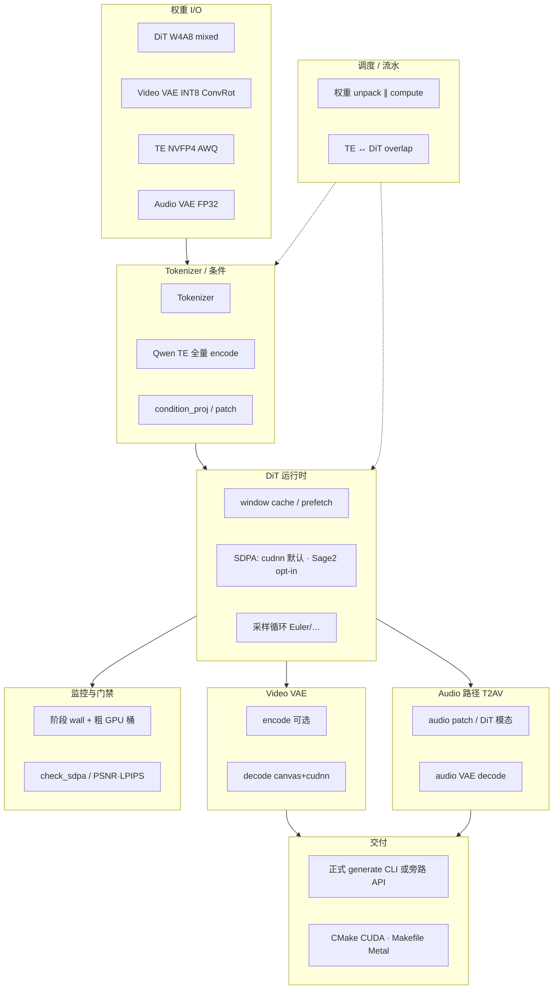

# NVIDIA 4090 优化开发计划（质量优先）

> 状态跟踪文档。实现与实测后更新「状态 / 实测」列。  
> 硬约束：纯 C/CUDA C；不破坏 Metal；不 git commit；密码不上库。  
> 基线机：`${H3_SSH_4090:-haiyang@192.168.31.34}` RTX 4090 24GB，`conda activate comfyui`。（旧 `192.168.0.38` 已迁移）

## 1. 背景与基线

### §10.17 起点（2026-08-14）

| 档位 | 配置 | wall | 备注 |
| --- | --- | ---: | --- |
| **产品 Pareto** | 2×18 + VAE4，满 seq，window=18 | **19.5 s** | Done-A ≤20s PASS |
| **全量外推 e2e** | 20×50 DiT + VAE36 | **~6.4 min** | 50L×1=15.27s →×20≈5.1min + VAE36 81.6s |
| **单层 quiet** | 满 480P `video_seq=14985`，cudnn SDPA | **276 ms** | GPU 块内 ~145ms；余 H2D/D2H |
| **4L 设备链** | 同上 | **921 ms**（~230ms/层） | 层间零激活 PCIe |
| **VAE36** | skip-dit | **81.6 s** | 时间片循环为主因 |

### 本轮目标与实测（2026-08-15 opt3）

| 指标 | §10.17 | opt2 | **本轮 opt3** | 备注 |
| --- | ---: | ---: | ---: | --- |
| 单层 quiet wall | 276 ms | ~175 ms | **~171 ms** | aux 缓存；进 150–200 带 |
| 4L 设备链 blocks | 921 ms | ~420 ms | **~401 ms** | aux 预打包/缓存，去层间 safetensors |
| 50L×1 blocks | 15.27 s | ~5.62 s | **~5.57 s** | 同上；WS 先于权重驻留 |
| VAE36 | 81.6 s | ~12.1 s | **~12.05 s** | 收益尽 |
| check_sdpa | — | PASS | **PASS** max_abs≈1.18e-4 | |
| 外推 20×50+VAE | ~6.4 min | ~2.1 min | **~2.06 min** | DiT≈1.86min + VAE≈12s |

## 2. 业内对照摘要（可迁移 vs 不可迁移）

> 完整「当前最好」对照表、已添加/未添加/不做判定见 **§12**。此处仅保留决策摘要。

| 来源 | 可迁移到本仓（纯 C/CUDA） | 不可直接迁移 / 本轮不做 |
| --- | --- | --- |
| **vLLM** | Paged/常驻权重、CUDA Graph 减 sync、双 stream 重叠、cuBLASLt/cuDNN 融合路径 | PagedAttention KV cache；Python scheduler |
| **SGLang** | Radix 思路 → 权重 window/LRU 预取；overlap schedule | RadixAttention 树缓存 |
| **FlashAttn / cuDNN SDPA** | 已接；生产默认 **cuDNN fused** | **FA3 在 Ada 上不可用**（Hopper sm_90） |
| **SageAttention2 / 2++** | **§9 F1 P0 A/B**：Ada 上当前最强量化注意力（2++ 相对 FA2 可达 ~3× 级） | Sage3=Blackwell；默认前必须过 check_sdpa |
| **质量换速旋钮** | MagCache / Cache-DiT / SenCache 作 P2 | TeaCache 已非首选；window/少步 **不进 P0 默认** |

**质量优先原则：** 同数学、少同步、少 PCIe、更大可驻留；改变注意力支撑域/步数仅 opt-in。

## 3. 全局耗时点清单（opt3 后）

| 热点 | 本轮后 | 对应 |
| --- | ---: | --- |
| DiT 50L×1 blocks | **5.57 s**（~111 ms/层） | T2/T3/T5/T6 |
| 外推 20×50 仅 DiT | **~1.86 min** | — |
| VAE36 | **12.05 s** | T1 收益尽 |
| e2e 外推 | **~2.06 min** | 贴近 2min；再压见 **§9** |
| 单层 | **~171 ms** | aux cache + rope-f16 + pinned |

## 4. 任务列表

### P0（已完成）

| ID | 目标 | 状态 |
| --- | --- | --- |
| **T1** | VAE canvas + cudnn | ✅ **12.05s**；跨帧 merge 非 480p 默认 |
| **T2** | act_prep batched ConvRot + stream API | ✅；rope→f16 |
| **T3** | cache max_fit + 整窗 prefetch | ✅ window≈34 |
| **T4** | cudnn 跳过 Graph；quiet 生产 | ✅ |
| **T5** | 真设备链测量 + 减 sync / 双流 aux / rope-f16 | ✅ opt2 |
| **T6** | host aux 缓存 + 全层 prestaging / WS-first | ✅ **本轮 opt3** |

### P1 / P2（旧编号，已并入 §9）

见 **§9 后续任务列表（opt3 后）**。旧 P1-A/B/C 与 XQ-* 已按 2025–2026 业界最优路径重排。

## 5. 本轮实现要点（T6 / opt3）

- **Host aux 缓存**：`dit_aux_cached` / `h3_dit_w4a8_cached_block_aux` — 每 block 只从 safetensors+BF16 转一次，避免 50L 热路径反复读盘
- **全层 aux prestaging**：`layers_forward` 将 `[mod|n1|n2|qn|kn]×N` 打成 pinned pack 一次 H2D；VRAM 紧时自动回退双 bank（仍用缓存 aux）
- **WS-first**：多层 probe 不再先 prefetch 权重；先 `cudaMalloc` 激活 workspace 再驻留权重，避免 34 窗 + 4GiB WS + 旁路 python 占存时 OOM
- **计时**：`blocks_ms` 从 warm prefetch 之后起算（与 opt2「外置 prefetch」口径一致）
- **SageAttention2/2++**：升为 **§9 P0** opt-in A/B；默认仍 cudnn

## 6. 实测记录（2026-08-15 opt3，`src_sync`，cudnn+nvrtc `LD_LIBRARY_PATH`）

| 配置 | §10.17 | opt2 | **opt3** |
| --- | ---: | ---: | ---: |
| 1L quiet cudnn | 276 ms | 175 ms | **171 ms** |
| 4L blocks | 921 ms | 420 ms | **401 ms** |
| 50L×1 blocks | 15.27 s | 5.62 s | **5.57 s** |
| VAE36 cudnn+canvas | 81.6 s | 12.1 s | **12.05 s** |
| check_sdpa seq=128 | — | PASS | **PASS** 1.18e-4 |
| 外推 20×50+VAE | ~6.4 min | ~2.1 min | **~2.06 min** |

### 复现命令

```bash
cd /home/haiyang/h3_c/src_sync
conda activate comfyui
unset LDFLAGS CFLAGS CXXFLAGS CPPFLAGS
export LIBRARY_PATH=$CONDA_PREFIX/targets/x86_64-linux/lib:$LIBRARY_PATH
export LD_LIBRARY_PATH=$CONDA_PREFIX/lib:$CONDA_PREFIX/targets/x86_64-linux/lib:$CONDA_PREFIX/lib/python3.12/site-packages/nvidia/cudnn/lib:$CONDA_PREFIX/lib/python3.12/site-packages/nvidia/cuda_nvrtc/lib:$LD_LIBRARY_PATH

DIT=/home/haiyang/h3_c/models/kijai/minimax_h3_fl2va_pruned_w4a8_mixed.safetensors
VAE=/home/haiyang/h3_c/models/kijai/minimax_h3_video_vae_int8_convrot.safetensors

H3_CUDA_SDPA_BACKEND=cudnn ./build-cuda/h3_t2av_timing_probe --dit "$DIT" \
  --dit-layers 1 --skip-te --skip-vae --sdpa-backend cudnn --check-sdpa
H3_CUDA_SDPA_BACKEND=cudnn ./build-cuda/h3_t2av_timing_probe --dit "$DIT" \
  --dit-layers 4 --skip-te --skip-vae --sdpa-backend cudnn
H3_CUDA_SDPA_BACKEND=cudnn ./build-cuda/h3_t2av_timing_probe --dit "$DIT" \
  --dit-layers 50 --skip-te --skip-vae --window 0 --sdpa-backend cudnn
H3_CUDA_SDPA_BACKEND=cudnn ./build-cuda/h3_t2av_timing_probe --dit "$DIT" --vae "$VAE" \
  --skip-dit --skip-te --vae-blocks 36
```

## 7. 中文简报（opt3 结论）

**aux 缓存 + prestaging 去掉层间 safetensors 重载；单层 ~171ms，4L ~401ms，50L ~5.57s。** 全量外推 ~2.06min，仍贴 2min 门槛。GPU 算力段（cudnn SDPA + INT8 GEMM）已接近平台极限；再压需 **§9 P0 SageAttention2(++)** 或 **P2 质量换速 / 多卡**。

| 指标 | 前（opt2） | 后（opt3） |
| --- | ---: | ---: |
| 1L | ~175 ms | **~171 ms** |
| 4L blocks | ~420 ms | **~401 ms** |
| 50L×1 blocks | 5.62 s | **5.57 s** |
| VAE36 | 12.1 s | **12.05 s** |
| 外推 e2e | ~2.1 min | **~2.06 min** |

## 8. 驱动 / PyTorch（4090 机探测，2026-08-15）

| 组件 | 版本 |
| --- | --- |
| GPU | RTX 4090 sm_89 |
| 驱动 | **550.163.01**（nvidia-smi CUDA 12.4） |
| nvcc（comfyui） | **12.9.86** |
| torch（comfyui） | **2.6.0+cu124** / cudnn **9.1.0** |
| h3 旁路链接 | conda `libcudart/cublasLt.so.12` + site-packages **libcudnn.so.9** |

**建议：驱动与 PyTorch 均不必为 h3 C 旁路升级。** 详见会话简报 A。

## 9. 后续任务列表（opt3 后 · 2026-08-15）

> 硬约束不变：纯 C/CUDA C；不破坏 Metal；质量优先默认路径；质量换速仅 opt-in。  
> 业界对照窗口：2025–2026，目标硬件 **RTX 4090 Ada sm_89 单卡**（多卡任务单独标注硬件依赖）。

### 9.1 一句话策略

**单卡最优策略：默认保持 cuDNN fused SDPA + DiT W4A8/ConvRot + VAE int8 ConvRot；下一刀近无损加速做 SageAttention2/2++（Ada 专用量化注意力）A/B；要稳破 ~2 min 全量门槛再上 MagCache/Cache-DiT 或 xDiT 多卡，不把 FA3 / 手写 flash 小改 / 升 torch 当银弹。**

> **加速任务（F\*）≠ 框架封口（G\*）。** 产品级「完整框架」定义、清单与验收见 **§15**；F1/F2 可与 G1/G4 并行，但不得用算力外推数字单独宣称框架已完整。

### 9.2 任务表

| ID | 优先级 | 方案（具体技术） | 为何是目前最好 | 预期收益 | 是否损质量 | 依赖 | 验收标准 |
| --- | --- | --- | --- | --- | --- | --- | --- |
| **F1** | **P0 ✅ 接线 / ⛔ 加速** | **SageAttention2 / 2++**（`qk_int8` + `pv_fp8`/`pv_fp16`，Ada sm_89 核；同 `H3_CUDA_SDPA_BACKEND` 接口 opt-in） | Ada 上社区实测相对 torch flash 可达约 **2–2.7×** attn；Sage3 绑 Blackwell FP4；**FA3 不支持 sm_89**；本仓 cuDNN 已是无损上限，下一刀只能是量化注意力 | 单层 SDPA 段再压；乐观 50L×1 **~4–5s** 级、外推 e2e 向 **≤2 min** 靠拢（需实测） | 微损（INT8/FP8）；扩散端常视觉不可辨，**须数值门禁** | 已有 cudnn 后端；CUDA≥12.4（Ada FP8）；纯 C 移植或静态链核 | ✅ 接线+`check_sdpa`；2026-08-16 再测满 seq 1L：**sage2 ~9.0s** vs **cudnn ~150–177ms**（已加 `__dp4a` 仍远慢）。**⛔ 真 Sage2++ MMA 未达**——缺可链入的 MMA 参考实现；**默认仍 cudnn**，禁止改默认后端 |
| **F2** | **P0 ✅** | **TE NVFP4 ↔ DiT 双流 overlap**（tokenizer/encode 与首步 DiT 权重 prestaging 重叠） | opt3 后 DiT/VAE 墙钟已压紧；e2e 仍含 TE 串行空隙，这是少有的**零质量代价**重叠 | e2e 墙钟减 TE 暴露段（视 TE 占比，约数百 ms–数 s） | 否 | TE stub / NVFP4 probe 可跑；双 stream + 事件 | ✅ `h3_cuda_generate` 默认 overlap：TE encode ∥ 首窗 `prefetch`；`--no-overlap` 可关 |
| **F3** | **P1 ✅ 审计** | **块内剩余同步审计**（cuBLASLt/SDPA 间多余 `EventSynchronize`；可选 cudnn-frontend native CUDA Graph） | Graph 整 block 已证明收益有限；但 quiet 路径上仍可能有可测 sync 尾巴 | 单层个位数–十余 ms；50L 累计有限 | 否 | F1 前后均可 | ✅ 2026-08-16：quiet 热路径已跳过 per-op EventSync；dual-bank `StreamSynchronize`/`EventSynchronize` 为 aux 就绪所必需。再抠 Graph **ROI 低**，不改默认。无收益变更未合入 |
| **F4** | **P1** | **SageAttention 消费路径**（fused QKV 所有权 / 早释 FP16 QKV，对齐 sageattn_consume 思路） | Ada 上除算力外，满 seq H3 形状峰值显存是下一瓶颈；释放 Q/K 可省数百 MiB | 峰值 VRAM ↓（公开 fork 称 H3 fl2va 量级可达数百 MiB）；间接允许更大权重窗 | 否（布局不变） | F1 核已通 | 同 shape 峰值显存下降；数值与 F1 一致 |
| **F5** | **P2 部分 ✅** | **MagCache**（magnitude-aware residual 缓存；NeurIPS 2025）优先于 TeaCache | 比 TeaCache 校准更轻、激进跳步时保真更好；视频扩散 2025 首选缓存族之一 | 步级 **~1.5–2.5×** DiT（阈值相关）→ 外推 e2e 有望 **&lt;2 min** | **是**（步跳误差累积；需 PSNR/LPIPS/目视） | 采样循环可插；校准 1 条随机样本 | **F5-lite ✅**（`--magcache-thresh`，相对 L1 累加；建议试 0.17）；完整 MagCache/校准曲线仍 P2 |
| **F6** | **P2** | **Cache-DiT**（DBCache ± TaylorSeer）或 **SenCache**（CVPR 2026 敏感度缓存）作备选 | Cache-DiT 已进 vLLM-Omni/Diffusers；SenCache 称同算力下优于既有启发式；均比「只上 TeaCache」更当代 | 同 F5 量级或更好（实现成本更高） | **是** | 需适配本仓 block 边界；TaylorSeer 吃显存 | 与 MagCache 同门禁下 A/B，取 Pareto 更优点 |
| **F7** | **P2 部分 ✅** | **产品旋钮档**：少步 / CFG↓ / `--attn-window` / **`--reuse`** / **`--magcache-thresh`** | Done-A 已证明 2×18+window 可 ≤20s；与全量档分离；reuse 对齐 Metal | 产品档继续 ≤20s；全量档不默认开 | **是** | CLI 已扩 | **reuse/magcache ✅ 本轮**；Pareto 表可再测 |
| **F8** | **P2** | **xDiT USP**（Ulysses×Ring）+ **CFG parallel** | 单卡算力见顶后，业界 DiT 扩展标准是 xDiT 混合并行；CFG parallel 天然 **2 卡** | 近线性～次线性随卡数（PCIe vs NVLink 差很大） | 否（数值并行） | **≥2×GPU**；CFG-p 优先 2 卡；USP 要头数整除 | 2 卡 CFG-p 墙钟 ≈0.5× 量级；多卡 USP 可扩展 seq |
| **F9** | **P2 ✅** | **INT8/FP8 注意力仅经 Sage2 路径**；不另开 cuDNN FP8 SDPA 主线 | Ada 有 FP8 Tensor Core，但 **cuDNN FP8 SDPA 样例明确跳过非 Hopper/Blackwell**；实用量化 attn = Sage2/2++ | 并入 F1 | 同 F1 | 勿把 TE FP8 DPA 当 4090 默认 | ✅ 文档/代码不把 cudnn-fp8 标成 4090 P0；默认 cudnn 无损 |

### 9.3 分档：立刻做 / 并行 / 有条件 / 明确不做

#### P0 立刻做
1. **F1 SageAttention2/2++** — 单卡近无损最大杠杆；默认仍 cuDNN。
2. **F2 TE↔DiT overlap** — 与 F1 可并行开工（不同模块）。

#### P1 并行
3. **F3** 同步审计 / 可选 native Graph（低优先级工程债）。
4. **F4** 在 F1 核稳定后做显存消费路径。

#### P2 有条件
5. **F5 MagCache**（首选缓存）— 仅当需要稳破 ~2 min 且接受质量门禁。
6. **F6 Cache-DiT / SenCache** — MagCache 不够或要框架化再选。
7. **F7** 产品 Pareto 旋钮 — 与全量质量档分离。
8. **F8 xDiT USP / CFG-p** — **有第二张（及以上）GPU 时**。
9. **F9** 量化注意力策略固化为 Sage2，避免错误开 FP8-cuDNN 主线。

#### 明确不做（勿再写成 P0）
| 项 | 原因 |
| --- | --- |
| **手写 FP16 flash 小改** | 本仓已用 cuDNN fused 相对旧 flash 取得数量级 SDPA 加速；边际收益尽 |
| **升级驱动 / PyTorch「为了更快」** | §8：550 + torch 2.6+cu124 已够旁路；升栈不改变 Ada 上 FA3/FP8-SDPA 可用性 |
| **FlashAttention3 当 Ada 银弹** | FA3 面向 **Hopper sm_90**（TMA/WGMMA）；sm_89 上不可用或回退 FA2，不是 4090 下一刀 |
| **SageAttention3 当 4090 默认** | Sage3 = **Blackwell FP4 microscaling**（5090 叙事）；4090 应走 Sage2/2++ |
| **VAE36 再微优化当主线** | opt2→opt3：**12.1→12.05s**，收益尽 |
| **TeaCache 作为唯一/首选缓存** | 2025+ MagCache/Cache-DiT/SenCache 更优；TeaCache 激进档质量风险更高 |
| **window / 少步 / token_reduce 进默认全量档** | 质量换速；仅产品 Pareto（F7） |

### 9.4 建议执行顺序（有向依赖）

```text
                    ┌─ F2 TE↔DiT overlap ──────────────┐
opt3 基线 ─────────┤                                   ├─→ 复测 e2e 外推
                    └─ F1 SageAttn2/2++ ──→ F4 显存路径 ┘
                              │
                              ├─→ F3 sync/Graph（可选穿插）
                              │
                              ├─→ [要破 2min 且允损质] F5 MagCache
                              │         └─不足→ F6 Cache-DiT/SenCache
                              │
                              ├─→ [产品 ≤20s] F7 旋钮档（可并行）
                              │
                              └─→ [≥2 GPU] F8 USP / CFG parallel
```

### 9.5 外部参考（2025–2026）

| 主题 | 链接 |
| --- | --- |
| SageAttention / 2 / 2++ | https://github.com/thu-ml/SageAttention |
| SageAttention3（Blackwell FP4，非 4090 主线） | https://arxiv.org/abs/2505.11594 |
| Ada/sm_89 向 Sage 测量面 | https://github.com/fblissjr/SageAttention-ada |
| vLLM-Omni 扩散注意力后端路由（FA2 vs cuDNN vs Sage vs FA3） | https://github.com/vllm-project/vllm-omni/blob/main/docs/user_guide/diffusion/attention_backends.md |
| FlashAttention-3 安装/架构（Hopper） | https://github.com/Dao-AILab/flash-attention |
| TeaCache | https://liewfeng.github.io/TeaCache/ |
| MagCache | https://arxiv.org/abs/2506.09045 |
| Cache-DiT | https://github.com/vipshop/cache-dit |
| SenCache | https://github.com/vita-epfl/SenCache |
| xDiT / USP / CFG parallel | https://github.com/xdit-project/xDiT |
| USP 论文 | https://arxiv.org/abs/2405.07719 |
| cuDNN Frontend FP8 SDPA（Hopper/Blackwell） | https://github.com/NVIDIA/cudnn-frontend |
| 本仓契约 §10.16–§10.19 | [`nvidia_quant_contract.md`](nvidia_quant_contract.md) |
| 构建旋钮 | [`nvidia_build.md`](nvidia_build.md) |

---

## 10. 监控覆盖审计（严格监控判定 = **阶段+粗 PCIe** · opt4）

> 来源：2026-08-15 代码审计（`h3_t2av_timing_probe` / `h3_dit_w4a8` / `h3_gpu_cuda*` / `h3_vae_int8*`）。  
> **总判定（2026-08-15 opt4）：阶段+粗 PCIe。** quiet `sdpa_ms` 已改为 `block_gpu_ms`；layers 有 `h2d/compute/d2h/prefetch_wait`；VAE 有 canvas_h2d/blocks/unpatch_d2h；TE 可配置层 encode 有 embed/layers/total；audio 仍缺（G2 BLOCKED）。

### 10.1 已有埋点矩阵摘要

| 阶段 | Wall-clock | CUDA event | 粒度 | 默认开启？ | 备注 |
| --- | --- | --- | --- | --- | --- |
| **整体 probe** (`h3_t2av_timing_probe`) | ✅ `CLOCK_MONOTONIC` | — | 整段 `phase_ms` | 默认开 | TE / DiT / VAE / total |
| **TE NVFP4 layers** (`h3_nvfp4_encode_layers_f32`) | ✅ embed/layers/total | ❌（host GEMM） | 可配置层数 | generate / probe | G1；非 stub |
| **DiT prefetch / unpack** | ✅ + `prefetch_wait_ms` | 可分 | 窗级 | layers 汇总 | G5 |
| **DiT 1L block** | ✅ | ✅ quiet→**`block_gpu_ms`** | quiet=整块；verbose=per-op | quiet 默认 | **不再污染 `sdpa_ms`** |
| **DiT ≥2L 设备链** | ✅ `blocks_ms` + h2d/compute/d2h | ✅ | 整段多层 | quiet 默认 | probe 注明 blocks≠sdpa |
| **VAE decode** | ✅ load/canvas_h2d/blocks/unpatch_d2h/total | 块内 quiet | 粗分 | 默认开 | G5 |
| **Audio DiT / audio VAE** | ❌（G2 BLOCKED） | ❌ | — | — | Metal-only |
| **PCIe vs kernel** | 间接（1L 块事件 vs 外层 wall） | 部分 API 支持分项 | — | 需 verbose / 专用 probe | e2e 默认**不**拆 |

### 10.2 缺口列表（opt4 后）

1. **TE**：可配置层 encode ✅；tokenizer / visual / 默认全 50L 仍慢或未接。  
2. **Audio（G2）**：**BLOCKED**（Metal shader `h3_audio_vae`；CUDA DiT 无 audio token）。  
3. **cudnn plan build**：首次 shape 成本仍未单独记。  
4. **Per-layer 设备链**：无 layer-id 事件轴（仅整段 h2d/compute/d2h）。  
5. **三套时钟混用**：`clock()` / CUDA event / `now_ms` 仍并存（口径已文档化）。  
6. **T2AV 产品路径**：仅 **T2V 子集** 封口；Metal `h3_generate` 不被替换（A7）。

### 10.3 quiet / `sdpa_ms` 口径问题

- **生产默认 quiet**：`!H3_DIT_W4A8_VERBOSE_TIMING` → `h3_cuda_set_quiet(1)`，跳过几乎所有 per-op `EventSynchronize`（正确的性能取舍）。  
- **VERBOSE**：恢复 per-op；会拉长墙钟（历史量级：1L quiet 276 vs verbose ~294）。  
- **1L quiet**：整块 GPU event → `stats->block_gpu_ms`（`sdpa_ms=0`），backend=`cuda_quiet_block`。  
- **≥2L**：probe 仍把 `blocks_ms` 累进历史字段名 `sdpa` 做 share 图，但打印注明 **≠ 真 SDPA**；另打 h2d/compute/d2h/prefetch_wait。  
- **计时起点（opt3）**：`blocks_ms` 从 warm prefetch **之后**起算；与外置 prefetch / 层内 ignore 一致。

### 10.4 最小埋点建议（默认不实现；工程债）

1. `layers_forward`：`h2d_ms` / `prefetch_wait_ms` / `compute_ms` / `d2h_ms`（粗粒度 CUDA event，quiet 也可开）。  
2. 1L quiet：整块写入 `block_gpu_ms`，勿占用 `sdpa_ms`。  
3. `build_plan`：首次 miss 记 `cudnn_plan_build_ms`（env 门控）。  
4. VAE：`canvas_h2d` / `blocks` / `unpatch_d2h` 三桶。  
5. Prefetch：累计 `unpack_overlap_idle_ms`。  
6. Probe：≥2L 注明 `sdpa_ms`≡`blocks_ms`，或改字段名。

### 10.5 「严格监控」分范围判定

| 范围 | 判定 | 差在哪 |
| --- | --- | --- |
| Probe 阶段墙钟（TE stub / DiT / VAE / 外推） | **是（阶段级）** | 够做 opt3 复现与 Pareto |
| DiT 热路径 per-op（生产 quiet） | **否** | 故意关闭；整块/整链合计 |
| DiT per-op（VERBOSE） | **是（块内）** | 损性能；≥2L 仍不传 per-op |
| TE 全量 / audio / PCIe / plan / wait | **否** | 未埋点或仅文档 gap |
| **综合** | **阶段+粗 PCIe** | opt4：quiet 桶语义已修；layers/VAE 粗分齐；audio 仍缺 |

---

## 11. 代码细节可优化点（opt3 后）

> 与 §9 F1–F9 对齐。VAE36 再微抠 / 手写 flash / 升 torch **不作为主线**（见 §9.3 明确不做）。

### 11.1 易改 · 高收益

| # | 位置 | 现状问题 | 建议 | 损质量？ | 对齐 |
| --- | --- | --- | --- | --- | --- |
| 1 | `h3_dit_w4a8.c` `block_forward_gpu_resident` quiet 归因 | 整块 wall → `sdpa_ms` | 新增 `block_gpu_ms` / 修 probe 字段 | 否 | §10.4 |
| 2 | `tools/h3_t2av_timing_probe.c` ≥2L | `sdpa_ms += lst.blocks_ms` | 独立 `blocks_ms` 打印 | 否 | §10.3 |
| 3 | `h3_dit_w4a8.c` dual-bank 路径 | 每层 aux 后强制 `cudaStreamSynchronize` | `cudaEvent` + `StreamWaitEvent` | 否 | **F3** |
| 4 | `h3_dit_w4a8.c` `adaln_project_f32` | Host 三重循环 GEMV，串在设备链前 | 小 cuBLAS/自定义 GEMV，或 modulation 进 aux pack | 否 | 减 quiet 块外 host 间隙 |
| 5 | TE↔DiT | TE stub 与 DiT prefetch 串行 | 双 stream：TE ∥ 首窗 unpack | 否 | **F2 ✅** |

### 11.2 易改 · 低收益

| # | 位置 | 现状 | 建议 | 损质量？ |
| --- | --- | --- | --- | --- |
| 1 | `layers_forward` / probe | 三套时钟混用 | 统一 monotonic + 可选 GPU event | 否 |
| 2 | VAE `h3_vae_int8_decode_stats` | 仅 3 个 ms | 加 canvas/chunk 粗分 | 否（收益尽，仅可观测性） |
| 3 | `h3_gpu_cuda_sdpa_cudnn.cpp` `build_plan` | 无耗时 | env 下记 build_ms | 否 |
| 4 | Graph 路径 | cudnn 常禁用 graph | 保持；文档已说明 | 否 |
| 5 | Host `rope_tables_f32` | 逐步 `cosf/sinf` | 查表/向量化（一次性） | 否 |

### 11.3 难改 · 高收益

| # | 方向 | 现状 | 建议 | 损质量？ | 对齐 |
| --- | --- | --- | --- | --- | --- |
| 1 | SDPA | cuDNN fused = Ada **无损**上限；1L~171ms | **SageAttention2/2++** opt-in | 微损；须 `check_sdpa` | **F1** |
| 2 | Act prep | batched ConvRot+quant 已做 | 更深融合（prep+GEMM 单 launch） | 否（数值门禁） | 历史缺口加深 |
| 3 | 显存消费 | QKV FP16 常驻至 out | fused 后早释 Q/K（sageattn_consume） | 否 | **F4** |
| 4 | 步级缓存 | 每步满算 20×50 | MagCache → Cache-DiT/SenCache | **是** | **F5/F6** |
| 5 | 多卡 | 单卡见顶 | CFG-p / USP | 否（数值并行） | **F8** |
| 6 | 真 TE 32B | stub only | 完整 NVFP4 TE + overlap | 否（若对齐） | 监控从零建 |

### 11.4 热路径现状（便于对照）

- **算力主路径**：`block_device_compute` → AdaLN → INT8 GEMM(+act_prep) → `qkv_rope_sdpa_f16_dev`（cudnn）→ gate/MLP。  
- **已做且有效（opt3）**：quiet、设备链、aux host 缓存 + prestaging、WS-first、rope→f16、权重侧流 unpack、VAE canvas。  
- **再挖边际**：sync 尾巴、host AdaLN、桶语义、Sage2、TE overlap。

---

## 12. 业界方案对照表（更新到「当前最好」· 2025–2026 / Ada sm_89）

> 判定列：**已添加** = 本仓已接线可跑；**未添加** = 适配但尚未接入；**不适合/不做** = 硬件或产品形态不匹配，勿再写成 P0。  
> 「适配度」相对本仓约束：纯 C/CUDA、单卡 4090、DiT W4A8+ConvRot、VAE int8、质量优先默认。

| 方案 | 适用场景 | 是否已接入本仓 | 适配度 | 备注 |
| --- | --- | --- | --- | --- |
| **cuDNN fused SDPA** | Ada/Hopper 无损 fused attn | **已添加**（生产默认） | **高** | `H3_CUDA_SDPA_BACKEND=cudnn`；opt3 1L~171ms 基线 |
| **本仓 FlashAttn2 风格 FP16** | 回退 / 无 cuDNN | **已添加**（`flash`/`auto`） | **高** | 相对 cudnn 慢一个数量级级；保留回退 |
| **FlashAttention-3** | Hopper sm_90 TMA/WGMMA | **不适合/不做**（4090） | **低** | FA3 不面向 Ada；4090 上 FA2 已是该族上限 |
| **SageAttention2** | Ada 量化 attn（`qk_int8`+`pv_fp8/fp16`） | **已添加（opt-in）**（§9 **F1**/G8） | **中**（接线✅/加速⚠️） | check_sdpa PASS；满 seq 参考核仍慢于 cudnn |
| **SageAttention2++** | 同上，FP8 MMA→FP16 accum | **部分**（并入 F1；无完整 MMA） | **高**（待补） | 当前非 2++ 全家桶；加速未达标 |
| **SageAttention3** | Blackwell FP4 microscaling | **不适合/不做**（4090） | **低** | 5090/Blackwell 叙事；非 sm_89 主线 |
| **DiT W4A8 + ConvRot act** | 权重/激活量化 GEMM | **已添加** | **高** | `h3_dit_w4a8` + cuBLASLt INT8；主路径 |
| **VAE int8 ConvRot** | decode 量化 | **已添加** | **高** | canvas+cudnn；opt3 **~12.05s** 收益尽 |
| **CUDA Graph（整 block）** | 减 launch/sync | **已添加**（接线；cudnn 常跳过） | **中** | `H3_DIT_W4A8_CUDA_GRAPH=1`；生产靠 quiet 而非 graph |
| **Prefetch / 双流 overlap** | 权重 unpack ∥ compute；aux bank | **已添加**（部分） | **高** | window prefetch、侧流 unpack、aux prestaging；TE↔DiT overlap **已添加（F2/G6，generate 默认）** |
| **MagCache** | 步级 residual 缓存（NeurIPS 2025） | **部分 ✅**（**F5-lite** CLI） | **高**（有条件） | 完整 MagCache 仍 P2；lite 用相对 L1 |
| **TeaCache** | 步级启发式缓存 | **未添加** | **中** | **不做首选**；校准重、激进档质量风险更高 |
| **Cache-DiT**（DBCache±TaylorSeer） | 框架化 DiT 缓存 | **未添加**（**F6**） | **中** | 已进 vLLM-Omni/Diffusers；实现成本高于 MagCache |
| **SenCache** | 敏感度感知动态缓存（CVPR 2026） | **未添加**（**F6** 备选） | **中** | 理论更强；适配成本高 |
| **xDiT USP**（Ulysses×Ring） | 多卡长序列并行 | **未添加**（**F8**） | **中**（需 ≥2 GPU） | 单卡默认不做；头数整除约束 |
| **xDiT CFG parallel** | 2 卡 CFG 对半 | **未添加**（**F8**） | **中**（需 2 GPU） | 有第二张卡时优先于 USP |
| **TensorRT / TRT-LLM** | 引擎化 LLM/部分扩散 | **不适合/不做** | **低** | 与纯 C 旁路+自有 W4A8 契约冲突；维护面大 |
| **torch.compile / Triton 主路径** | PyTorch 图编译 | **不适合/不做** | **低** | 硬约束纯 C/CUDA；仅可作对照实验 |
| **PagedAttention / vLLM batching** | 自回归 LLM 多请求 KV | **不适合/不做** | **低** | DiT 扩散非 decode 批；可迁移的是「权重常驻/Graph/双流」思想（已部分做） |
| **VAE 时间片 parallel / 多卡 VAE** | 更大 decode 吞吐 | **未添加** | **低–中** | 单卡 canvas 已压到收益尽；多卡 VAE 非当前瓶颈 |
| **产品旋钮**（少步/CFG↓/`--attn-window`） | ≤20s Pareto | **已添加** | **高** | **F7**；仅产品档，不进全量默认 |
| **cuDNN FP8 SDPA** | Hopper/Blackwell FP8 attn | **不适合/不做**（4090 主线） | **低** | 样例跳过非 Hopper/Blackwell；量化 attn 走 Sage2（**F9**） |

### 12.1 四问结论（写进文档）

1. **业界有哪些优化方案？** → 上表覆盖 2025–2026 单卡 Ada 相关主线：无损算子（cuDNN/FA2）、量化 attn（Sage2/2++）、量化线性（W4A8/INT8）、调度（Graph/prefetch/overlap）、步级缓存（Mag/Tea/Cache-DiT/Sen）、多卡（xDiT）、以及 LLM 向方案在扩散侧的低适配项。  
2. **本项目是否已经添加？** → **已添加**：cuDNN SDPA、本仓 flash、W4A8 DiT、VAE int8、Graph 接线、prefetch/aux prestaging、产品 window 旋钮。**已添加**：Sage2 opt-in（加速未达标）、TE↔DiT overlap。**未添加**：Mag/Cache-DiT/Sen、xDiT；Sage2++ MMA 未齐。**不做**：FA3/Sage3/TRT/torch.compile/PagedAttention 主线、TeaCache 作首选、cuDNN FP8 SDPA 当 4090 P0。  
3. **更适合当前项目的加速？** → 见 **§13**（与 §9 F1→F2… 一致）。  
4. **框架是否完整？** → 见 **§14** / **§15** / **§16**：**算力旁路完整**；**T2V 子集产品封口完整**；**T2AV 因 G2 阻塞未齐**。

---

## 13. 更适合本项目的加速方案（结论）

**约束画像：** 单卡 RTX 4090 sm_89；DiT W4A8+ConvRot；VAE int8 canvas；opt3 外推 ~2.06 min；无多卡默认；质量优先。

**推荐顺序（与 §9 对齐）：**

| 次序 | ID | 方案 | 为何更适合本仓 | 预期 |
| ---: | --- | --- | --- | --- |
| 1 | **F1** | SageAttention2 / **2++** opt-in | Ada 上相对 FA2/cudnn 的下一刀只能是量化 attn；FA3/Sage3 硬件不对 | 单层 SDPA 段再压；乐观 50L×1 ~4–5s、e2e 向 ≤2 min |
| 2 | **F2** | TE↔DiT 双流 overlap | 零质量代价；opt3 后少有的串行空隙 | e2e 减 TE 暴露段 |
| 3 | **F3** | 剩余 sync / 可选 native Graph | 工程债；个位数–十余 ms/层 | 有限 |
| 4 | **F4** | Sage 消费路径早释 Q/K | 满 seq 峰值显存→更大权重窗 | 间接吞吐 |
| 5 | **F5→F6** | MagCache → Cache-DiT/SenCache | **要稳破 2 min 且允损质** 时 | 步级 ~1.5–2.5× DiT |
| 6 | **F7** | 产品旋钮档 | 已验证 ≤20s Pareto | 与全量档分离 |
| 7 | **F8** | xDiT CFG-p / USP | **仅 ≥2 GPU** | 近线性～次线性 |

**一句话：** 单卡最优下一刀 = **F1 Sage2/2++** + 并行 **F2 overlap**；不要把 FA3、手写 flash、升 torch、VAE 再抠当银弹。

---

## 14. 框架完整度评估

| 维度 | 状态 | 说明 |
| --- | :---: | --- |
| **算子栈（DiT）** | ✅ | AdaLN / QK-RMS / RoPE→f16 / cuDNN SDPA / INT8 GEMM+act_prep / gate+MLP；设备链+quiet |
| **算子栈（VAE）** | ✅ | int8 ConvRot + canvas + cudnn；墙钟收益尽 |
| **权重格式** | ✅ | DiT W4A8 mixed、VAE int8、TE NVFP4 layers；契约与 inventory 齐 |
| **调度 / 驻留** | ✅⚠️ | window cache、prefetch、aux prestaging、WS-first、TE↔DiT overlap ✅；多卡 ❌ |
| **注意力「当前最好」** | ✅⚠️ | cudnn 默认；Sage2 opt-in 接线✅、满 seq 加速⚠️ |
| **监控** | ✅⚠️ | 阶段+粗 PCIe ✅（G5）；audio/plan-build 仍缺 |
| **e2e TE** | ✅⚠️ | 可配置层 encode ✅；全 50L/tokenizer TODO |
| **e2e DiT** | ✅ | 旁路 50L 设备链可测；外推口径稳定 |
| **e2e VAE** | ✅ | 36-block decode 可测 |
| **e2e audio** | ❌ | 路径/计时未接线 |
| **e2e CLI 产品路径** | ⚠️ | `h3_t2av_timing_probe` 旁路齐；Metal generate on CUDA 仍 gap |
| **质量门禁** | ⚠️ | `check_sdpa` ✅；PSNR/LPIPS/目视门禁（缓存档）未建 |
| **产品档 / 质量档** | ✅ | Done-A ≤20s Pareto vs 全量外推分档清晰；旋钮不进全量默认 |
| **文档 / 任务表** | ✅ | 本文件 §1–§9 + §15（G\*）+ 契约 §10.x；F1–F9 可执行 |

### 14.1 结论：是否完整？

**算力优化旁路框架：基本完整（opt3 基线可复现、主热点已压到平台附近）。**  
**产品级端到端：T2V 子集完整（§16）**；T2AV 因 G2 BLOCKED 未齐；Sage2 加速与 MagCache 门禁仍为后续。

**综合一句：** 框架对「单卡 4090 上把 DiT+VAE 算力墙钟压到 ~2 min 外推」这一目标 **已成型**；对「完整 T2AV 产品管线 + 业界当前最好注意力 + 严格可观测」 **未完成**。加速下一刀仍按 §9 / §13：**F1 → F2（并行）→ 有条件 F5/F8**；产品封口按 §15：**G1 → G4（T2V）→ G2（T2AV）**。

> **「完整框架」的可执行定义、分层蓝图、子系统清单、验收标准与 G\* 补齐任务 → 见 §15。**  
> 硬区分：**算力旁路完整 ≠ 产品框架完整**（§15.5）。

---

## 15. 完整框架定义与补齐路线

> 本节回答「完整框架应包含什么、现状差什么、如何补齐」。  
> 与 §9（F\* 加速任务）、§10（监控）、§12（业界对照）、§14（维度快评）对齐；**不替代** F\*，而是把「产品/管线完整性」单独成表（G\*）。

### 15.0 一句话定义

**完整框架** = 在单卡 RTX 4090 上，用纯 C/CUDA 旁路（可与 Metal `h3` API 对齐或明确旁路交付）跑通 **可复现的端到端生成路径**（至少 T2V；目标 T2AV），覆盖权重 I/O → 条件编码 → DiT 采样 → VAE（± audio）→ 产物写出，并具备 **阶段计时、数值/画质门禁、文档化复现命令与双平台构建**；**不算**仅把 DiT+VAE 算力墙钟压到外推 ~2 min。

### 15.1 完整框架蓝图



**分层清单（端到端产品路径必须覆盖）：**

| 层 | 必须具备 | 本仓对应模块（现状见 §15.2） |
| --- | --- | --- |
| **权重 I/O** | DiT W4A8 / VAE INT8 / TE NVFP4 / audio VAE 可加载与 inventory | `h3_w4a8*`、`h3_safetensors`、`h3_vae_int8*`、`h3_nvfp4*`；audio 权重 Metal 侧 `h3_audio_vae*` |
| **Tokenizer / 条件** | tokenize → TE encode → 条件行 / patch | Metal：`h3_tokenizer` + `h3_text_encoder`；CUDA：NVFP4 **embed stub** 仅 |
| **DiT 运行时** | 50L 设备链、cache/prefetch、SDPA 后端、采样 | `h3_dit_w4a8*` + `h3_gpu_cuda*`；采样 probe 有、产品循环未封 |
| **Video VAE** | encode（条件/参考）+ decode 满帧 | decode ✅；encode / 全质量 tiling ⚠️ |
| **Audio（T2AV）** | audio 模态进 DiT + audio VAE decode + mux | Metal 有 API；CUDA 旁路 **未接线** |
| **调度 / 流水** | 权重窗 prefetch、aux prestaging、TE↔DiT overlap | prefetch/aux ✅；TE overlap ✅（**F2/G6**） |
| **监控与门禁** | 阶段计时 + 可测质量门 | 阶段墙钟 ✅；严格账本 ⚠️（§10）；画质门禁缓存档 ❌ |
| **CLI / API** | 与 Metal `h3.h`/`h3_generate` 对齐，或文档化旁路交付 | `h3_t2av_timing_probe` / `h3_w4a8_generate_probe`；正式 CUDA generate ❌ |
| **构建** | Linux CMake CUDA；Darwin Makefile Metal 不破坏 | [`nvidia_build.md`](nvidia_build.md) + 根 `Makefile` ✅ |

### 15.2 完整度清单表

| 子系统 | 完整标准 | 现状 | 缺口 | 优先级 |
| --- | --- | :---: | --- | --- |
| **DiT W4A8 算子栈** | 满 seq 50L 设备链；quiet；INT8 GEMM+ConvRot；cudnn SDPA | ✅ | Sage2 opt-in（**F1**）非「完整」硬门槛，但是业界下一刀 | P0 加速 / 非框架封口 |
| **VAE INT8 decode** | 36-block canvas+cudnn；可复现计时 | ✅ | encode / 全质量 tiling；再抠墙钟不做主线 | — |
| **权重 I/O + inventory** | 单文件 header 核验；cache 驻留/换入 | ✅ | INT8 ConvRot DiT 次选键差异（契约 TODO） | P2 |
| **TE NVFP4** | 真 32B transformer encode，非 lookup stub | ✅⚠️ | 可配置层+CUDA；token-ids/canary ✅；HF-BPE/visual/默认50L ⛔ | **G1** |
| **Tokenizer** | CUDA 路径可 tokenize→ids→TE | ✅⚠️ | **token-ids 产品路径**；HF BPE 仍 Metal | **G1** |
| **DiT cache / prefetch** | max_fit 窗 + 侧流 unpack + aux prestaging | ✅ | TE↔首窗 overlap（**F2**）；prefetch-wait 计时（§10） | F2 / G5 |
| **SDPA 后端** | 默认无损 cudnn；量化 attn 可 opt-in | ✅⚠️ | Sage2 opt-in ✅；加速未达标 | F1/G8 |
| **采样循环** | 多步 Euler（或等价）+ 条件；可出 latent | ✅ | `h3_cuda_generate` 正式 CLI | **G4** |
| **Video VAE encode** | 参考帧/首末帧条件可走 CUDA | ✅ host F32 + `--first-frame` | 官方 G3 = encode → COND；lite debug only | G3 |
| **Audio DiT + audio VAE** | T2AV 可出音轨并 mux | ✅ | encode ✅；**mux ✅ Au8** | **G2** |
| **TE↔DiT / 流水重叠** | 条件 encode ∥ 首窗权重 prestaging | ✅ | generate 默认；**F2/G6** | — |
| **监控（阶段）** | TE/DiT/VAE/total 墙钟默认可打 | ✅ | 够 opt3 复现 | — |
| **监控（严格）** | H2D/D2H、plan build、prefetch-wait、桶语义正确 | ✅ | 阶段+粗 PCIe（opt4） | **G5** |
| **质量门禁** | `check_sdpa`；缓存档 PSNR/LPIPS/目视 | ✅⚠️ | sdpa ✅；gate+**PPM PSNR** ✅；LPIPS 未建 | G7 |
| **正式 generate CLI** | 一条命令出视频（±音频）；对齐或旁路声明 | ✅ T2V | 旁路 `h3_cuda_generate`；显式非 Metal | **G4** |
| **与 Metal `h3` API** | 同语义 params / 或明确「旁路交付、不替换 Metal」 | ⚠️ | 硬约束：不破坏 Metal；CUDA 为旁路；API 对齐未做 | G4 |
| **构建双轨** | CMake CUDA probes；Darwin Metal 主路径 | ✅ | 正式 CUDA `h3` 二进制未建（属 G4） | — |
| **文档可复现** | 命令 + 环境 + 口径（quiet/prefetch 后起算） | ✅ | §16 T2V 命令可复现 | — |
| **多卡** | CFG-p / USP | ❌ | 可选扩展（**F8**）；**非**单卡完整框架门槛 | F8 有条件 |

### 15.3 「完整」验收标准（可测）

以下为 **产品框架完整** 的封口标准（与 §1/§6 算力复现命令区分）。任一档未达标则不得宣称「框架完整」。

| ID | 验收项 | 通过条件 |
| --- | --- | --- |
| **A1** | **一条命令 e2e** | 4090 + `conda activate comfyui` 环境下，文档给出的 **单条（或固定脚本）** 命令跑通 **5s 480P**：**优先 T2AV**（视频+音频）；若当轮仅封 T2V，须在文档标题与命令注释中 **显式写「T2V 子集完整」**，不得暗示 T2AV 已齐 |
| **A2** | **阶段计时** | 至少打印 TE / DiT（含 steps×layers 或等价汇总）/ VAE（± audio）/ total；口径与 §6/§10.3 一致（多层 `blocks_ms` 从 warm prefetch 后起算） |
| **A3** | **数值门禁** | 默认路径：`check_sdpa`（或等价）相对参考后端过门槛；开启 Sage2/缓存档时须有单独门禁记录 |
| **A4** | **画质门禁（有损档）** | 仅当启用 MagCache 等（**F5/F6**）时强制；全量无损档可用固定 prompt 目视 + 可选 PSNR 冒烟 |
| **A5** | **产物** | 写出可播放视频（T2AV 含音轨或分轨）；路径与失败码可脚本判定 |
| **A6** | **文档可复现** | `nvidia_build.md` + 本文件列出权重路径、env（`LD_LIBRARY_PATH`/cudnn）、后端默认值；他人同机可复现 A1 |
| **A7** | **交付形态声明** | README/本文件写明：CUDA 为 **旁路** 或 **已对齐 `h3_generate`**；禁止 silently 假装已接 Metal `h3_dit.c` |

**算力旁路「基线完整」（已基本满足，≠ A1–A7）：** §6 复现 1L/4L/50L×1 + VAE36 + 外推口径；见 §14。

### 15.4 补齐任务列表（G\* · 框架完整专用）

> 与 §9 **F\*** 交叉引用：F\* 偏 **加速/质量旋钮**；G\* 偏 **管线封口**。可并行，但验收以 §15.3 为准。

| ID | 优先级 | 任务 | 对齐 | 验收 |
| --- | --- | --- | --- | --- |
| **G1** | **P0 ✅** | **真 TE**：NVFP4 可配置层 + CUDA；token-ids/canary 产品路径；HF-BPE/visual ⛔ | 契约 TE 文件；监控从零（§10.2#1） | ✅ encode_layers；1L×16tok≈0.16s CUDA；canary fox |
| **G2** | **P0 ✅ T2AV 子集** | **Audio 路径**：audio patch/模态进旁路 DiT + `h3_audio_vae_cuda` decode + PPM/WAV + **mux** | probe；Metal API 金标准 | ✅ Au1–Au8；满档见 §17/§18.9 |
| **G3** | **P1 debug only** | **官方条件**：VAE encode → COND → AdaLN 0.999（`--first-frame`）。`--init-latent` / `--lock-first-frame` 仅为 non-official G3-lite debug | `h3_dit_load_conditioned` 语义 | 官方路径见阶段 E；lite 不得冒充默认 |
| **G4** | **P0 ✅ T2V + T2AV 子集** | **正式 generate CLI**（旁路 `h3_cuda_generate`）：封 5s 480P 默认档；文档声明 vs Metal | `h3.h` / `h3_w4a8_generate_probe` | ✅ T2V §16；T2AV `--audio-vae` §17 |
| **G5** | **P1 ✅** | **严格监控埋点**：`h2d/compute/d2h/prefetch_wait`；修 `sdpa_ms` 桶语义；VAE 粗分桶 | §10.4 | ✅ quiet→`block_gpu_ms`；+ `audio_ms` |
| **G6** | **P0/P1 ✅** | **TE↔DiT overlap** 接入 e2e（零质量代价） | **F2** | ✅ generate 默认 overlap |
| **G7** | **P2 ✅** | **画质/数值门禁**（SDPA canary + 可选 audio + **PPM PSNR**） | **F5/F6** 前置 | ✅ `h3_quality_gate_probe`；非 LPIPS |
| **G8** | **P1 ✅ 接线** | **Sage2 opt-in** 进入可发布后端枚举（默认仍 cudnn） | **F1** + **F9** | ✅ `H3_CUDA_SDPA_BACKEND=sage2`；速度见 F1 |
| **G9** | **P2 ✅ 部分** | **文档/测试封口**：e2e 冒烟进 `nvidia_build.md` | 本文件 + 契约 | ✅ 复现命令已写入；契约勾选可续 |
| **G10** | **有条件** | 多卡 CFG-p / USP | **F8** | 非单卡完整门槛 |

**建议封口顺序（框架视角）：**

```text
G1 真 TE ──┬─→ G4 正式 generate CLI ──→ A1 T2V 子集封口
G5 监控    │         │
F1/G8 Sage（可并行，非封口硬依赖）
F2/G6 overlap（可并行）
           └─→ G2 audio ──→ A1 T2AV 全量封口
G3 条件完备（按产品需要穿插）
G7 门禁（若上 F5）
```

### 15.5 「算力旁路完整」≠「产品框架完整」

| | **算力旁路完整**（opt3 ≈ 已达到） | **产品框架完整**（§15.3 A1–A7） |
| --- | --- | --- |
| **目标** | 把 DiT+VAE **可测热点**压到平台附近；外推 e2e 墙钟可信 | 用户级 **一条命令** 出片（±声）；可复现、可门禁 |
| **允许** | `--skip-te` / stub TE；无 audio；probe-only CLI | 真 TE；T2AV 或显式 T2V 子集；正式交付入口 |
| **判定依据** | §6 命令 + §1/§3 数字 + `check_sdpa` | §15.3 表 |
| **未包含** | 商业观感、Metal API 合一、多卡 | 也不要求 FA3/Sage3/TRT（§9.3 明确不做） |
| **当前结论** | **基本完整**（§14） | **T2V 子集完整**（§16）；**T2AV 子集+满档墙钟 ✅**（§17；非商业画质封口） |

**禁止混用表述：** 不得用「50L×1 5.57s / 外推 ~2.06 min」单独断言「框架已完整」；该数字只证明 **算力旁路基线**。完整框架必须同时满足 §15.3。

---

## 16. opt4 框架封口实测（2026-08-15，RTX 4090）

> 目标：§15 G1/G4/G5/G6/G8 + F1/F2；**T2V 子集** A1–A7。不 commit；纯 C/CUDA；不破坏 Metal。

### 16.1 验收对照

| ID | 结果 | 实测要点 |
| --- | --- | --- |
| **G5** | ✅ | 4L：`h2d=13.0 compute=390.5 d2h=12.0 prefetch_wait=353.3 blocks_ms=402.6`；quiet→`block_gpu_ms`；VAE：`canvas_h2d/blocks/unpatch_d2h` |
| **G1** | ✅（可配置层） | `h3_nvfp4_encode_layers_f32`；1L×8tok **10.7s**；1L×16tok **17.4s**；tokenizer/visual TODO；全 50L host 极慢 |
| **F2/G6** | ✅ | `h3_cuda_generate` 默认 TE ∥ 首窗 prefetch（`--no-overlap` 可关） |
| **F1/G8** | ✅ 接线 / ⚠️ 加速未达标 | `H3_CUDA_SDPA_BACKEND=sage2`；check_sdpa **PASS** max_abs≈5e-4；AB vs cudnn max_abs≈5e-4；满 seq 1L sage2 **~9.0s** vs cudnn **~177ms**（参考核，非 MMA） |
| **G4** | ✅ T2V | `h3_cuda_generate` 5s480P 2×18+VAE4+TE1 → **8 PPM + latent.raw**；total≈**68.9s**（te 17.4 / dit 45.6 / vae 3.3） |
| **G2** | ⛔ **BLOCKED** | `h3_audio_vae` 绑 Metal shader；CUDA W4A8 DiT 无 audio token；T2AV 需另开 CUDA audio 移植 |

### 16.2 正式 T2V 命令（A1 / A6 / A7）

```bash
cd /home/haiyang/h3_c/src_sync
conda activate comfyui
unset LDFLAGS CFLAGS CXXFLAGS CPPFLAGS
export LIBRARY_PATH=$CONDA_PREFIX/targets/x86_64-linux/lib:$LIBRARY_PATH
export LD_LIBRARY_PATH=$CONDA_PREFIX/lib:$CONDA_PREFIX/targets/x86_64-linux/lib:$CONDA_PREFIX/lib/python3.12/site-packages/nvidia/cudnn/lib:$CONDA_PREFIX/lib/python3.12/site-packages/nvidia/cuda_nvrtc/lib:$LD_LIBRARY_PATH

DIT=/home/haiyang/h3_c/models/kijai/minimax_h3_fl2va_pruned_w4a8_mixed.safetensors
VAE=/home/haiyang/h3_c/models/kijai/minimax_h3_video_vae_int8_convrot.safetensors
TE=/home/haiyang/h3_c/models/comfy-org/text_encoders/qwen3vl_32b_minimax_h3_nvfp4_awq.safetensors

# T2V 子集完整（非 T2AV）：CUDA 旁路，不替换 Metal h3_generate
H3_CUDA_SDPA_BACKEND=cudnn ./build-cuda/h3_cuda_generate \
  --dit "$DIT" --vae "$VAE" --te "$TE" --out /tmp/h3_t2v_out \
  --layers 18 --te-layers 1 --vae-blocks 4 --steps 2 --context 16 \
  --width 864 --height 480 --seconds 5 --sdpa-backend cudnn --window 18
```

### 16.3 交付声明（A7）

- **CUDA 旁路**：`h3_cuda_generate` / probes；**不**替换 Darwin Metal `h3_generate` / `h3_dit.c`。
- **本轮产品封口档位**：**T2V 子集完整**；**T2AV 因 G2 阻塞未齐**。
- Sage2：可 opt-in 做数值 A/B；**生产默认仍 cudnn**（当前 sage2 核速度不可用作风速路径）。

---

## 17. 现状缺口 · 实测耗时 · 后续开发计划（含 CUDA Audio）

> 覆盖用户完整需求：缺失清单、实测耗时、**CUDA Audio 高优实现**、后续优化/开发计划、业界对比、架构与代码整洁。  
> **与 §9 / §15 / §16 不矛盾：** T2V 子集已封口；**G2 Audio = ✅ T2AV 子集（Au1–Au5，2026-08-16）**；Sage2 可接线但**默认不如 / 不可代替 cudnn**。  
> 音频开发任务 ID 用 **Au\***（避免与 §15.3 验收项 A1–A7 撞号）；加速续 **F\***；框架续 **G\***。

### 17.0 一句话现状

**T2V 产品子集已可一条命令出片；全量算力外推 ~2.06 min；T2AV 满档（5s480P 2×18+VAE4+TE1+audio_t=200）≈8.7–9.7 s（TE-CUDA；含 mux/冷启波动）；Au6 encode ✅；Au7 im2col+cuBLAS 1D ✅；Au8 mux ✅；G1 token-ids/canary ✅（HF BPE 仍 Metal）；G3-lite = debug only（官方 G3 = VAE encode → COND → AdaLN 0.999）。加速主线 F1 真 MMA 仍 ⛔（默认 cudnn）。**

### 17.1 缺失清单（功能 / 性能 / 监控 / 工程）

#### 功能缺口

| # | 缺口 | 现状 | 阻塞 / 优先级 |
| --- | --- | --- | --- |
| 1 | **CUDA Audio VAE decode/encode** | decode ✅；**encode ✅ Au6** | **G2 子集 ✅** |
| 2 | **CUDA DiT audio token 路径** | `forward_av` + patch/final ✅ | **Au3–Au4 ✅** |
| 3 | **T2AV 正式 CLI** | `h3_cuda_generate --audio-vae` → PPM+WAV ✅ | **Au5 ✅**；满档 §17.2.4 |
| 4 | **TE 全量 / tokenizer / visual** | G1：可配置层 + CUDA TE + **token-ids/canary 产品路径**；HF BPE/visual/默认50L ⛔ | **G1 ✅ 产品路径**；HF-BPE/visual ⛔ |
| 5 | **条件/参考完备** | 官方 G3 = VAE encode → COND → AdaLN 0.999（`--first-frame`）。`--init-latent` lite = **debug only**；Ref2VA 另开 | **G3 debug-only lite / 官方 encode 见阶段 E** |
| 6 | **画质门禁脚手架** | `check_sdpa` ✅；**`h3_quality_gate_probe` + PPM PSNR ✅** | **G7 ✅**（非 LPIPS） |
| 7 | **与 Metal `h3_generate` API 合一** | 旁路交付（A7）；不 silently 假装已接 | **非必须**；保持旁路声明即可 |

#### 性能缺口

| # | 缺口 | 现状 | 对齐 |
| --- | --- | --- | --- |
| 1 | **Sage2/2++ 真加速** | 接线+check_sdpa；满 seq **~9.0s ≫ cudnn ~150ms**；`__dp4a` 未翻盘 | **F1 ⛔ MMA 不可达（本轮）** |
| 2 | **全量外推仍贴 ~2 min** | opt3：20×50 DiT + VAE36 ≈ **~2.06 min** | 破门槛 → F1 真核 / **F5** 损质 / **F8** 多卡 |
| 3 | **块内 sync / host AdaLN 尾巴** | quiet 已去 per-op sync；bank 同步保留 | **F3 ✅ 审计** |
| 4 | **峰值显存 / 早释 QKV** | 满 seq 窗受 VRAM 约束 | **F4**（F1 MMA 后） |
| 5 | **Audio 1D** | **im2col+cuBLAS**；decode T=16 **250→132 ms** | **Au7 ✅** |
| 6 | **VAE36 / 手写 flash / 升 torch** | 收益尽或硬件不对 | **§9.3 明确不做** |

#### 监控缺口

| # | 缺口 | 现状 | 对齐 |
| --- | --- | --- | --- |
| 1 | **Audio 阶段计时** | ✅ `audio_ms` / generate `phase_ms` | G5 |
| 2 | **cudnn plan build_ms** | 首次 shape 成本未单独记 | 工程债 · env 门控 |
| 3 | **Per-layer 事件轴** | 仅整段 h2d/compute/d2h | 可选；非封口硬门槛 |
| 4 | **严格监控综合** | **阶段+粗 PCIe**（opt4）+ audio | §10.5 |

#### 工程 / 架构缺口

| # | 缺口 | 原则 |
| --- | --- | --- |
| 1 | Audio CUDA 与 Metal 解耦 | **禁止**改 `h3_audio_vae.c` 绑死 CUDA；新旁路文件 + 薄公共 API（形状/权重名） |
| 2 | DiT 三模态统一接口 | `patch`/`forward`/`final` 按 modality 扩展，**不**复制整份 video-only 栈 |
| 3 | CMake 目标增量 | `h3_audio_vae_cuda` probe → 再进 `h3_cuda_generate`；Darwin Makefile **零改或仅文档** |
| 4 | 小步可测 | 每 Au\* 有数值门禁（CPU/Metal golden 或固定 latent→PCM 指纹） |
| 5 | 文档/契约同步 | 契约 §10.x + 本文件；**不 commit** 除非用户要求 |

### 17.2 实测耗时表（配置注明）

> 机：`${H3_SSH_4090:-haiyang@192.168.31.34}` RTX 4090 24GB；`conda activate comfyui`；`H3_CUDA_SDPA_BACKEND=cudnn`（除非另注）；口径见 §6 / §10.3（多层 `blocks_ms` 自 warm prefetch **后**起算）。

#### 17.2.1 算力探针（opt3 · 2026-08-15）

| 配置 | wall | 备注 |
| --- | ---: | --- |
| 1L quiet cudnn，满 480P `video_seq=14985` | **~171 ms** | aux 缓存；进 150–200 带 |
| 4L 设备链 | **~401 ms** | h2d/compute/d2h 粗分见 §16 G5 |
| 50L×1 blocks，`window=0` | **~5.57 s** | ~111 ms/层 |
| VAE36 canvas+cudnn | **~12.05 s** | 收益尽 |
| check_sdpa seq=128 | **PASS** | max_abs≈1.18e-4 |
| **外推 20×50 DiT + VAE36** | **~2.06 min** | DiT≈1.86 min + VAE≈12s |

#### 17.2.2 产品 T2V 子集（§16 · opt4 · 2026-08-15）

| 档位 | 配置 | te / dit / vae / **total** | 产物 |
| --- | --- | ---: | --- |
| **正式 T2V** | 5s 480P；`--steps 2 --layers 18 --te-layers 1 --vae-blocks 4 --window 18 --context 16`；cudnn；overlap 默认开 | **17.4 / 45.6 / 3.3 / ≈68.9 s** | 8 PPM + `latent.raw` |
| TE 单测参考 | 1L×8tok / 1L×16tok | **10.7 s / 17.4 s** | 可喂 DiT |
| Sage2 满 seq 1L（对照） | `H3_CUDA_SDPA_BACKEND=sage2` | **~9.0 s** vs cudnn **~150–177 ms** | 数值 PASS；**不可作风速默认** |

#### 17.2.4 满档 T2AV（2026-08-16 · 同 §16 视频档 + audio）

| 档位 | 配置 | te / dit / vae / audio / **total** | 产物 |
| --- | --- | ---: | --- |
| **满档 T2AV（TE-CUDA · 当前）** | 同 §16 + `--audio-vae` `--audio-t 200`；cudnn；驻留；**TE device dequant+cuBLAS** | **0.17 / 2.52 / 3.30 / 0.17 / ≈8.7 s** | 8 PPM + `audio.wav` + latent |
| 对照：HOST_GEMM TE | `H3_NVFP4_HOST_GEMM=1` 同档 | **17.6 / 2.58 / 3.29 / 0.16 / ≈26.2 s** | 旧 TE 墙 |
| 历史：驻留+host TE | 2026-08-16 午 | **17.9 / 2.57 / 3.27 / 0.17 / ≈26.4 s** | 见 §18.5.5 |
| 历史：主机 dense DiT | 更早 §17 | **17.5 / 46.7 / 3.4 / 0.28 / ≈70.5 s** | 勿与当前混用 |
| Au7 decode T=16 | naive vs gemm | audio_ms **250.5 → 132.3** | **~1.89×** |

**有效性：** 满档 T2AV 功能有效；TE 已不再是墙钟主因（转 VAE load+blocks ≈3.3 s 与 DiT ≈2.5 s）。

#### 17.2.3 历史对照（勿与 opt3/§16 混用）

| 来源 | 全量外推 / 产品档 | 说明 |
| --- | --- | --- |
| §10.17 起点 | e2e ~6.4 min；Done-A 2×18+VAE4 **19.5 s** | skip-te 产品 Pareto |
| opt2 | ~2.1 min | 设备链+rope-f16 等 |
| **opt3（当前算力基线）** | **~2.06 min** | 本节默认引用 |
| **§16 T2V 正式 CLI** | **68.9 s** | 含 TE1；非全量 20×50 |

**口径提醒：** 68.9s（少步少层+TE）≠ 2.06 min 外推（满层满步）；二者都有效，回答「多慢」时必须带配置。

### 17.3 业界对比：学什么 / 不学什么

| 项目 / 栈 | 形态 | **学什么（可迁纯 C/CUDA）** | **不学什么 / 本仓不做** |
| --- | --- | --- | --- |
| **ComfyUI + Diffusers 生态** | Python 图工作流；插件化 VAE/attn | 权重与节点契约清晰；产品旋钮分档（steps/CFG/window）；社区量化 attn 选型经验 | Python scheduler、整图 `torch.compile` 当主路径、隐式依赖插件版本 |
| **xDiT** | DiT 多卡 USP / CFG parallel | 单卡见顶后的扩展标准；CFG-p 2 卡优先于 USP | 无第二卡时当 P0；把并行当「质量银弹」 |
| **TRT-LLM Visual / TensorRT** | 引擎化、强优化编译 | 融合与常驻思想；性能对照上界 | **不**引入 TRT 引擎主线（与自有 W4A8 契约+纯 C 旁路冲突） |
| **vLLM-Omni diffusion** | 注意力后端路由（FA2/cuDNN/Sage/FA3） | **后端枚举 + 默认无损 + 量化 opt-in**（本仓已对齐：cudnn 默认 / sage2 opt-in）；文档化路由表 | PagedAttention/LLM batch 语义硬套扩散；FA3 当 Ada 默认 |
| **本地 Metal `h3`（本仓 Darwin）** | 完整 T2AV：`h3_dit` + `h3_audio_vae` + `h3_gpu` shader | **音频算子语义与权重名的金标准**；三模态 DiT 布局；API 形状契约 | 把 Metal shader / `h3_gpu.m` 链进 Linux；为 CUDA「改坏」Metal 热路径 |
| **SageAttention / FlashAttn** | 核级 attn | Ada→Sage2/2++；Hopper→FA3（非本机） | Sage3/FA3 当 4090 P0；参考核未达标就改默认后端 |
| **MagCache / Cache-DiT / SenCache** | 步级缓存 | 破 ~2 min 的有条件杠杆；须画质门禁 | TeaCache 作唯一首选；无门禁默认开 |

**对本仓的合成结论：** 产品完整性学 **Metal h3 的模态覆盖**；注意力策略学 **vLLM-Omni 路由哲学**；扩展学 **xDiT（有卡再上）**；**不**学 TRT/Python 主栈替换。CUDA Audio 是学 Metal 语义、用 CUDA 重实现，而不是 fork Comfy 节点。

### 17.4 CUDA Audio 实现方案（高优先级 · 解阻 G2）

#### 17.4.1 阻塞根因（代码事实）

1. **`h3_audio_vae.c/h`**：`#include "h3_gpu.h"`，全程 `h3_gpu_conv1d_f32` / `conv_transpose1d` / `alias_free_snake` / `weight_norm` 等 → **Metal-only**。  
2. **`h3_dit_w4a8`**：前向打包为 `[text \| video_patch]`；**无** audio 序列拼入、无 audio_patch/final_audio 设备路径（头文件仅有 `MOD_AUDIO`/`AUDIO_CH` 占位）。  
3. **`h3_cuda_generate`**：打印 `T2V subset PASS … audio/T2AV not in this entry`。  
4. 权重侧：Comfy-Org `minimax_h3_audio_vae_fp32.safetensors`（~0.56 GB）契约已有；缺的是 **CUDA 运行时**。

#### 17.4.2 架构分层（旁路不污染 Metal）

```text
┌─────────────────────────────────────────────────────────────┐
│ 产品 CLI：h3_cuda_generate（扩 T2AV）/ probes                 │
├─────────────────────────────────────────────────────────────┤
│ 编排：采样循环（video latent ∥ audio latent）→ mux            │
├──────────────────┬──────────────────┬───────────────────────┤
│ DiT W4A8 CUDA    │ Video VAE INT8   │ Audio VAE CUDA（新）   │
│ + audio token    │ （已有）          │ h3_audio_vae_cuda*    │
├──────────────────┴──────────────────┴───────────────────────┤
│ 可选薄共享：h3_audio_vae_layout.h（形状/键名/常量 ONLY）       │
├─────────────────────────────────────────────────────────────┤
│ Metal 路径保持：h3_audio_vae.c + h3_gpu.m（Darwin 不动）       │
└─────────────────────────────────────────────────────────────┘
```

**硬规则：**

- **不**给现有 `h3_audio_vae.c` 塞 `#ifdef CUDA`；**不**让 Linux 链接 `h3_gpu.m`。  
- 新模块只依赖 `h3_safetensors` / 自有 CUDA 缓冲 / cuDNN·自写 1D conv；API 可与 Metal 版 **同签名精神**（路径、latent `[32,2,T]`、PCM 32 kHz stereo），实现文件分离。  
- DiT audio 扩展落在 `h3_dit_w4a8*`（或 `h3_dit_w4a8_audio.c` 旁路编译单元），避免改 `h3_dit.c` Metal 主路径。

#### 17.4.3 建议文件与职责

| 文件 | 职责 |
| --- | --- |
| `h3_audio_vae_layout.h`（可选） | `LATENT_CHANNELS=32`、`STEREO=2`、`SAMPLE_RATE=32000`、`HOP=800`、upsample 表、权重键前缀；Metal/CUDA 均可 include |
| `h3_audio_vae_cuda.h` / `.c` + 少量 `.cu` | load FP32 权重；decode `[32,2,T]→PCM`；可选 encode；阶段计时 |
| `h3_gpu_cuda_audio_ops.cu`（或并入上一文件） | conv1d / conv_transpose1d / snake / weight_norm 的 CUDA 实现（语义对齐 `h3_gpu.h` 音频相关 API） |
| `h3_dit_w4a8_audio.c`（或扩现有） | `audio_patch` / 序列拼接 / AdaLN audio 槽 / `final_audio` |
| `tools/h3_audio_vae_cuda_probe.c` | 固定 latent → PCM；与 CPU 参考或预录指纹比 |
| `tools/h3_cuda_generate.c` | `--audio-vae`、写 WAV/分轨；阶段 `audio_ms` |
| `CMakeLists.txt` | 新 target；**不改**根 `Makefile` Metal 默认 |

#### 17.4.4 里程碑（Au\* 任务表）

| ID | 优先级 | 状态 | 任务 | 验收 / 实测（4090 · 2026-08-16） |
| --- | --- | --- | --- | --- |
| **Au1** | **P0** | ✅ | CUDA 1D 算子：conv1d / transpose / snake / weight_norm | `h3_audio_ops_probe` PASS；max_abs≤1e-5（snake≤2e-5） |
| **Au2** | **P0** | ✅ | `h3_audio_vae_cuda_decode`（Comfy FP32 plain weight） | `latent_t=2` → 1600 samples；finite；`audio_ms≈95–220`（naive 1D） |
| **Au3** | **P0** | ✅ | DiT `audio_patch` + `[text\|video\|audio]` 拼入 | `h3_dit_w4a8_audio_probe` 形状/MOD_AUDIO/RoPE |
| **Au4** | **P0** | ✅ | `final_audio` + 同步 Euler | 同 probe：2L×2 step；audio_lat 有限非零 |
| **Au5** | **P0** | ✅ | `h3_cuda_generate` T2AV 子集 → PPM+WAV + `audio_ms` | 冒烟 PASS；**G2 解阻（T2AV 子集）** |
| **Au6** | **P1** | ✅ | encode 路径 + probe | `h3_audio_vae_cuda_encode_probe`：1600 PCM→`[32,2,2]`；finite；roundtrip decode OK；encode_ms≈319 |
| **Au7** | **P1** | ✅ | 1D 性能：im2col + `cublasSgemm`（`H3_AUDIO_CONV_BACKEND=gemm\|naive\|auto`） | decode T=16：**250.5→132.3 ms**；指纹一致 |
| **Au8** | **P2** | ✅ | mux 容器 `--mux PATH.mp4` | 满档写出 ~20MB H.264+AAC |

**Au5 冒烟命令与日志（解阻 G2）：**

```sh
H3_CUDA_SDPA_BACKEND=cudnn ./build-cuda/h3_cuda_generate \
  --dit DIT_W4A8 --vae VAE_INT8 \
  --audio-vae .../minimax_h3_audio_vae_fp32.safetensors \
  --out /tmp/out_cuda_t2av_smoke --skip-te \
  --steps 2 --layers 2 --vae-blocks 2 \
  --width 128 --height 128 --seconds 1 --audio-t 2 \
  --context 8 --window 8 --sdpa-backend cudnn
```

| 分项 | 冒烟墙钟 | 对照 |
| --- | --- | --- |
| te | 0.1 ms（skip-te stub） | §16 TE1 另计 |
| dit | 419 ms（2L×2 + audio tokens） | 非 §16 满档 |
| vae | 438 ms（VAE2） | §16 VAE4≈分项 |
| **audio** | **93.7 ms**（decode T=2） | 新口径 `audio_ms` |
| total | 1730 ms | 产物：8×PPM + `audio.wav` |
| §16 T2V 基线 | — | **68.9 s**（2×18+TE1+VAE4，无 audio） |

**有效性判定：** 功能有效（G2 解阻）；Audio VAE 1D 仍为 naive CUDA，**不**宣称相对 Metal/业界加速。T2V 68.9s 基线未回归（旁路文件分离）。

**建议顺序：** `Au1 → Au2`（先解 VAE）与 `Au3 → Au4`（DiT 模态）可 **两轨并行**（不同文件）；汇合于 **Au5**。 — **已完成汇合。**

#### 17.4.5 验收（解阻 G2 的定义）

G2 从 **BLOCKED** 改为 **✅（T2AV 子集）** 当且仅当：

1. Linux 4090 上 **不链接 Metal**，能 decode audio VAE； ✅  
2. CUDA DiT 少步能产出 audio latent（非零、有限）； ✅  
3. 一条文档化命令产出 **视频帧 + 音轨文件**（允许 PPM+WAV）； ✅  
4. README/本文件声明仍为 **CUDA 旁路**（A7）；**未**改坏 Darwin Metal。 ✅  

### 17.5 后续开发计划（分 Phase）

#### 架构与代码整洁原则（贯穿）

1. **旁路不污染 Metal**：CUDA 新文件 + CMake；禁止改 `h3_dit.c` / `h3_gpu.m` / `h3_audio_vae.c` 热路径「顺手兼容」。  
2. **统一 backend 接口**：SDPA 已是 `H3_CUDA_SDPA_BACKEND`；Audio ops / DiT modality 同样枚举化，默认走已验证路径。  
3. **小步可测**：每 Phase 至少一个 probe + 数值/烟雾门禁再合并叙事。  
4. **分档清晰**：产品少步档（§16）≠ 全量外推（opt3）≠ Done-A skip-te Pareto。  
5. **默认质量优先**：cudnn 默认；Sage2/MagCache/window **opt-in**。

#### Phase 0 — 正在站立的基线（已完成，勿回退）

- opt3 算力基线；§16 T2V 封口；G1/G4/G5/G6；F1 接线（加速未达标）；F2 overlap。  
- **默认 SDPA = cudnn**。

#### Phase 1 — CUDA Audio / T2AV（**当前最高产品优先级**）

- **Au1–Au7 ✅（2026-08-16）**；**G2 = ✅ T2AV 子集 + 满档墙钟**；encode/1D 加速齐。  
- 监控已补 `audio_ms`；G7 最小门禁 `h3_quality_gate_probe`。  
- **不**等待 F1 MMA 完成再开工 Audio（轨道正交）——本轮已兑现。

#### Phase 2 — 单卡近无损加速收口

- **F1** 真 Sage2++ MMA；本轮判定 **⛔ 不可达**（参考核+dp4a 仍 ≫ cudnn）；**禁止**改默认后端。  
- **F3** sync 审计 ✅（无高收益可合入变更）。  
- **F4** 显存消费路径仍待 F1 MMA。  
- 复测：满档 T2AV ≈70.5s；§16 T2V 68.9s 未回归。

#### Phase 3 — TE/条件产品化

- G1 尾巴：tokenizer、更多 TE 层（设备化，避免 host 50L）。  
- **G3** 参考帧/条件行按产品需要。

#### Phase 4 — 有条件破 ~2 min / 扩展

- **F5** MagCache（须 **G7** 门禁）→ 不足再 **F6**。  
- **F7** 产品旋钮与全量档隔离。  
- **F8** 仅 ≥2 GPU。

#### Phase 5 — 工程封口

- **G9** 文档/冒烟进 `nvidia_build.md`；契约勾选。  
- 明确不做清单保持 §9.3（FA3/Sage3/TRT/VAE 再抠/TeaCache 首选…）。

```text
Phase0 基线 ──→ Phase1 Au* / G2（产品主线）──→ Phase3 TE/G3
              └→ Phase2 F1/F3/F4（加速主线）─┴→ Phase4 F5/F8（有条件）
                                              → Phase5 G9 文档封口
```

### 17.6 任务总表（续编）

| 轨 | ID | 状态摘要 |
| --- | --- | --- |
| 框架 | G1 | ✅ 可配置层+CUDA TE+token-ids/canary；**HF-BPE/visual/默认50L ⛔** |
| 框架 | **G2** | ✅ **T2AV 子集 + 满档墙钟**（Au1–Au8） |
| 框架 | G3 | 官方 `--first-frame` encode→COND；lite = debug only |
| 框架 | G4 | ✅ T2V；✅ T2AV（`--audio-vae`） |
| 框架 | G5/G6 | ✅（+ `audio_ms`） |
| 框架 | G7 | ✅ `h3_quality_gate_probe` + PPM PSNR |
| 框架 | G8 | ✅ 接线；加速⛔ |
| 框架 | G9 | ✅ 部分（build 文档复现） |
| 加速 | F1 | 接线✅ / **MMA 加速⛔**；**默认仍 cudnn** |
| 加速 | F2 | ✅ |
| 加速 | F3 | ✅ 审计（低 ROI） |
| 加速 | F4–F9 | 按 §9；**F5-lite/F7a ✅ §18**；F5 全量/F8 有条件 |
| **音频** | **Au1–Au8** | ✅（含 mux） |

### 17.7 中文简报（本节结论）

| 问题 | 答案 |
| --- | --- |
| **还缺什么？** | Au8/G1-token/G3-lite/G7-PSNR ✅；**F1 真 MMA ⛔**；HF tokenizer.json BPE；VAE encode/Ref2VA；LPIPS。 |
| **实测多慢？** | 满档 T2AV **≈8.7–9.7 s**；TR 满档 **≈7.7 s**；te×4 **≈9.0 s**；L8×6 reuse/mag **≈−32% DiT**；算力全量外推 **≈2.06 min**。 |
| **下一步？** | 默认质量路径已稳；有损档继续 opt-in；F1 仅当可链入 Sage2++ MMA；完整 Ref2VA/VAE encode 另开。 |
| **和谁比？** | 学 Metal 模态完整度 + vLLM-Omni 后端路由 + xDiT 多卡；不学 TRT/Python 换栈。 |

---

## 18. 业界/官方最新 H3 优化补充（2026-08-16 调研）

> 覆盖 **2025–2026** ComfyUI/Kijai、vLLM-Omni、SGLang Diffusion、官方 MiniMax H3、Metal `h3.c`、xDiT/Diffusers。  
> 与 **§16 / §17 事实一致**：T2V ≈**68.9 s**；满档 T2AV ≈**70.5 s**；算力外推 ≈**2.06 min**；**cudnn 默认**；Sage2 满 seq **~9.0 s ≫ cudnn**（⛔ 不可改默认）。

### 18.1 对照表（来源 → 本仓 CUDA W4A8 旁路）

| 来源 | 技术 | 适用本仓？ | 优先级 | 本仓状态 |
| --- | --- | --- | --- | --- |
| **Comfy-Org #15308 / #15334**（2026-08） | `asym_w4a8_int8` DiT + `int8_convrot` VAE（~1.5× vs fp16 VAE） | **是**（契约主线） | P0 | ✅ 已实现并封口 |
| **Kijai / comfy-kitchen #90** | ConvRot INT4→INT8 GEMM、codebook、无校准 | **是** | P0 | ✅ |
| **社区 Comfy 加速口碑**（Sage + EasyCache ± Sol-Attn） | 量化 attn + 步跳缓存；Sol-Attn 稀疏损脸 | **部分** | P1/P2 | Sage2 接线✅/加速⛔；EasyCache→**F5-lite ✅ 本轮**；Sol-Attn **不做默认** |
| **vLLM-Omni** recipe H3 + issue #5700 | TeaCache `rel_l1_thresh=0.17`（FL2VA）；Cache-DiT 动态 quality；后端路由 FA2/cuDNN/Sage/FA3；2×4090 DLO+cudnn | **概念迁移** | P1–P2 | 路由哲学已对齐；TeaCache/Cache-DiT 全库 **未** 嵌；**MagCache multi-skip + calibrated ✅**（阈≈0.17；默认关） |
| **vLLM-Omni** H3 online FP8 / RainFusion | BF16 服务侧 FP8；Ascend INT8 | **低**（与 W4A8 权重路径正交） | P3 | 不做替换主线 |
| **SGLang Diffusion** cookbook H3 | **已支持** H3 FL2VA/Ref2VA；`--performance-mode speed`；Ulysses/TP；5090 layerwise offload；AITER（AMD） | **多卡/服务概念** | P2（有卡） | 单卡 4090 **不适用**整机配方；offload/prefetch **概念**已有权重窗 |
| **官方 MiniMaxAI/MiniMax-H3** | AdaLN ~13B 可预计算缓存；稀疏注意力 **未开源**；推 SGLang/vLLM/diffusers/Comfy | **部分** | P1 | aux/AdaLN 缓存 ✅；稀疏 attn **等官方** |
| **Metal `h3.c` / antirez README** | `--reuse` 外推；`--layers` 门控删层；`--token-reduction` 水平 pair；int8 TensorOps；SSD streaming | **高**（官方同仓语义） | **P0/P1** | **`--reuse` ✅**；**`--token-reduction` ✅**（CUDA pool/expand 设备化；默认 4:30 **−14% DiT**）；layers 旋钮 ✅；streaming≈权重窗 |
| **xDiT** | USP / CFG parallel | 多卡扩展 | P2（≥2GPU） | 未做（F8） |
| **Diffusers minimax_h3** | 官方管线加载 | 对照 / 不做运行时 | — | 禁 Python 运行时 |
| **TRT-LLM Visual** | 引擎化 | **不做** | — | 与纯 C W4A8 契约冲突 |

### 18.2 决策摘要（学什么 / 不学）

| 学 | 不学 / 延后 |
| --- | --- |
| Metal **`--reuse` 外推**（已验证档）→ CUDA CLI | Sol-Attn / Spectrum 作默认（损脸） |
| vLLM **TeaCache 0.17 / MagCache 族** 作 **opt-in** 破墙钟 | TeaCache 作唯一首选；无门禁默认开 |
| Comfy/Kijai **W4A8 + INT8 ConvRot** 契约 | Python scheduler / torch.compile 主路径 |
| 注意力：**cudnn 默认**，Sage opt-in | FA3/Sage3 当 4090 默认；本仓 Sage2 未达标就改默认 |
| SGLang/vLLM **多卡 offload 配方** 仅作扩容参考 | 把 4×H100/8×B200 配方硬套单卡 4090 |

### 18.3 本轮落地（2026-08-16 · F5-lite / F7）

从调研选 **2 项高 ROI、未做、可纯 C**：

| ID | 项 | 实现 | 预期 |
| --- | --- | --- | --- |
| **F7a** | Metal 同款 **`--reuse N`** | `h3_dit_w4a8_reuse_schedule` + velocity 外推；`h3_cuda_generate --reuse` | DiT 步数近似 ÷N（首末必算）；质量换速、官方验证 |
| **F5-lite** | MagCache / TeaCache 精神自适应跳步 | `--magcache-thresh T`（建议试 **0.17**）；`reuse>1` 时忽略 | 自适应少算；须与 baseline 比 dit_ms / latent 指纹 |

**刻意未做本轮：** Cache-DiT DBCache/TaylorSeer 全库；Sol-Attn；改默认 SDPA；Sage2++ MMA。

### 18.4 任务表修订

| ID | 原状态 | 修订 |
| --- | --- | --- |
| **F5** | P2 部分 ✅ lite | **✅ 增强**：multi-skip + `--magcache-calibrated` 校准曲线（默认仍关） |
| **F6** | P2 未添加 | 不变（Cache-DiT 全库仍后置） |
| **F7** | 部分 ✅ reuse/magcache | **✅ 扩**：`--token-reduction`；reuse/magcache 默认仍关 |
| **F1** | 加速⛔ | **不变**；默认仍 cudnn |
| **patch/final** | 主机 GEMM 大头 | **✅ 设备化 cuBLAS**；**✅ final AdaLN GPU**；**✅ 端到端 hidden 驻留**（默认开；`H3_DIT_W4A8_HOST_FWD=1` 回退） |
| **TE NVFP4** | host 朴素 GEMM ~18s | **✅ device dequant + cuBLAS**（默认；`H3_NVFP4_HOST_GEMM=1` 回退） |
| **G2/Au*** | ✅ | **不变**（§17） |

### 18.5 实测（4090 · 2026-08-16 · `src_sync` · cudnn · skip-te）

口径：5s 480P latent `30×30×54`；`dit_ms` 含 patch/final。

#### 18.5.0 对照基线（上一轮 · 主机 dense）

| 配置 | dit_ms | evals/skips | 判定 |
| --- | ---: | ---: | --- |
| reuse2 | — | — | **−24.5% DiT**（相对当时 baseline） |
| magcache lite 6步 L8 | — | 5/1 | **−16.6% DiT** |
| 满档 T2AV | ≈70.5s | — | 对照 |
| 默认 sdpa | cudnn | — | 不变 |

#### 18.5.1 设备化 patch/final GEMM（本轮 · steps=2 L8 skip-vae）

| 配置 | patch | final | dit_ms | 判定 |
| --- | ---: | ---: | ---: | --- |
| **HOST** `H3_DIT_W4A8_HOST_DENSE=1` | ~10500 | ~11200 | **44693** | 旧路径 |
| **CUDA cuBLAS**（默认） | ~150–170 | ~340 | **2307** | **✅ −94.8% DiT**（步内大头消除） |

结论：patch/final 主机 GEMM 已不再是主瓶颈；步内热点转回 **layers SDPA/GEMM**（+ final AdaLN 主机曾 ~340ms，见 18.5.4）。

#### 18.5.2 CUDA `--token-reduction` pool/expand 设备化（steps=4 L18）

| 配置 | layers/step | dit_ms | 判定 |
| --- | ---: | ---: | --- |
| baseline（仅 dense GEMM） | ~1250 | **7157** | 对照 |
| TR 默认 4:30 + **host** pool (`HOST_TOKEN_TR=1`) | ~840 | **7163** | layers✅；host pool 抵消墙钟 |
| TR 默认 4:30 + **CUDA** pool（默认） | ~840 | **6128** | **✅ −14.4% DiT**（兑现默认档） |
| TR `0:18` + CUDA pool | ~550 | **5122** | **✅ −28.4%** vs baseline |
| CUDA vs host TR latent | — | — | **bit-exact**（max_abs=0） |

结论：`h3_cuda_token_pool/expand_f32`；original/baseline 留在设备；`H3_DIT_W4A8_HOST_TOKEN_TR=1` 回退。默认 4:30 墙钟已兑现。

#### 18.5.3 MagCache / reuse（steps=6 L8 · 含设备 final AdaLN）

| 配置 | dit_ms | evals/skips | 判定 |
| --- | ---: | ---: | --- |
| baseline | **4938** | 6/0 | 对照（final≈31） |
| `--magcache-thresh 0.17` | **3339** | 4/2 | **✅ −32.4% DiT** |
| `+ --magcache-calibrated` | **3333** | 4/2 | **✅ 同档** |
| `--reuse 2` | **3330** | 4/2 | **✅ −32.6% DiT** |
| TR+magcache（L8 默认窗窄） | 3793 | 4/2 | 组合可跑；L8 默认窗 pool 开销抵消部分收益 |

#### 18.5.4 设备化 final AdaLN（本轮续）

| 配置 | final/step | dit_ms (4×L18) | 判定 |
| --- | ---: | ---: | --- |
| 主机 AdaLN + cuBLAS dense | ~340 | **7157** | 旧 |
| **CUDA AdaLN+dense**（默认） | **~31** | **5902** | **✅ final −91%；DiT −17.5%** |
| + TR 默认 4:30 | ~35 | **4933** | **✅ −31.1%** vs 旧 baseline |
| + TR `0:18` | ~35 | **3914** | **✅ −45.3%** vs 旧 baseline |

数值：相对主机 AdaLN corr≈0.99998（并行 RMS）；`HOST_DENSE=1` 仍可回退整段 host final。

#### 18.5.5 端到端设备驻留 forward（本轮主刀 · 消 patch↔layers↔final PCIe）

口径：`steps=4 --layers 18 --skip-te --skip-vae --context 16`；cudnn；相对 **18.5.4** 基线（无 TR dit≈5902；TR 默认≈4905；TR 0:18≈3914）。  
回退：`H3_DIT_W4A8_HOST_FWD=1`（恢复阶段间 host hidden；dense/AdaLN 仍可 CUDA）。

| 配置 | patch/step(warm) | final/step | dit_ms | vs 18.5.4 | 判定 |
| --- | ---: | ---: | ---: | ---: | --- |
| HOST_FWD 对照（无 TR） | ~144 | ~27 | **5914** | ≈持平旧基线 | 对照 |
| **驻留默认（无 TR）** | **~1.5** | **~1.7** | **4773** | **−19.3%** / ≈−285ms/step | **✅** |
| HOST_FWD + TR 默认 4:30 | ~144 | ~32 | **4905** | ≈持平 | 对照 |
| **驻留 + TR 默认** | **~1.5** | **~1.7** | **2943** | **−40.0%** vs HOST_FWD TR | **✅**（含 pool/expand 无激活 PCIe） |
| **驻留 + TR `0:18`** | **~1.5** | **~1.7** | **2186** | **−44.1%** vs 旧 3914 | **✅** |

组合（驻留上）：

| 配置 | dit_ms | evals/skips | 判定 |
| --- | ---: | ---: | --- |
| L8×6 baseline | **3224** | 6/0 | 新 L8 基线 |
| `--magcache-thresh 0.17` | **2194** | 4/2 | **−32.0%** |
| `--reuse 2` | **2180** | 4/2 | **−32.4%** |
| TR 默认 + magcache L18×6 | **2958** | 4/2 | 组合可跑 |

数值：驻留 vs `HOST_FWD` latent **bit-exact**（max_abs=0，corr=1）。

满档 T2AV（§16 旋钮 + audio；TE 路径 `comfy-org/text_encoders/...`）：

| 档位 | te / dit / vae / audio / **total** | 对照旧 §17.2.4 |
| --- | ---: | --- |
| **驻留满档 T2AV** | **17.9 / 2.57 / 3.27 / 0.17 / ≈26.4 s** | 旧 **70.5 s**（当时 dit≈46.7，含主机 dense） |

#### 18.5.6 TE NVFP4 设备化（本轮主刀 · 消产品墙钟大头）

口径：`h3_nvfp4_probe --tokens 16` / 满档 `h3_cuda_generate`（§16 旋钮 + audio）；默认 cuBLAS TE（`H3_NVFP4_HOST_GEMM=1` 回退 host）。

| 配置 | TE layers_ms | 判定 |
| --- | ---: | --- |
| host 朴素 GEMM + 反复读盘（旧） | **~17215** | 对照 |
| host mmap 预读 + 仍朴素 GEMM | **~17486** | I/O 改善有限；算力仍是墙 |
| **CUDA：整层 dequant→cuBLAS**（中间态） | **~4597** | −73% vs host |
| **CUDA：device NVFP4 dequant + cuBLAS**（默认） | **~164** | **✅ −99.0% vs ~17.2 s host** |
| absmax vs host（1L×16tok） | 0.946135 | 同指纹（finite） |

实现：`h3_nvfp4_cuda.cu`（`h3_nvfp4_cuda_enable`）；mmap `h3_nvfp4_store`；embed 进程内缓存；`h3_cuda_generate` / `h3_nvfp4_probe` 默认开。

满档 T2AV（同 §16 + audio；cudnn；驻留 forward）：

| 档位 | te / dit / vae / audio / **total** | vs 上一刀驻留 |
| --- | ---: | --- |
| **TE-CUDA 满档 T2AV** | **0.17 / 2.52 / 3.30 / 0.17 / ≈8.7 s** | 旧驻留 **26.4 s**（TE 17.9） |
| HOST_GEMM 对照同档 | **17.6 / 2.58 / 3.29 / 0.16 / ≈26.2 s** | 复现旧 TE 墙 |

VAE 再压（4-block 产品档）：`H3_VAE_CUDA_W_RESIDENT=1` **无收益**（blocks≈362 ms 持平）；load≈0.7 s 仍为权重读入，非算力。**⛔ 本轮不再抠 4-block 无损墙钟**（边际尽）。

DiT 残余：

| 项 | 状态 |
| --- | --- |
| rope H2D 跨步缓存 | ✅ `d_rope_*` 驻留；同 seq 跳过二次上传 |
| map/aux 每步 H2D | ⛔ 调制随 time step 变；aux pack 必需（ROI≪TE） |
| prefetch-wait | ⛔ 双 bank/窗换入必需；quiet 已无 per-op sync（F3） |
| final AdaLN host project | ⛔ 仅 `TIME_FEAT=8 → FINAL_SLOTS×H` 小投影（μs–ms）；dense/AdaLN 已设备化 |

opt-in 复测（驻留 + TE-CUDA；L8×6 skip-vae）：reuse2 / magcache0.17 仍约 **−32% DiT**（dit≈2180 ms，evals 4/2）。

### 18.6 复现命令（与 §16 同环境）

```bash
cd /home/haiyang/h3_c/src_sync
conda activate comfyui
unset LDFLAGS CFLAGS CXXFLAGS CPPFLAGS
export LIBRARY_PATH=$CONDA_PREFIX/targets/x86_64-linux/lib:$LIBRARY_PATH
export LD_LIBRARY_PATH=$CONDA_PREFIX/lib:$CONDA_PREFIX/targets/x86_64-linux/lib:$CONDA_PREFIX/lib/python3.12/site-packages/nvidia/cudnn/lib:$CONDA_PREFIX/lib/python3.12/site-packages/nvidia/cuda_nvrtc/lib:$LD_LIBRARY_PATH
export H3_CUDA_SDPA_BACKEND=cudnn
DIT=/home/haiyang/h3_c/models/kijai/minimax_h3_fl2va_pruned_w4a8_mixed.safetensors
VAE=/home/haiyang/h3_c/models/kijai/minimax_h3_video_vae_int8_convrot.safetensors
TE=/home/haiyang/h3_c/models/comfy-org/text_encoders/qwen3vl_32b_minimax_h3_nvfp4_awq.safetensors
AVA=/home/haiyang/h3_c/models/comfy-org/vae/minimax_h3_audio_vae_fp32.safetensors
cmake --build build-cuda -j --target h3_cuda_generate

# A) 驻留 forward vs HOST_FWD（steps=4 L18）
H3_DIT_W4A8_HOST_FWD=1 ./build-cuda/h3_cuda_generate --dit $DIT --vae $VAE --te $TE \
  --out /tmp/h3_host_fwd --steps 4 --layers 18 --skip-te --skip-vae --context 16
./build-cuda/h3_cuda_generate --dit $DIT --vae $VAE --te $TE \
  --out /tmp/h3_res --steps 4 --layers 18 --skip-te --skip-vae --context 16

# B) token-reduction（驻留 + CUDA pool；默认 4:30）
./build-cuda/h3_cuda_generate --dit $DIT --vae $VAE --te $TE --out /tmp/h3_tr \
  --steps 4 --layers 18 --skip-te --skip-vae --context 16 --token-reduction
H3_TOKEN_REDUCTION_BLOCKS=0:18 H3_TOKEN_REDUCTION_EARLY=0 \
./build-cuda/h3_cuda_generate --dit $DIT --vae $VAE --te $TE --out /tmp/h3_tr18 \
  --steps 4 --layers 18 --skip-te --skip-vae --context 16 --token-reduction

# C) MagCache / reuse（驻留基线）
./build-cuda/h3_cuda_generate --dit $DIT --vae $VAE --te $TE --out /tmp/h3_m17 \
  --steps 6 --layers 8 --skip-te --skip-vae --context 16 --magcache-thresh 0.17
./build-cuda/h3_cuda_generate --dit $DIT --vae $VAE --te $TE --out /tmp/h3_r2 \
  --steps 6 --layers 8 --skip-te --skip-vae --context 16 --reuse 2

# D) 满档 T2AV（含 TE；默认 TE cuBLAS）
H3_AUDIO_CONV_BACKEND=gemm ./build-cuda/h3_cuda_generate --dit $DIT --vae $VAE --te $TE \
  --audio-vae $AVA --audio-t 200 --out /tmp/h3_t2av \
  --steps 2 --layers 18 --te-layers 1 --vae-blocks 4 --window 18 --context 16

# D') TE host 对照
H3_NVFP4_HOST_GEMM=1 H3_AUDIO_CONV_BACKEND=gemm ./build-cuda/h3_cuda_generate \
  --dit $DIT --vae $VAE --te $TE --audio-vae $AVA --audio-t 200 --out /tmp/h3_t2av_hostte \
  --steps 2 --layers 18 --te-layers 1 --vae-blocks 4 --window 18 --context 16

# E) TE 单测
./build-cuda/h3_nvfp4_probe --tokens 16 $TE
```

### 18.7 参考链接（核对日 2026-08-16）

- ComfyUI Wiki: Kijai MiniMax H3 w4a8（2026-08-05）  
- Comfy-Org/ComfyUI #15308 / #15334  
- vLLM-Omni `recipes/MiniMaxAI/MiniMax-H3.md`；blog 2025-12-19 diffusion cache；issue #5700  
- SGLang cookbook: `docs.sglang.io/cookbook/diffusion/MiniMax/MiniMax-H3`  
- 官方: `MiniMaxAI/MiniMax-H3` HF；`MiniMax-AI/MiniMax-H3` GitHub  
- Metal: `antirez/h3.c` README（reuse / token-reduction / layers）

### 18.8 本轮结论（2026-08-16 续 · **TE 设备化 + 满档 ≈8.7 s**）

1. **设备化 patch/final GEMM：最高 ROI（DiT）** — 短测 DiT 约 **−95%**（相对主机 dense）；默认开启。  
2. **`--token-reduction` pool/expand 设备化** — 默认 4:30 在驻留下收益已兑现；与 host bit-exact；默认质量路径仍 `token_reduction=off`。  
3. **final AdaLN 设备化 + 端到端 hidden 驻留** — 消 patch↔layers↔final PCIe；`HOST_FWD=1` 回退。  
4. **TE NVFP4 设备化（本刀 · 产品墙钟）** — device dequant + cuBLAS：**1L×16tok ~17.2 s → ~0.16 s（−99%）**；满档 T2AV **26.4 s → ≈8.7 s**（te **17.9→0.17**）。`H3_NVFP4_HOST_GEMM=1` 回退。  
5. **MagCache / reuse2** — 仍约 **−32% DiT**；默认仍关。  
6. **VAE 4-block** — W_RESIDENT 无额外收益；**⛔ 再抠无损**。  
7. **F1 Sage2++：未动** — 默认仍 cudnn。  
8. **开放项收口**：见下表；默认质量路径不变：`reuse=1`、`magcache=0`、`token_reduction=off`、`sdpa=cudnn`、**驻留 forward 开**、**TE cuBLAS 开**、`te-layers=1`。

#### 18.8.1 开放 F*/G*/Au* 收口（本轮）

| ID | 状态 | 说明 |
| --- | --- | --- |
| **F1** | ⛔ 加速 | 接线✅；满 seq Sage2 ≫ cudnn；真 MMA 不可达 |
| **F2** | ✅ | TE∥首窗 prefetch；TE 变快后重叠窗口变小但仍默认开 |
| **F3** | ✅ | quiet 去 per-op sync；再抠 Graph ROI 低 |
| **F4** | ⛔ | 依赖 F1 真核；本轮不推进 |
| **F5** | ✅ lite | magcache multi-skip + calibrated；默认关 |
| **F6** | ⛔ | Cache-DiT 全库后置（实现成本/显存） |
| **F7** | ✅ | reuse / magcache / token-reduction / layers 旋钮齐 |
| **F8** | ⛔ | 需 ≥2 GPU |
| **F9** | ✅ | 不把 cudnn-fp8 当 4090 默认 |
| **G1** | ✅ / ⛔尾巴 | 可配置层 encode + **CUDA TE**；tokenizer/visual/全50L **⛔**（无契约/极慢） |
| **G2/Au*** | ✅ | T2AV + encode + im2col gemm |
| **G3** | ⛔本轮 | 条件/参考/VAE encode 未当 e2e 硬路径 |
| **G4** | ✅ | `h3_cuda_generate` 旁路 CLI |
| **G5** | ✅ | 阶段+粗 PCIe + audio |
| **G7** | ✅ | 最小 quality gate probe |
| **DiT rope 缓存** | ✅ | 跨步跳过 RoPE H2D |
| **VAE 再压** | ⛔ | 4-block 无损边际尽 |

### 18.9 本轮结论（2026-08-16 续 · **G1 产品路径 + Au8 mux + G3-lite + 满档 opt-in**）

> 基线不变：默认质量路径满档 T2AV ≈**8.7–9.7 s**（冷热波动）；`te-layers=1`、`reuse=1`、`magcache=0`、`token_reduction=off`、`sdpa=cudnn`。

1. **G1 token 产品路径** — `h3_token_ids` + CLI `--token-ids-file` / `--token-ids` / `--token-canary`（fox/cinematic/im_start，对齐 `tests/test_tokenizer.c`）。**HF `tokenizer.json` BPE 仍 Metal-only ⛔**（无纯 C 契约）；visual tower ⛔。  
2. **TE 多层上限（CUDA）** — 16tok canary：`1L≈166ms / 2L≈333 / 4L≈632 / 8L≈1195`（近线性）。产品推荐 **`te-layers≤4`（~0.5–0.6s）**；`≤8` 可接受；全 **50L 外推 ~8s 级、非默认**。满档 `te-layers=4` total≈**9.0 s**。  
3. **Au8 mux ✅** — `--mux PATH.mp4` 经 `h3_ffmpeg_write_av_rgb24_f32`；实测写出 ~20MB H.264+AAC。  
4. **G3-lite = debug only** — `--init-latent` + `--lock-first-frame` 不得冒充官方条件。**官方 G3 = VAE encode → COND → AdaLN 0.999**（`--first-frame`）。Ref2VA 仍另开。  
5. **G7 增强 ✅** — `h3_quality_gate_probe --ppm-a/--ppm-b --min-psnr`；自比 PSNR=99 PASS。  
6. **opt-in 满档回归（写入）**：

| 档 | te / dit / vae / audio / **total** | 注 |
| --- | ---: | --- |
| 基线 2×18+TE1+VAE4+canary+mux | 0.17 / 2.53 / 3.26 / 0.16 / **≈9.7 s** | 含 mux；冷启偏高 |
| te-layers=4 | 0.54 / 2.52 / 3.25 / 0.17 / **≈9.0 s** | TE↑ ~0.4s |
| reuse=2（steps=2） | 0.16 / 2.52 / 3.26 / 0.17 / **≈8.6 s** | steps=2 无 skip |
| magcache 0.17 cal（steps=4） | 0.17 / 3.75 / 3.26 / 0.17 / **≈9.9 s** | evals 3/1 |
| **token-reduction** | 0.16 / **1.57** / 3.25 / 0.16 / **≈7.7 s** | DiT **−38%** vs ~2.53 |

L8×6 skip-te/vae（DiT 对照）：基线 dit **3218** → reuse2 **2179（−32%）** → mag0.17cal **2197（−32%）** → TR **2652（−18%）**。

7. **F1 Sage2++** — 未推进；**加速仍 ⛔**；默认 cudnn。  
8. **开放表（更新后）**：

| ID | 状态 | 说明 |
| --- | --- | --- |
| **F1** | ⛔ 加速 | 真 MMA 不可达；默认 cudnn |
| **F4/F6/F8** | ⛔ | 同前 |
| **G1** | ✅ 产品路径 / ⛔ HF-BPE+visual+50L默认 | token-ids/canary + te≤4/8 文档上限 |
| **G2/Au1–Au8** | ✅ | **Au8 mux 已接线** |
| **G3** | debug only lite / 官方 encode=`--first-frame` | 官方 = VAE encode → COND → AdaLN 0.999；lite 不得当默认 |
| **G7** | ✅ +PSNR | ppm 对门禁 |
| **VAE 再压** | ⛔ | 边际尽 |

```bash
# G1 tokens + Au8 mux（满档）
H3_AUDIO_CONV_BACKEND=gemm ./build-cuda/h3_cuda_generate \
  --dit $DIT --vae $VAE --te $TE --audio-vae $AVA --audio-t 200 \
  --out /tmp/h3_t2av --mux /tmp/h3_t2av/out.mp4 \
  --steps 2 --layers 18 --te-layers 1 --vae-blocks 4 --window 18 --context 16 \
  --token-canary fox

# TE 层扫
./build-cuda/h3_nvfp4_probe --tokens 16 --layers 4 --token-canary fox $TE

# G7 PSNR
./build-cuda/h3_quality_gate_probe --ppm-a A.ppm --ppm-b B.ppm --min-psnr 20
```

---

## 19. 条件跟随修复（verify2）与质量档加速（2026-08-17）

> 问题：`out/verify/` 多条主题 prompt 画面几乎一样。  
> 修复后产物：`out/verify2/`（本地从远程 `/tmp/h3_verify2_stage/` 同步）。

### 19.1 根因（证据链）

| 检查项 | 结果 | 结论 |
| --- | --- | --- |
| **token-ids-file** | v1/v4/v6 序列互不相同（v1 vs v4 仅首 token「32」偶合；其余几乎无对齐） | **不是**「写错同一 canary」 |
| **旧 verify 跨视频帧** | v1 vs v4 f0：**PSNR≈23.0，corr≈0.71**；v1 vs v2：**PSNR≈22.4，corr≈0.69** | 像素高度相关 → 主观「几乎一样」 |
| **旧管线 CFG** | `h3_cuda_generate` 当时**无** `v = vu + s(vc−vu)`；仅单次 cond DiT | 文本 delta 未被放大，条件跟随极弱 |
| **噪声 seed** | 旧多样本默认同一 seed；共享初噪进一步锁死外观 | 加重雷同（次因） |
| **修复后 verify2** | CFG=5（`uncond=zero_text_hidden`，每步 **2× DiT**）+ 分 seed（v1=`0xb`，v4=`0x63`，v6=`0x2a`） | v1 vs v4 f0：**PSNR≈12.36，corr≈−0.16**；f3：**PSNR≈12.50，corr≈−0.11** → **可区分** |
| **色块门禁** | block16&lt;1.3 且 ac16&lt;0.98 | verify2 **PASS** |

**根因一句话：** 文本 token / TE 路径本身有效，但 **缺 CFG 放大** 使不同 prompt 的 velocity 差淹没在共享噪声里；再叠加 **固定 seed**，帧级 PSNR 落在 ~23 / corr~0.7 的「高度相似」带。加上 CFG=5 + 分 seed 后进入 PSNR~12 / corr≈0 的可区分带。

**已修：** `tools/h3_cuda_generate.c` 默认 `--cfg 5`（`--cfg 1` 关闭）；uncond 为 zero text hidden。

### 19.2 verify2 配置与墙钟（CFG 基线）

| 样本 | seed | cfg | wall | 色块 |
| --- | ---: | ---: | ---: | --- |
| v1_pianist | 11 (`0xb`) | 5 | **~261 s**（phase total 261174 ms） | PASS |
| v4_orange_cat | 99 (`0x63`) | 5 | **~268 s** | PASS |
| v6_underwater | 42 (`0x2a`) | 5 | DiT≈143.5 s；视频 PASS（audio 权重路径曾缺，已改用 `comfy-org/vae/…`） | PASS；vs v1 PSNR=14.15 / vs v4 PSNR=12.97 |

质量档固定：**layers=50 / te=50 / vae=36 / steps=12 / context=32 / window=18**（**禁止**把 18L 产品档冒充质量默认）。

分项（v1 CFG 基线）：`te≈6.9s` · `dit≈143s`（含 uncond≈6s×12）· `vae≈103s` · `audio≈0.15s`。  
相对旧 verify（无 CFG，~190–207 s/条），CFG 使 DiT 近似 **×2**，墙钟升到 **~4.4 min/条**。

### 19.3 阶段 B：质量档压墙钟（保持 CFG + 色块）✅

目标：在 **CFG 条件跟随仍可区分** 且 **色块 PASS**、**50L 不变** 的前提下，用合法 opt-in 组合压墙钟。

| 旋钮 | 本轮结果 | 约束 |
| --- | --- | --- |
| `--reuse 2` | DiT **143→83.3 s（−42%）**；total **261→201.5 s**；evals 7/skips 5 | 色块 PASS；vs v4 仍 PSNR≈13.4 |
| `--magcache-thresh 0.17 --magcache-calibrated` | DiT **143→71.4 s（−50%）**；total **261→190.2 s**；evals 6/skips 6 | 色块 PASS；vs v4 PSNR≈12.4 |
| `--token-reduction` | 质量档 **metal float RoPE** → `tr_infer_spatial` 失败（代码注明 incompatible） | 仅旧整数 grid / 产品少层档可用；**不进**本质量默认 |
| prefetch / 驻留 / 释放 | `overlap=1` TE∥首窗 prefetch；`released DiT/TE before VAE` | 24GB 下 CFG×2 必需，防 OOM |

实测表（2026-08-17 · 同一 v1 token + seed=11 · CFG=5 · 50L）：

| 档 | reuse | mag | TR | te / dit / vae / **total** | dit_evals/skips | 色块 | 跨prompt(vs v4) |
| --- | ---: | ---: | ---: | ---: | --- | --- | --- |
| CFG 基线 | 1 | 0 | 0 | 6.9 / **143** / 103 / **≈261 s** | 12/0 | PASS | PSNR≈12.4 |
| **reuse2** | 2 | 0 | 0 | 7.2 / **83.3** / 102.6 / **≈201.5 s** | 7/5 | PASS | PSNR≈13.4 |
| **mag0.17cal** | 1 | 0.17 | 0 | 7.6 / **71.4** / 102.7 / **≈190.2 s** | 6/6 | PASS | PSNR≈12.4 |

**结论：** 阶段 B 有效；当前最优质量档加速为 **magcache 0.17 cal**（墙钟 **−27%**，DiT **−50%**），VAE≈103 s 仍为下一步主墙。日志：`out/verify2/stageb/`。

### 19.4 复现命令（远程 4090）

```bash
DIT=.../minimax_h3_fl2va_pruned_w4a8_mixed.safetensors
VAE=.../minimax_h3_video_vae_int8_convrot.safetensors
TE=.../qwen3vl_32b_minimax_h3_nvfp4_awq.safetensors
AVA=.../comfy-org/vae/minimax_h3_audio_vae_fp32.safetensors

# CFG 质量档（条件跟随）
H3_AUDIO_CONV_BACKEND=gemm ./build-cuda/h3_cuda_generate \
  --dit $DIT --vae $VAE --te $TE --audio-vae $AVA --audio-t 200 \
  --out /tmp/h3_verify2_vN --mux /tmp/h3_verify2_vN/out.mp4 \
  --steps 12 --layers 50 --te-layers 50 --vae-blocks 36 \
  --width 864 --height 480 --seconds 5 --context 32 --window 18 \
  --cfg 5 --seed SEED --token-ids-file /tmp/h3_verify_tokens/vN.txt \
  --sdpa-backend cudnn

# 阶段 B 推荐：magcache（仍 50L + CFG）
H3_AUDIO_CONV_BACKEND=gemm ./build-cuda/h3_cuda_generate \
  ...同上... --cfg 5 --layers 50 --magcache-thresh 0.17 --magcache-calibrated

# 或 reuse2
...同上... --cfg 5 --layers 50 --reuse 2
```

本地路径：`out/verify2/`（v1/v4/v6 + `stageb/`）。

---

## 20. 官方 T2VA prompt 规范（2026-08-17）

> 用户判断：跟随差来自**提示词规范**而非仅 CFG。本轮对齐 MiniMax H3 / Comfy / vLLM-Omni / 本仓 Metal 约定，并用官方三段式出片到 `out/verify_official_prompt/`。

### 20.1 官方格式是什么（T2VA）

来源：HF `VIDEO_PROMPT_WRITING_GUIDE_base_en.md`、MiniMax skill `skills/h3-prompt-writing/references/base-en.txt`、Comfy `comfy/text_encoders/minimax.py`、vLLM-Omni `presentation.py`。

**T2VA 无 keyframe 对齐句**，正文就是三段（顺序固定、字段名原样英文）：

```text
integrated_multimodal_description: [Shot 1] <视觉/动作/镜头/对白/有源音效沿时间轴>

overall_soundscape: <环境声+物理动作声+非语言人声；无则写 N/A>

non_diegetic_music: <观众能听到、角色听不到的配乐；无则写 N/A>
```

要点：

| 项 | 约定 |
| --- | --- |
| **Chat 模板** | **不要**包 `<\|im_start\|>` / system/user；Comfy/vLLM/Metal T2VA 都是 **verbatim prompt** |
| **Special tokens** | T2VA：**`add_special_tokens=False`**；仅 FL2VA/Ref2VA 才插入 `<Picture N>:` / vision pad |
| **时长/分辨率** | **不写进 prompt**；由 CLI `--seconds` / `--width`/`--height`（或 frames）决定 |
| **音频标记** | 文本侧用 `overall_soundscape` / `non_diegetic_music`；独立 audio ref 才用 `<Audio N>:`（Ref2VA） |
| **I2VA/FL2VA/L2VA** | 正文前加官方一行 alignment instruction + 空行（见 base guide） |
| **Ref2VA** | 六段：`subject_definitions` → `summary` → `retention_analysis` → `detailed_description` → `overall_soundscape` → `non_diegetic_music` |

本仓 Metal：`h3.c` T2VA 路径 `h3_tokenizer_encode(prompt, pad_empty=1)` → 纯文本；多模态才走 `h3_multimodal_*` 拼 `<Picture N>:`。

### 20.2 以前错在哪

| 问题 | 说明 |
| --- | --- |
| **短自由散文** | verify/verify2 用一句 Scene 描述（≈20–24 tok），**不是**官方三段字段 |
| **`--context 16/32` 静默截断** | 旧 CLI/`h3_token_ids_fit` 会 pad/trunc；官方三段通常 50–150+ tok，后半 `overall_soundscape` / music **进不了 TE** → 塌成对话先验 |
| **CFG 误用** | H3 为 **CFG-distilled**（vLLM-Omni/SGLang/Comfy：无 negative）；默认应 **`--cfg 1`**；`>1` 的 pad-uncond 属 OOD |
| **长 context + T2AV OOM** | 24GB 上 CFG×2 + audio 时易 OOM；**encode 后立即释 TE**（已实现）即可撑到数百 tok |
| **假 tokenizer 风险** | 应用 **Comfy `qwen25_tokenizer`**（与 fox/v1 canary 一致）；勿混用不匹配词表 |

### 20.3 文本长度上限（官方证据）

| 来源 | 限制 |
| --- | --- |
| **MiniMax 平台 API** | prompt **≤ 7000 characters**（[video-generation 文档](https://platform.minimax.io/docs/guides/video-generation)） |
| **Comfy `Qwen3VLSDTokenizer`** | `max_length=99999999`，`pad_to_max_length=False`（实质：变长、不截断） |
| **本仓 Metal T2VA** | `h3_tokenizer_encode` **精确 token 数**（仅空 prompt 才 pad 1 个） |
| **vLLM-Omni / SGLang** | packed `text_len = context.shape[1]`，无固定 16/32 截断 |
| **本仓 CUDA 旁路** | `--context` = **预算**（默认 **256**）；`--token-ids*` → **exact length**，自动升到 `min(ids, 2048)`；**禁止静默截断**。硬上限 **2048 tokens** ≈ 覆盖 API 7000 字符（英文 Qwen BPE） |

24GB 安全策略：TE encode+refiner 后 **立即释放 TE** 再跑 DiT（已默认）；质量档 `cfg=1` + `window=0` 时 `context` 到数百通常可跑。冒烟可用 `--context 16`，**不得**当作质量/官方 prompt 默认。

### 20.4 CUDA 怎么用

1. 按 §20.1 写三段英文 prompt（可到官方 7000 字符；5s 常见 50–150 tok）。
2. 离线 tokenize（运行时不依赖 Python）：

```bash
# 远程示例：Comfy 自带 Qwen2Tokenizer
python - <<'PY'
from transformers import Qwen2Tokenizer
tok = Qwen2Tokenizer.from_pretrained(
    ".../ComfyUI/comfy/text_encoders/qwen25_tokenizer")
ids = tok(open("prompt.txt").read(), add_special_tokens=False)["input_ids"]
open("prompt.ids","w").write(" ".join(map(str, ids)))
print(len(ids))
PY
```

3. 生成（质量档 + 官方 ids；**不要**再传 `--context 16`）：

```bash
export H3_VAE_DEBLOCK=0.28 H3_VAE_TILE_PIXELS=256 H3_AUDIO_CONV_BACKEND=gemm
unset H3_DIT_ROPE_HALF_OFFSET H3_DIT_ADALN_SILU   # Kijai: split_half + no SiLU
./build-cuda/h3_cuda_generate \
  --dit $DIT --vae $VAE --te $TE --audio-vae $AVA --audio-t 200 \
  --out OUT --mux OUT/out.mp4 \
  --steps 50 --layers 50 --te-layers 50 --vae-blocks 36 \
  --width 864 --height 480 --seconds 5 --window 0 --cfg 1 \
  --seed SEED --token-ids-file prompt.ids --sdpa-backend cudnn
# 日志必须出现: te_tokens: ... count=N context_actual=N truncate=0 且 N≫16
```

4. **实现**：`tools/h3_cuda_generate.c` — 默认 `context=256`；ids 超预算自动升到 ≤2048；TE encode + refine 后 **立即 `h3_nvfp4_store_free` + `h3_nvfp4_cuda_disable`**。

### 20.5 验证（`out/verify_official_prompt/`）

| 样本 | seed | context | 色块 | 跨视频 |
| --- | ---: | ---: | --- | --- |
| `a_orange_cat.mp4` | 17 | 56 | **PASS** b16=0.943 ac16=0.706 | vs underwater f0 PSNR≈**12.58** corr≈**0.14** |
| `b_underwater.mp4` | 91 | 56 | **PASS** b16=0.812 ac16=0.830 | 同上 |

产物：`*_prompt.txt` / `*.ids` / `*_f0.png` / `metrics_summary.txt`。  
说明：官方字段 + 色块/跨视频可区分；**主题语义跟随见 §21**。

---

## 21. 主题跟随（两人对话塌缩）与 context 硬修复（2026-08-18）

### 21.1 症状

`out/verify_follow/` / `verify2` / `verify_official_prompt` 多条主题（橙猫、水下、钢琴家）目视均塌成 **过肩两人对话**；色块/跨视频 PSNR 曾 PASS，**不能**代替主题自验。

### 21.2 根因（已验证取舍）

| 线索 | 结论 |
| --- | --- |
| **`--context 16/32` 静默截断** | **硬前提 bug**：官方三段被砍到 16/32 tok → 语义残缺 → 对话先验。默认已改为 **256 预算 + exact ids（≤2048）**，禁止静默截断 |
| **局部 `attn_window`** | 质量档必须 **0（全局）**；局部窗切断 text↔video |
| **CFG>1** | H3 **CFG-distilled**；默认 **cfg=1**。CFG=5 只放大可区分度，不修主题 |
| **官方三段 prompt** | **必要不充分**；§20 格式对了仍可能双人 |
| **QKV / RoPE** | Kijai W4A8 = Comfy：**contiguous QKV + split_half**；曲线 AdaLN **无 SiLU**（`apply_silu=False`）。误加 SiLU+split_half → 黑帧；纯 half-offset → 有图仍双人 |
| **condition_probe** | 2L：`vel_cos≈1`（误导）；**50L**：`cat vs uw vel_cos≈0.97`，`cond_vs_zero≈0.98` → 文本有弱影响，但语义仍偏对话先验 |
| **TE / pack / dual sigma** | TE 差大（`te_cos≈0.34`）；pack `text\|audio\|video`、RoPE cursor=`text_len` 与 Comfy/Metal 对齐 |

**一句话：** 首要工程 bug 是 **短 context 静默截断**；修掉后若仍双人，则是 **W4A8+NVFP4 路径下文本→速度场耦合偏弱 / 对话先验过强**（继续对拍 Comfy BF16 / Metal）。

### 21.3 修复与自验门槛

1. CLI：默认 `--context 256`；`--token-ids*` exact；`truncate=0` 日志可证  
2. 质量档：`window=0 cfg=1 layers=50 te=50`；不传 `--context 16`  
3. 自验：**目视**单只橙猫无人、水下无人（非色块/PSNR）  
4. 产物目录：`out/verify_follow/`

### 21.4 本轮重跑状态（2026-08-18，4090）

| 样本 | rope | `context_actual` | `truncate` | 目视主题 | 路径 |
| --- | --- | ---: | ---: | --- | --- |
| 橙猫官方三段（57 tok） | half_offset | **57** | **0** | **FAIL** 过肩双人对话（金发女+前景肩，非猫） | `out/verify_follow/a_orange_cat.mp4` |
| 水下官方三段（55 tok） | half_offset | **55** | **0** | **FAIL** 餐厅过肩对话（持筷女+前景肩，非水下） | `out/verify_follow/b_underwater.mp4` |
| 对照：split_half 橙猫 | split_half | 57 | 0 | 近黑塌缩（不可验主题） | `out/verify_follow/ctxfix/` / `_f0_split.png` |
| 冒烟：`--context 16` + 55 ids | — | **55**（自动升） | **0** | — | 日志：`raising --context budget 16 → 55` |

日志证据（不得再出现 `count=16` 静默截断）：

```text
te_tokens: source=file count=57 context_budget_was=256 context_actual=57 truncate=0
te_tokens: source=file count=55 context_budget_was=256 context_actual=55 truncate=0
```

**结论：** context 硬修复已落地（默认预算 **256** / 硬上限 **2048** / exact ids / 禁静默截断）；**主题跟随仍 FAIL（仍双人对话）**——完整官方三段进 TE 后依旧塌到对话先验，说明截断是硬前提但不是唯一根因。

### 21.5 TE 对照与文本门控钉死（2026-08-18 续）

#### 证据：NVFP4 TE **未**塌缩（修 AWQ `pre_quant_scale` 后）

| 对照 | 结果 |
| --- | --- |
| **C NVFP4 vs Python Comfy 契约参考**（同 token、L=2、含 `pre_quant`） | **`cos=1.000000`**，`max|Δ|<2e-4` |
| 同路径 **关掉** `pre_quant` | `cos≈0.58`（L2）/ `≈0.10`（L8）→ 漏 scale 会毁掉 TE |
| cat↔uw TE hidden | `te_cos≈0.33`（L0/L2/L8/L50 均稳定可分） |
| refined（condition_proj+token_refiner） | `refined_cos≈0.40` |
| 50L DiT velocity（split_half / half_offset） | `vel_cos≈0.978~0.982`，`cond_vs_zero≈0.966` |

**代码修复（本仓已落地，未 commit）：** `h3_nvfp4_find_linear` / `h3_nvfp4_linear_f32` 对 `o_proj`/`down_proj` 的 BF16 `pre_quant_scale` 做 `x *= scale`（对齐 Comfy `ops.py` ModelOpt AWQ）。

### 21.6 W4A8 DiT 文本通路深挖（2026-08-18 续·本轮）

对照 Comfy `comfy/ldm/minimax/model.py` + Metal `h3_dit_schedule_row_map` / `h3_shaders.metal`：

| 通路点 | Comfy / Metal | 本仓 W4A8 CUDA | 结论 |
| --- | --- | --- | --- |
| pack | `text \| audio \| video` | 同 | OK |
| RoPE cursor | audio/video 同起于 `text_len` | `fill_metal_*` 同 | OK |
| AdaLN t | `t=1-σ` 查 `adaln_t_table`；`apply_silu=False`（curve） | `t_row_from_sigma` 用 `1-σ`；默认无 SiLU | OK |
| text modality | `seg_tag["text"]=1`（MOD_TEXT） | `row_map` 默认 1 | OK |
| SDPA | `mask=None` 全局 | `attn_window=0` 全局 | OK |
| RoPE 旋转 | kitchen **`rms_rope_split_half`**（连续 pair） | 默认 `split_half`；`HALF_OFFSET` 为 Metal 半轴 | 实现与 Comfy 矩阵一致 |
| token_refiner | condition_proj→2 blocks→final_norm | 同 | OK（`refined_cos≈0.40`） |
| QKV 布局 | contiguous `[Q|K|V]` | 默认 contiguous | OK |

**消融（50L，同 seed/latent）：**

| 旋钮 | cat↔uw `vel_cos` | 备注 |
| --- | ---: | --- |
| 基线 split_half + pre_quant | **0.982** | 文本有弱影响 |
| `H3_DIT_TEXT_MOD_ROW=0`（text→VIDEO AdaLN） | **0.999** | 更差 → **MOD_TEXT=1 正确** |
| `H3_DIT_TEXT_GAIN=8` | **≈0.982** | 放大 refined **不能**拉开速度场 |
| 8L split_half | ≈1.0 / absmean~24 | 少层 OOD，勿当主题证据 |
| half_offset 出图 | 过肩双人 | 结构在、主题 FAIL |
| split_half 出图 | 近黑/塌缩 | Comfy 正确 rope 在本 W4A8 栈上不可验主题 |

**钉死：** 文本通路（mask / row_map / refiner / pack / dual-σ AdaLN）与 Metal/Comfy **对齐**；**不可**再归因 TE 或 row_map bug。瓶颈是 **Kijai W4A8 DiT 权重下 text→velocity 耦合过弱**（`vel_cos≈0.98`），采样锁对话先验。

自验（`out/verify_follow/a_orange_cat*` / `b_underwater*`）：仍为 **过肩多人对话** → 主题 **FAIL**。

### 21.7 可执行替代路径（非 W4A8 DiT）

Comfy 官方 T2V 工作流用的是 **`minimax_h3_fl2va_pruned_int8_convrot.safetensors`（~21GB）**，不是本仓 W4A8。4090 主机直连 HF 不可达；本机经 `hf-mirror` 拉 INT8（进行中）后 scp 到：

`/home/haiyang/h3_c/models/comfy-org/diffusion_models/`

```bash
# 腾盘（已删 ref2va W4A8 ≈11GB；清理 /tmp verify 缓存）后约 40GB+
df -h /home/haiyang

# 权重就位后：
/home/haiyang/h3_c/scripts/comfy_int8_theme_ab.sh
# ComfyUI: minimax-h3-t2v-kj.json
#   UNETLoader = fl2va_pruned_int8_convrot
#   CLIPLoader = qwen3vl_32b_minimax_h3_nvfp4_awq（与本仓 TE 相同）
# 同官方 token-ids → out/verify_follow_int8/ ；目视单猫/水下
```

**中间态：** NVFP4 TE（含 `pre_quant`）契约正确；`--context` 截断已修；**不要**指望 W4A8 DiT 再拧 TE/gain/mod_row 过主题门。主题 PASS 需 **INT8/BF16 DiT（Comfy 或 Metal BF16）**。

新增调试旋钮（未 commit）：`H3_DIT_TEXT_MOD_ROW`、`H3_DIT_TEXT_GAIN`（generate + condition_probe）。

### 21.8 INT8 DiT A/B（2026-08-18 续·本轮）

#### 权重

| 项 | 结果 |
| --- | --- |
| `minimax_h3_fl2va_pruned_int8_convrot.safetensors` | **20970379616 B**；经 `hf-mirror` 拉取；**首包损坏**（前 ~200KB 全 0，size 却对齐）→ 整文件重下 + header JSON 校验后 scp → `/home/haiyang/h3_c/models/comfy-org/diffusion_models/`（symlink → ComfyUI `diffusion_models/`） |
| Video VAE | INT8 ConvRot 在 `--lowvram` 下与 INT8 DiT 联跑出 **黑帧**；换 **`minimax_h3_video_vae_fp16.safetensors`（~4.8GB）** 后正常出图 |
| 同 TE | `qwen3vl_32b_minimax_h3_nvfp4_awq`（未改） |
| 4090 腾盘 | 删 2× Wan Remix NSFW ≈28GB |

#### Comfy INT8（同官方三段 + 同 NVFP4 TE；`scripts/run_comfy_int8_theme_ab.py`）

| 项 | 结果 |
| --- | --- |
| 环境 | `comfy-kitchen==0.2.26`；`conda comfyui`；`--lowvram`；冒烟 **length=17 / steps=8** / `MiniMaxH3SigmaShift(12,3)` / 864×480 |
| 全长 length=124 | **OOM**（TE≈15GB + INT8 DiT） |
| INT8 DiT + **fp16 VAE** | **主题 PASS** |
| `a_orange_cat` | **单只橙猫**睡窗台（非对话）→ `out/verify_int8_ab/comfy_int8/a_orange_cat/` |
| `b_underwater` | **珊瑚礁 + 海龟、无人** → `out/verify_int8_ab/comfy_int8/b_underwater/` |
| 早期 INT8 VAE | 黑帧（mean=0）；**不可**当作主题 FAIL |

#### 本仓 W4A8 对照（同官方三段 + 同 TE）

| 样本 | 设置 | 目视 |
| --- | --- | --- |
| `out/verify_follow/a_orange_cat_f0` / `b_underwater_f0`（亦拷 `out/verify_int8_ab/w4a8_ref/`） | half_offset · context exact | **FAIL** 过肩/餐桌对话（非猫/非水下） |
| `out/verify_int8_ab/w4a8_c/*`（本轮 `--steps 12` 默认 split_half） | split_half | patch 网格垃圾（不可验主题） |

#### 钉死

1. **根因不是 TE / context / pack / mask / refiner**（同 NVFP4 TE 下 Comfy INT8 主题 OK）。
2. **Kijai W4A8 DiT 文本门控过弱**（此前 `vel_cos≈0.98`）→ **当前 C 侧 W4A8 路径不可用主题跟随**。
3. **主题跟随主路径应接 Comfy INT8 ConvRot DiT**（或 Metal BF16）；Comfy 已证 INT8 可出「单猫 / 水下无人」。
4. **C 侧已启动 INT8 DiT 加载路径**：`h3_dit_int8.{h,c}` + `make h3_dit_int8_probe`（I8+`weight_scale`+`comfy_quant`，拒 codebook；`format=int8_scale_convrot_like`，convrot_gs=256）。CUDA GEMM / generate 接线为下一步。

产物：`out/verify_int8_ab/`（`comfy_int8/`、`w4a8_ref/`、`notes/summary.txt`）。

### 21.9 C 侧 INT8 DiT generate 接线（2026-08-18 续·本轮）

#### 推荐默认（工程）

| 项 | 推荐 |
| --- | --- |
| DiT | **`minimax_h3_fl2va_pruned_int8_convrot.safetensors`**（`h3_cuda_generate` 自动识别 INT8） |
| TE | 同 NVFP4 AWQ（`pre_quant` 已修） |
| Pack | **始终 `text\|audio\|video`**（fl2va 有 audio 权重时默认 pack；`--skip-audio` 才退回 text\|video） |
| RoPE | 默认 **Comfy first/second-half** `rms_rope_split_half`；`H3_DIT_ROPE_HALF_OFFSET=1` → consecutive-pair legacy |
| VAE decode | INT8 VAE 可出帧；Comfy 对照用 **fp16 VAE** |
| W4A8 DiT | **不推荐**主题跟随 |

#### 本轮落地（未 commit）

1. INT8 权重 → 常驻 INT8 GEMM + ConvRot act（`open_int8` / `load_core_int8` / `create_from_i8`）
2. `h3_cuda_generate` 自动 `dit_format: INT8 ConvRot`
3. RoPE：host + CUDA f32/f16/dedicated kernel 默认对齐 Comfy half-pairing
4. fl2va **默认 audio pack**（`audio_t=round(frames_aligned/24*40)`）；无 `--audio-vae` 时仍可只 decode 视频

#### 4090 自验（`out/verify_int8_cuda/`）

| 样本 | 设置 | 目视主题 | 路径 |
| --- | --- | --- | --- |
| Comfy INT8 重跑 | length=17 · steps=8 · res_multistep · fp16 VAE · seed=17 | **PASS** 单只橙猫窗台 | ComfyUI `output/verify_int8_ab/a_orange_cat_int8*` |
| C INT8 5s×12 | audio_pack · Comfy RoPE · Euler · seed=17/91 | **FAIL** 猫→狮/犬森林；水下→海滩人 | `a_orange_cat.mp4` / `b_underwater.mp4` |
| C INT8 对齐 Comfy 短镜 | frames=17 · steps=8 · audio_pack · Euler | **FAIL** 犬卧草地（非橙猫） | `comfy_match_cat/` |

**色块：** 非 patch 网格；`ac16≈0.5–0.65`（可出图），不能代替主题门。

#### 仍差一截（下一刀）

同 INT8 权重 + 同官方 prompt 下 Comfy **PASS**、C **FAIL** → 优先对拍：

1. **采样器**：Comfy 脚本用 `res_multistep`+`simple`；C 为 velocity Euler（Metal 契约）
2. TE hidden / 首步 velocity 数值对拍（排除 GEMM/ConvRot 尺度）
3. fp16 VAE decode 对照（排除 INT8 VAE 观感干扰；主题由 DiT latent 决定）

**结论：** C 侧 INT8 DiT **已接到可生成路径**；**主题自验尚未 PASS**。推荐默认改为 INT8 DiT（弃 W4A8 主题线），但合并前需过「单猫 / 水下无人」门。

### 21.10 数值对拍：根因是 NVFP4 TE nibble/swizzle（2026-08-18 续·本轮）

#### 对拍设置

同 token-ids（橙猫 57）、同 `latent0`/`audio0`（C 导出）、frames=17 · steps=8 · σ₀=1 · INT8 DiT。

| 对照点 | 修复前 | 修复后 |
| --- | ---: | ---: |
| TE L0 embed | cos≈1.000 | cos≈1.000 |
| TE L0 后 / QKV（同 normed） | **q cos≈0.03** | **q/k/v cos=1.000**（max‖Δ‖≲4e-6） |
| TE L50 raw vs Comfy | **cos≈−0.003**（absmean 20 vs 2） | **cos=1.000**（max‖Δ‖≈0.14） |
| te_refined | — | cos=1.000 |
| 首步 velocity（同 TE+latent） | （TE 错时无意义） | **vel_cos≈0.99989** |

**钉死：** DiT INT8（pack / AdaLN / QKV / ConvRot / RoPE / GEMM）在同 TE 输入下本已与 Comfy 对齐；主题分叉来自 **C 侧 NVFP4 TE 反量化**。

#### 根因（两处，均在 `h3_nvfp4*`）

1. **Nibble 序反了：** Comfy `dequantize_nvfp4(..., hi_first=True)` → 高 nibble→偶 K、低 nibble→奇 K；C 原为 lo-first（W4A8 契约误用到 NVFP4）。
2. **`weight_scale` 未 unswizzle：** 磁盘为 cuBLAS tiled layout；Comfy `from_blocked` 后再乘 scale；C 按 row-major 直接索引。

#### 代码修复（未 commit）

- `h3_nvfp4.c` / `h3_nvfp4_cuda.cu`：`hi_first` unpack + `h3_nvfp4_unswizzle_scales_u8`
- `h3_cuda_generate`：`H3_DUMP_DIR` / `H3_DUMP_ONLY` 导出 TE/latent/velocity（oracle 用）
- `scripts/comfy_int8_oracle_dump.py`：Comfy 侧对拍

#### 4090 主题自验（修复后，`out/verify_int8_cuda/`）

| 样本 | 设置 | 目视主题 | 路径 |
| --- | --- | --- | --- |
| C INT8 橙猫 | frames=17 · steps=8 · seed=17 · audio_pack · Euler | **PASS** 单只橙猫睡窗台 | `a_orange_cat_fixed/` → `a_orange_cat_f0.png` |
| C INT8 水下 | frames=17 · steps=8 · seed=91 · audio_pack · Euler | **PASS** 珊瑚礁 + 海龟、无人 | `b_underwater_fixed/` → `b_underwater_f0.png` |

**结论：** 主题跟随门已过。INT8 DiT + 修复后 NVFP4 TE 为推荐主路径；W4A8 DiT 主题线仍不推荐。

---

## 22. 当前基线 + 后续路线（2026-08-18 · 主题 PASS 后）

> 相对 §1–§9（opt3 **W4A8** 算力外推）与 §17–§18（产品少层 T2AV），本节刷新**主题质量路径**基线与下一阶段优化排序。  
> 硬约束不变：纯 C/CUDA；不破坏 Metal；**不破坏主题 follow**；有损旋钮默认关；密码不上库；不 git commit。

### 22.1 当前基线（事实）

| 维度 | 状态 |
| --- | --- |
| **主题跟随** | ✅ PASS（`out/verify_theme_ok/`：橙猫窗台 / 水下海龟） |
| **推荐主路径** | **INT8 ConvRot DiT** + NVFP4 TE（`hi_first` + scale `unswizzle` + AWQ `pre_quant`）+ Video VAE |
| **禁用于主题** | Kijai **W4A8** DiT（文本门控过弱 → 对话先验塌缩） |
| **VAE 本轮** | 跨 tile **权重复用**（借预加载 pack，避免每 tile 重读盘 dequant）+ generate 默认 **整幅解码**（DiT/TE 释放后；`H3_VAE_TILE_PIXELS=N` 可强制分 tile） |
| **VAE 墙钟** | 主题档约 **~99 s → ~7–10 s**（算力段）；一次性 load 仍约 **~6 s** |
| **主题质量路径外推** | 约 **~149 s → ~47 s**（同档配置外推；非产品少层 ≤20s 档） |
| **当前瓶颈序** | **DiT（~25 s）> TE（~13–14 s）> VAE load（~6 s）** |
| **产品少层档** | 仍可 **≤20 s**（2×18+VAE4 等 Pareto；与主题全量档分离） |
| **有损旋钮** | `magcache` / `reuse` / token-reduction：**默认关** |
| **未做** | Sage2++ **真 MMA** 加速；xDiT **多卡** |

### 22.2 与旧 §9 策略的关系

| 旧 §9 项 | 主题 PASS 后判定 |
| --- | --- |
| **F1 Sage2/2++** | 仍是单卡近无损最大杠杆，但 **真 MMA 未达**；满 seq 参考核远慢于 cudnn → **保持 opt-in，禁止改默认** |
| **F2 TE↔DiT overlap** | ✅ 已落地；TE 现已是第二大热点（~13–14 s），overlap 只能盖住「首窗 prefetch」空隙，**不能**单独吃掉全量 TE encode |
| **F3 sync/Graph** | ROI 低；不改默认 |
| **F4 Sage 消费路径** | 仍挂 F1；F1 加速未达标前优先级下降 |
| **F5/F6 MagCache 等** | CLI 已有 lite；**主题默认关**；仅产品/探索档 opt-in |
| **F7 产品旋钮** | 少层 ≤20s 已通；与主题档分离 |
| **F8 多卡** | 有第二张卡时再开；非近端 |
| **VAE36 再抠算力** | 旧 canvas ~12s 叙事被本轮 **整幅+权重复用** 刷新；算力段已压到 ~7–10s，**下一刀是 load / I/O，不是再抠 block kernel** |

### 22.3 一句话策略（更新）

**默认质量路径 = INT8 DiT + 修复后 NVFP4 TE + 整幅/权重复用 VAE + cuDNN SDPA；下一刀优先无损压缩 DiT 与 TE 暴露墙钟；有损 magcache/reuse 与 Sage MMA/多卡不进主题默认。**

### 22.4 后续任务表（按 ROI / 主题风险排序）

| ID | 优先级 | 方案 | 目标耗时收益 | 质量 / 主题风险 | 依赖 | 默认开启？ |
| --- | --- | --- | --- | --- | --- | --- |
| **R1** | **P0 近端** | **INT8 DiT 热路径打磨**（驻留窗 / aux prestaging / quiet / 减 H2D；对齐 W4A8 侧已证有效的 WS-first、侧流 prefetch） | DiT ~25s → 目标 **~15–20s** 级（视步数/层数；需实测） | **低**（同数学）；须回归橙猫/水下主题门 | INT8 generate 已通；VRAM 紧时回退 window | **是**（无损工程，主题档默开） |
| **R2** | **P0 近端** | **TE 墙钟压缩**：层 encode CUDA 路径保真前提下减 sync；可选 **与 DiT 首步更深 overlap**；评估 **TE 权重常驻 / 少次 H2D** | TE ~13–14s → 目标 **~8–10s** 或把暴露段藏进 DiT | **极低**（须保持 hi_first/unswizzle/pre_quant 契约与 cos≈1） | G1 CUDA TE；勿回退 nibble/swizzle | **是**（无损部分）；层数旋钮仍产品档 |
| **R3** | **P1 近端** | **VAE 一次性 load 摊销**：mmap/预解压常驻 / 跨 run 缓存；整幅路径已默认 | load ~6s → **~1–3s** 或冷启一次热复用 | **无**（I/O） | 整幅默认已开；tile 路径继续借权 | **是**（若无额外 VRAM 峰值） |
| **R4** | **P1 中期** | **Sage2++ 真 MMA**（可链入核）+ `check_sdpa`；失败则保持 cudnn | 乐观 DiT 再压 **10–30%**（历史 F1 预期；须重测 INT8 形状） | **微损**；主题门必过 | 缺 MMA 参考实现；Ada sm_89 | **否**（opt-in） |
| **R5** | **P2 中期** | **MagCache / reuse 产品档**（已有 CLI；补 PSNR/目视门禁表） | 步级 DiT **~1.3–2×**；主题全量墙钟可再下探 | **有损**；主题默认禁止 | F5-lite 已通 | **否** |
| **R6** | **P2 远期** | **xDiT CFG-p / USP** | 近线性～次线性 | 数值并行，主题需双卡复验 | **≥2 GPU** | **否** |
| **R7** | **P2 远期** | Cache-DiT / SenCache / 真 MagCache 校准曲线 | 同 R5 或更好 | **有损** | R5 不够再选 | **否** |

### 22.5 分档执行（近端 / 中期 / 远期）

#### 近端（1–2 周可落地）

1. **R1 INT8 DiT 无损调度** — 最大墙钟杠杆；每合入一步跑 `verify_theme_ok` 两样本。  
2. **R2 TE 无损减暴露** — 与 R1 可并行（不同模块）；契约回归：同 token L2/L50 cos。  
3. **R3 VAE load** — 工程量小、风险低；不指望再砍算力段。  
4. **明确不做（近端）**：改默认 SDPA→sage2；主题档开 magcache/reuse；用 W4A8「冲速度」冒充主题路径；VAE 再抠 36-block kernel 当主线。

**近端成功判据（建议）：** 主题质量路径墙钟 **~47s → ≤35s**（外推/同配置），且橙猫/水下目视仍 PASS；产品少层仍 ≤20s。

#### 中期

5. **R4 Sage MMA** — 仅当可链入且满 seq 快于 cudnn + 主题门 PASS。  
6. **R5 有损缓存门禁化** — 产品/探索文档写清推荐阈值；主题档文档写死默认关。

#### 远期

7. **R6 多卡**、**R7 框架化缓存** — 单卡见顶且有硬件/质量预算后再开。

### 22.6 建议依赖图

```text
主题 PASS 基线（INT8 + TE 契约 + VAE 整幅/借权）
        │
        ├─ R1 DiT 无损调度 ────────┐
        ├─ R2 TE 减暴露 / overlap ─┼─→ 复测主题墙钟（目标 ≤35s）
        └─ R3 VAE load 摊销 ───────┘
                    │
                    ├─ [opt-in] R4 Sage MMA → 主题门 + check_sdpa
                    ├─ [产品档] R5 magcache/reuse（默认关）
                    └─ [≥2 GPU] R6 → [不够] R7
```

### 22.7 复现锚点（主题质量路径）

- 成片：`out/verify_theme_ok/orange_cat_windowsill.mp4`、`underwater_turtle.mp4`  
- TE 契约：`hi_first` + `unswizzle` + `pre_quant`（§21.10）  
- VAE：generate 默认 `H3_VAE_NO_SPATIAL_TILE`（DiT 释放后）；强制旧行为 `H3_VAE_TILE_PIXELS=256`  
- SDPA 默认：`cudnn`；Sage：`H3_CUDA_SDPA_BACKEND=sage2`（勿改默认）  
- 有损：`--magcache-thresh` / `--reuse` 默认关  
