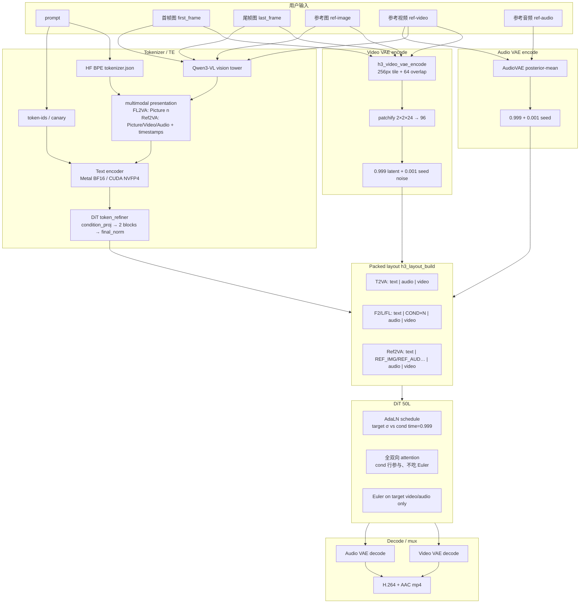

# H3 生成架构与全局观

> 本文是产品生成能力的**架构真源**。后续开发必须以本文件锁定的边界为准，不得把「调 `img_w` / 加 CLI 开关 / 锁 t=0 latent」当成 F2VA/L2VA/FL2VA/Ref2VA。  
> 对照代码以本仓库为准；MiniMax-H3 / Comfy / Kijai 仅作语义旁证。  
> 日期：2026-08-18。不替代 `docs/nvidia_optimization_plan.md` 的算力账本，但**覆盖并纠正**其中把 G3-lite 写成条件完备的表述。

**架构一句话：** 所有生成模态共用一条 packed DiT 序列；文本走 TE，图像/视频参考走 VAE encode（+ Qwen vision），音频参考走 Audio VAE encode；首/尾帧是 FL2VA 的 `H3_SEG_COND` keyframes，有序参考是 Ref2VA 的 `H3_SEG_REF_*`；CUDA 旁路目前只打通了无视觉条件的 T2V/T2AV。

---

## 0. 读本文的方式

1. 先看 **§1 产品能力** 与 **§2 系统框图**：这是产品要交付什么。
2. 再看 **§4 核心抽象**：这是实现必须共用的骨架，不是某一模态的补丁。
3. 然后看 **§5 三列对照** 与 **§6 功能矩阵**：这是「已经有什么 / 缺什么」。
4. **§7 禁止项** 是硬约束。
5. 排期见配套 [`2026-08-18-h3-generation-roadmap.md`](2026-08-18-h3-generation-roadmap.md)。该计划在本文边界锁定之后才写。

旧计划仅作历史参考，**不要当任务清单执行**：

- `2026-08-18-f2va-vision-condition-channel.md`（方向对，但只切了 F2VA，且容易被执行成「先 host encoder 再加 `--first-frame`」补丁序）
- `2026-08-18-nvidia-accel-r1-r3.md` / `2026-08-18-r1r3-closeout-fixes.md`（速度阶段；**功能完整之后**才碰）

---

## 1. 产品能力（必须全部进架构）

本仓库要对齐官方 MiniMax-H3 的五类生成。名称与入口以本仓 `h3.h` / `h3_generate` 为准。

| ID | 产品名 | 用户输入 | 官方语义（一句话） | 权重树 |
| --- | --- | --- | --- | --- |
| **T2V / T2AV** | 文生视频（±音频） | prompt | 无视觉/参考条件；DiT pack `[text \| audio \| video]`；目标音视频从噪声去噪 | **FL2VA** |
| **F2VA** | 首帧生视频 | prompt + 首帧图 | 首帧是 **condition**，不是覆盖 t=0 噪声；keyframes=`[0]` | **FL2VA** |
| **L2VA** | 尾帧生视频 | prompt + 尾帧图 | 同上，keyframes=`[frame_count-1]` | **FL2VA** |
| **FL2VA** | 首尾帧生视频 | prompt + 首帧 + 尾帧 | 两段 `H3_SEG_COND`；中段插值 | **FL2VA** |
| **Ref2VA** | 参考生视频 | prompt + 有序参考（图/音/视频） | 切 **Ref2VA** checkpoint；keyframes 与 references **互斥** | **Ref2VA** |

补充约定：

- Metal `h3_generate` **始终**走联合音视频（T2AV）：即使没有参考音频，layout 仍含 `H3_SEG_AUDIO` 目标段，再 decode 出音轨。
- CUDA `h3_cuda_generate` 可以只出视频（仍常 **pack 零音频行**，以稳住 FL2VA DiT 的 audio patch/final）。「T2V 子集」= 主题视频可跟 prompt；「T2AV」= 另接 Audio VAE decode + mux。
- Ref2VA 再拆：**image / audio / video**（video 还可带内嵌或外挂音轨）。standalone `--ref-audio` 必须与图像或视频参考同时出现（Metal 校验）。

---

## 2. 系统框图

文本、图像、音频、视频如何进入 TE / VAE encode / DiT / VAE decode / mux：



两条权重树（互斥选择，不是同一 DiT 加开关）：

| 树 | 何时选用 | Metal 路径 | CUDA 旁路现状 |
| --- | --- | --- | --- |
| **FL2VA** | 无 `reference_count`：纯文本、首帧、尾帧、首尾帧 | `FL2VA/{tokenizer,text_encoder,transformer,video_vae,audio_vae}` | 已接 pruned INT8 / W4A8 单文件 + 独立 TE/VAE |
| **Ref2VA** | `reference_count > 0` | `Ref2VA/...`（optional；缺则拒绝参考请求） | **未接** |

CUDA 量化交付与 Metal 官方树不是同一份文件，但 **pack / 段种类 / AdaLN / RoPE 语义必须对齐官方**，不能对齐「噪声侧 lite」。

---

## 3. 双平台交付形态

| | **Metal（Darwin 主路径）** | **CUDA（Linux 旁路）** |
| --- | --- | --- |
| 入口 | `./h3` → `h3_generate`（`h3.c` / `h3_cli.c` / `main.c`） | `h3_cuda_generate`（`tools/h3_cuda_generate.c`） |
| 构建 | 根 `Makefile` | `CMakeLists.txt`，`H3_GPU_BACKEND=cuda` |
| DiT | `h3_dit.c` BF16/Metal int8 MLP | `h3_dit_w4a8*` + `h3_dit_int8*`（主题默认 **INT8 ConvRot**） |
| 硬约束 | 不被 CUDA 替换 | **不破坏 Metal**；文档必须写「旁路」 |
| API 对齐 | 金标准 | **未**对齐 `h3.h`；CLI 语义自行声明 |

禁止把 CUDA 墙钟或 lite 开关说成「已经实现官方 F2VA」。算力旁路完整 ≠ 产品框架完整（`nvidia_optimization_plan.md` §15.5）。

---

## 4. 核心抽象（所有模态共用）

这些抽象是骨架。F2VA/L2VA/FL2VA/Ref2VA 只是 **往骨架填不同的段**，不是五套平行管线。

### 4.1 Packed layout（`h3_host.c` / `h3_host.h`）

`h3_layout_build(spec)` 生成一段连续序列，段种类：

| `h3_segment_kind` | 含义 | 出现条件 |
| --- | --- | --- |
| `H3_SEG_TEXT` | TE 精炼后的文本（含 vision presentation tokens） | 永远 |
| `H3_SEG_COND` | 首/尾帧视觉条件行 | FL2VA keyframes；**仅** frame 0 或 last |
| `H3_SEG_REF_IMAGE` | 参考图，或参考视频的视觉 token 网格 | Ref2VA |
| `H3_SEG_REF_AUDIO` | 参考音频行 | Ref2VA |
| `H3_SEG_AUDIO` | **目标**音频（去噪对象） | 永远（Comfy EmptyMiniMaxH3LatentAV） |
| `H3_SEG_VIDEO` | **目标**视频（去噪对象） | 永远 |

硬规则：

- `keyframes` 与 `references` **互斥**。
- 无条件 T2VA：`[text | audio | video]`。
- F2/L/FL：`[text | COND×N | audio | video]`。实测 5s 480P、text=128、双 keyframe 时 `seq_len=8009`（`tests/test_h3.c` `test_layout_fl2va`）。
- Ref2VA：text 之后按请求顺序交错 `REF_IMAGE` / `REF_AUDIO`，再接目标 audio/video。

CUDA `h3_dit_w4a8_forward_av_f32` 今天只实现 T2VA 那一种 pack（注释写死 `text | audio | video`），**没有** `H3_SEG_COND` / `H3_SEG_REF_*`。

### 4.2 Keyframes（仅 FL2VA 家族）

```c
if (first_frame) keyframes[k++] = 0;
if (last_frame)  keyframes[k++] = temporal.frame_count - 1;
```

RoPE `condition_time`（`h3_host.c`）：

- 首帧：`condition_time = text_len`
- 尾帧：`condition_time = text_len + video_span(latent_t) - frame_rescale`

COND 行空间网格与目标视频同一 canvas（`latent_h × latent_w`），但 **时间轴钉在首/尾**，不是跟着去噪步走。

像素几何：

- 首帧：stretch 到 render canvas（`H3_IMAGE_FIT_STRETCH`）
- 尾帧：aspect-cover + center crop（`H3_IMAGE_FIT_COVER`）

### 4.3 Condition channel（`H3_SEG_COND` / `H3_SEG_REF_*`）

官方条件 **不是** 改目标 latent 的初值。

| 步骤 | 官方做什么 | 明确不是 |
| --- | --- | --- |
| 1 | 像素/波形 → VAE encode | 把 jpeg 当 t=0 噪声 |
| 2 | video：patchify → 96-d 行；audio：pack 宽 32 | 逐步 `img_w` mix 覆盖 Euler 状态 |
| 3 | `0.999 * encode + 0.001 * seeded noise`（`h3_augment_conditions`） | `--lock-first-frame` 每步 memcpy t=0 |
| 4 | 写入 `video_input` / `audio_input` 的 **条件前缀** | 只改噪声侧 |
| 5 | patch proj 与目标视频 **共用** `video_patch_*`（COND/REF_IMAGE/VIDEO 同源） | 另开一套投影冒充 |
| 6 | 全序列 bidirectional attention；**Euler 只更新 target 段** | 把条件行当去噪对象 |
| 7 | AdaLN：条件用 **time=0.999** 的 visual/audio_condition 行；目标用当前 σ | 条件与目标共用同一个 video timestep |

Metal AdaLN（`h3_dit_schedule.c`）：

- 有视觉条件时额外占一行 `times[visual_condition_row] = 0.999f`
- 若当前 video σ 已经 `>= 0.999`，条件行回退到普通 `video_rows[step]`
- `row_map`：`H3_SEG_COND` / `H3_SEG_REF_IMAGE` → visual_condition + modality tag 0；`H3_SEG_REF_AUDIO` → audio_condition + tag 2
- Qwen vision 写进文本段的 token **tag=0**（视频模态），纯文本 tag=1

CUDA 现状：AdaLN 只有 3 个 modality 槽 × **一个** 视频 timestep（音频可 splice 第二行）。没有 visual_condition 的 0.999 行 → **即使塞进 jpeg latent，DiT 也看不到「干净条件」语义**。

### 4.4 Vision tower + multimodal TE

VAE 条件行告诉 DiT「像素长什么样」；vision + multimodal 告诉语言模型「这是第几张图/哪段视频」。官方 F2VA **两者都要**。

| 路径 | 函数 | 行为 |
| --- | --- | --- |
| FL2VA 首/尾帧 | `h3_vision_encode_bf16` + `h3_multimodal_encode_fl2va_bf16` | `<Picture n>`，三层 deepstack |
| Ref2VA 图 | 同上，按请求顺序 | 有序 `<Picture N>` |
| Ref2VA 视频 | 每 12 帧抽一对，两帧 vision block + timestamp | `<Video N>` |
| 纯 T2VA | `h3_tokenizer_encode` + `h3_text_encode_bf16` | 无 vision |

CUDA TE（`h3_nvfp4*`）是 **token-ids → NVFP4 文本层**。G1 已声明：**HF BPE / visual tower / 默认全 50L 非产品默认**。因此 CUDA 目前即使有 jpeg，TE 也看不到图。

### 4.5 Audio VAE

| 角色 | Metal | CUDA |
| --- | --- | --- |
| 目标音轨 decode | `h3_audio_vae` → mux | `h3_audio_vae_cuda` decode + `--mux`（G2/Au8 ✅） |
| 参考音频 encode | `h3_audio_vae_encode`，进 `H3_SEG_REF_AUDIO` | `h3_audio_vae_cuda_encode` **probe 已有**，generate **未接 Ref2VA** |
| T2AV 无参考 | 目标音频从噪声生成 | pack 零/噪声音频；可选 decode |

约束（Metal README）：参考音频 2–15s，最多 3 段，总时长 ≤15s；standalone audio 必须配图像或视频参考。

### 4.6 加载入口（Metal）

| 条件 | `h3.c` 调用 |
| --- | --- |
| 无视觉/音频条件 | `h3_dit_load_t2va` |
| 有 `condition_video_rows` 或 `condition_audio_rows` | `h3_dit_load_conditioned`（行数必须等于 layout 的 `img_cond_rows` / `audio_cond_rows`） |

CUDA 应对齐的不是函数名，而是：**cond_seq=0 时与现有 `forward_av` bit-for-bit；cond_seq>0 时插入条件段且 Euler 不写回条件行**。

---

## 5. 官方语义 vs Metal vs CUDA（三列对照）

| 层 | 官方语义 | Metal 实现 | CUDA 旁路 |
| --- | --- | --- | --- |
| 交付入口 | 一条命令出片 | `./h3` / `h3_generate` | `h3_cuda_generate`（显式旁路） |
| 文生 T2V | prompt → 视频 | ✅ 联合 T2AV 的视频部分 | ✅ 主题质量路径 **PASS**（INT8 DiT + 修复 TE；橙猫/水下） |
| 文生 T2AV | 同时出音轨 | ✅ native AudioVAE + mux | ✅ 子集：pack + decode + mux；主题档常不 decode |
| Tokenizer | HF `tokenizer.json` | ✅ | ⛔ 产品用 `--token-ids-file` / canary；无纯 C BPE |
| TE | Qwen 32B | ✅ BF16 Metal | ✅⚠️ NVFP4 可配置层 + CUDA；契约 `hi_first`+unswizzle+pre_quant；visual ⛔ |
| Vision tower | 图/视频进 TE | ✅ `h3_vision_encoder.c` | ❌ |
| Multimodal 包装 | Picture/Video/Audio 标签 | ✅ `h3_multimodal.c` | ❌ |
| Video VAE encode | 条件/参考必经 | ✅ `h3_video_encoder.c` tiling | ❌（G3 encode ⛔） |
| Video VAE decode | 满帧 | ✅ | ✅ INT8/fp16 CUDA；主题整幅/借权 |
| Audio VAE encode | 参考音频 | ✅ | ⚠️ probe ✅，产品 generate ❌ |
| Audio VAE decode | 目标音轨 | ✅ | ✅ |
| Layout / pack | 上表六种段 | ✅ `h3_layout_build` | 仅 `[text\|audio\|video]` |
| `H3_SEG_COND` | 首/尾帧条件行 | ✅ `h3_dit.c` patch + Euler 排除 | ❌ |
| `H3_SEG_REF_*` | 有序参考 | ✅ | ❌ |
| AdaLN 条件 timestep | cond=0.999 / target=σ | ✅ `h3_dit_schedule` | ❌ 仅单一 video t_row |
| RoPE condition_time | 首=text_len，尾=span 末 | ✅ | ❌ 仅目标视频网格 |
| 0.999/0.001 augment | 条件行 | ✅ | ❌ |
| 首/尾 CLI | `--first-frame` / `--last-frame` | ✅ `main.c` + `!first`/`!last` | ❌ 只有 `--init-latent` lite |
| Ref CLI | `--ref-image/video/audio` | ✅ one-shot；交互会话目前只有 `!ref-image` | ❌ |
| F2VA 噪声 lite | **不是官方** | 不使用 | ⚠️ `--init-latent` + `--lock-first-frame` / `--init-first-frame` |
| 主题默认 DiT 权 | 官方 BF16 树 | Metal int8 MLP 是加速，不是换 ckpt 家族 | **INT8 ConvRot**；W4A8 **禁止**当主题默认（对话先验塌缩） |
| 速度 ≤35s | 非语义 | Apple 另表 | **未达标**（P3 橙猫 ~64s / 水下 ~68s；TE 暴露仍高） |

---

## 6. 功能矩阵

判定口径：

- **产品能力缺失** = Metal 官方路径也没有，或 CUDA 若作为 Linux 产品入口则用户拿不到该能力。
- **仅旁路缺失** = Metal 已有官方实现；CUDA 还没有同语义接线。Linux/4090 产品化仍算缺口，但不要写成「仓库不会做 F2VA」。
- 质量门：主题（prompt follow）、首/尾帧对齐（对 jpeg PSNR/目视）、闪烁（时域跳变，不是 tile 相位）。

| 能力 | Metal | CUDA | 质量门（现状） | 缺失类型 | 备注 |
| --- | :---: | :---: | --- | --- | --- |
| **T2V** | ✅ | ✅ | 主题：橙猫窗台 / 水下海龟 **PASS**（`out/verify_theme_ok/`、`out/verify_r1r3_p3_vae/`） | — | CUDA 主题默认 INT8+NVFP4+cudnn；cfg=5；reuse/magcache 默认关 |
| **T2AV** | ✅ | ✅⚠️ | 主题视频门已过；满档音轨是 G2 子集封口，不是商业画质封口 | 旁路：质量档常 pack 静音 | `--audio-vae` + `--mux` 可出音；与主题 PASS 配置不是同一条默认命令 |
| **F2VA** | ✅ 官方 | ⚠️ lite | Metal：README 声明 e2e。CUDA lite：锁 t=0 → 站桩；img2img → 首帧易冲/后续过曝；**无**官方 cond 对齐门 | **仅旁路缺失**（官方语义） | CUDA 禁止再把 lite 当产品。`out/verify_f2va_test1*` 是噪声侧实验 |
| **FL2VA** | ✅ 官方 | ❌ | Metal 首尾对齐 + 中段插值。CUDA 无 `--last-frame`、无双 COND | **仅旁路缺失** | |
| **L2VA** | ✅ 官方 | ❌ | Metal 尾帧 cover-crop + COND。CUDA 无 | **仅旁路缺失** | |
| **Ref2VA image** | ✅ | ❌ | 身份/构图跟随；有序 `<Picture N>` | **仅旁路缺失** | 需 Ref2VA ckpt；与 keyframes 互斥 |
| **Ref2VA audio** | ✅ | ❌ generate | 参考声线/节奏进条件行；目标音轨仍去噪 | **仅旁路缺失** | encode probe 已有，未进 pack |
| **Ref2VA video** | ✅ | ❌ | 运动延续 + 可选内嵌/外挂音频 | **仅旁路缺失** | 含因果 VAE `ceil(T/4)`、两帧 Qwen 采样 |

### 6.1 子系统完成度（支撑上表）

| 子系统 | Metal | CUDA | 说明 |
| --- | :---: | :---: | --- |
| FL2VA DiT forward | ✅ | ✅ T2VA-only | CUDA 缺 cond/ref 段 |
| Ref2VA DiT 权加载 | ✅ | ❌ | Kijai Ref2VA 另有 `comfy_quant` 键，loader 未当产品路径 |
| Video VAE encode | ✅ | ❌ | 无 `h3_vae_*_encode` 产品 API |
| Video VAE decode | ✅ | ✅ | |
| Vision + multimodal TE | ✅ | ❌ | CUDA visual 仍 ⛔ |
| Audio encode / decode | ✅ / ✅ | ⚠️ / ✅ | |
| `h3_layout_build` | ✅ | 未消费 | CUDA 手写 seq = text+audio+video |
| CFG | Metal 蒸馏路径 | CUDA 默认 `--cfg 5`（verify2 主题修复） | 无 CFG 时跨 prompt 会塌成「几乎一样」 |
| 质量门禁工具 | 目视 + 内部测试 | `h3_quality_gate_probe` PSNR；主题靠目视 | F2VA 尚无「f0 vs jpeg」产品门进旁路 CI |

---

## 7. 已完成 / 部分 / 缺失（按层）

### 已完成

- **Metal 产品竖切（官方语义）：** T2AV、F2VA、L2VA、FL2VA、Ref2VA（图/音/视频）在 `h3_generate` 内按 params 分支，而不是五份拷贝。
- **CUDA 文生主题路径：** INT8 ConvRot DiT + 修复后 NVFP4 TE + VAE decode + cfg=5；橙猫/水下主题 PASS。
- **CUDA T2AV 工程子集：** audio pack、Audio VAE decode、mux、TE↔DiT overlap、阶段计时。
- **CUDA 算力旁路基线：** cuDNN SDPA、权重窗/prefetch、aux prestaging、WS-first（W4A8 已证；INT8 路径部分对齐）。
- **明确否定的加速银弹：** 默认 Sage2、FA3 on Ada、用 W4A8 冲主题、VAE36 再抠 kernel。

### 部分

- **CUDA F2VA：** 只有噪声侧 G3-lite（`--init-latent` / `--lock-first-frame` / `--init-first-frame`）。能出片，**不是**官方 F2VA。
- **CUDA TE：** 文本层可跑；无 BPE、无 vision；全 50L 墙钟仍是 e2e 大头。
- **CUDA Audio encode：** 算子/probe 在，Ref2VA 未用。
- **交互 CLI：** Metal `!ref-image` 已接；`!first`/`!last` 已接；视频/音频参考主要走 one-shot `main.c` 旗标。
- **速度：** 产品少层 Pareto 可 ≤20s；**主题质量路径 ≤35s 未达标**（独立问题）。

### 缺失

| 项 | 类型 | 后果 |
| --- | --- | --- |
| CUDA `H3_SEG_COND` + visual_condition AdaLN + condition RoPE | 仅旁路 | 无法做官方 F2/L/FL |
| CUDA 视频 VAE encoder | 仅旁路 | 条件行没有 payload（现靠预计算 raw，仍不是 cond 段） |
| CUDA vision tower + multimodal TE | 仅旁路 | TE 不认图；官方 F2VA/Ref 不完整 |
| CUDA `--first-frame` / `--last-frame` 官方 CLI | 仅旁路 | 即使用户有 jpeg 也只能走 lite |
| CUDA Ref2VA ckpt + `H3_SEG_REF_*` | 仅旁路 | 参考生视频不存在 |
| 用 lite 冒充官方条件 | **产品语义缺失（若对外这么宣传）** | 站桩、冲首帧、后续人物不可认 |
| 主题路径 ≤35s | 性能，非功能 | 不阻塞「会不会做 F2VA」，但阻塞速度收口叙事 |

---

## 8. 明确禁止

1. **禁止**再靠 `--init-latent` / `--lock-first-frame` / `--init-first-frame` / 调 `img_w` **冒充**官方 F2VA、L2VA、FL2VA、Ref2VA。这些开关最多保留为 **debug / ablation**，文档与 CLI help 必须写「非官方 condition」。
2. **禁止**把「f0 对得上 jpeg」当成 F2VA 完成：官方要求后续帧仍由 DiT 在 **看见干净 COND 行** 的前提下运动，而不是把 t=0 钉死。
3. **禁止**为 F2VA 新开一套与 `h3_layout_build` 无关的 pack； cond 必须能退化为现有 T2VA pack。
4. **禁止**无 condition 时改 CUDA DiT 数学（T2V bit-for-bit 是第一道门）。
5. **禁止**把 R1–R3 / Sage / magcache / 少步少层缠进 condition channel。速度是功能完整之后的独立阶段。
6. **禁止**把 Kijai W4A8 DiT 当主题默认（文本门控过弱）。
7. **禁止**静默截断 token-ids；禁止用 256 token 冒充质量档。
8. **禁止**远程密码入库。

G3-lite 在 `nvidia_optimization_plan.md` 标成「G3 ✅ lite」——**本架构将其降级为非产品路径**。真正的 G3 是：VAE encode → 官方段 → AdaLN 0.999。

---

## 9. 质量门（写入架构，而不是事后补测）

| 门 | 适用 | 通过标准（产品） |
| --- | --- | --- |
| **T2V 主题** | 任何改 DiT/TE/pack 的 PR | 橙猫=单猫窗台；水下=海龟+礁石无人；无 condition 时 CUDA DiT **bit-for-bit** 或文档化的容差 |
| **T2AV** | 开 audio decode 时 | 可播放音轨；不破坏主题视频门 |
| **F2VA 首帧对齐** | `--first-frame` 官方路径 | f0 对输入 jpeg 高 PSNR/目视可认；**禁止**靠 100% lock 过门 |
| **F2VA 后续可认** | 同上 | 后续帧同一主体，能运动，不是站桩、不是主题塌缩 |
| **闪烁** | 所有视频 | 无整帧闪、无 COND/目标交界撕裂；tile 相位稳定 |
| **L2VA 尾帧** | `--last-frame` | 末帧对 jpeg 对齐；开头不是尾帧复制 |
| **FL2VA** | 双锚 | 首尾同时对齐；中段连贯插值 |
| **Ref2VA** | 有序参考 | 身份/风格/声线按参考走；不与 FL2VA keyframes 混用 |

lite 实验目录（`out/verify_f2va_test1*`）**不是**上述门的金标准。

---

## 10. 速度与功能的边界

| 轨道 | 内容 | 何时做 |
| --- | --- | --- |
| **功能轨道** | condition 骨架 → VAE encode → vision/TE → F2/L/FL/Ref 竖切 | **现在的主线** |
| **速度轨道** | R1 INT8 调度余量、R2 TE 暴露、R3 VAE 冷启、主题 ≤35s | **功能完整之后**；可与功能并行调研，但不得改 pack/AdaLN 语义换速度 |

当前速度事实（主题质量路径，非产品少层）：默认总时长仍约 50–68s，TE 暴露 ~16–24s，≤35s **FAIL**。这不改变「F2VA 必须走 COND」的架构决定。

---

## 11. 关键文件地图

### Metal 金标准

| 文件 | 职责 |
| --- | --- |
| `h3.h` / `h3.c` | 产品 API；模式选择；encode 编排；cache |
| `h3_cli.c` / `main.c` | 交互 / one-shot 旗标 |
| `h3_host.c` | layout、keyframes RoPE、参考 canvas |
| `h3_dit.c` | pack、patch、Euler 排除 cond、load_conditioned |
| `h3_dit_schedule.c` | AdaLN 0.999 visual/audio condition |
| `h3_video_encoder.c` | 视觉 VAE encode |
| `h3_vision_encoder.c` / `h3_multimodal.c` | Qwen vision + presentation |
| `h3_audio_vae.c` | 参考 encode / 目标 decode |
| `tests/test_h3.c` | FL2VA / Ref2VA layout 金数字 |

### CUDA 旁路（今日 T2VA）

| 文件 | 职责 |
| --- | --- |
| `tools/h3_cuda_generate.c` | 旁路 CLI；**lite F2VA 也在这里，待降级** |
| `h3_dit_w4a8.c` / `.h` | `forward_av_f32` = `[text\|audio\|video]` |
| `h3_dit_int8.c` | 主题默认权 |
| `h3_nvfp4.c` / `h3_nvfp4_cuda.cu` | 文本 TE |
| `h3_vae_int8_cuda.c` | **仅 decode** |
| `h3_audio_vae_cuda.c` | decode + encode probe |
| `h3_token_ids.c` | 无 BPE 的 ids 路径 |

### 文档

| 文件 | 角色 |
| --- | --- |
| **本文** | 生成架构真源 |
| `2026-08-18-h3-generation-roadmap.md` | 功能竖切排期 |
| `docs/nvidia_optimization_plan.md` | 算力/G\*/R\* 账本；G3-lite 以本文为准降级 |
| `docs/nvidia_quant_contract.md` | 权文件契约 |
| `docs/nvidia_build.md` | CUDA 构建 |

---

## 12. 对后续计划的约束（执行前必读）

1. **先骨架，后竖切：** 先让 CUDA DiT 在 `cond_seq=0` 时与今日 T2VA 完全一致，再接首帧、再尾帧、再双锚、再 Ref。不要先做 jpeg CLI。
2. **共享 encoder，不要每个模态复制一份 VAE/vision。**
3. **F2VA 产品完成定义 =** VAE cond 行 + vision multimodal TE + 官方 CLI；缺一不可对外宣称。
4. **Ref2VA 是另一棵 DiT，** 不是 FL2VA 加更多 init-latent。
5. 速度优化单独立项，验收仍要过 §9 主题门。

配套计划：[`2026-08-18-h3-generation-roadmap.md`](2026-08-18-h3-generation-roadmap.md)。
