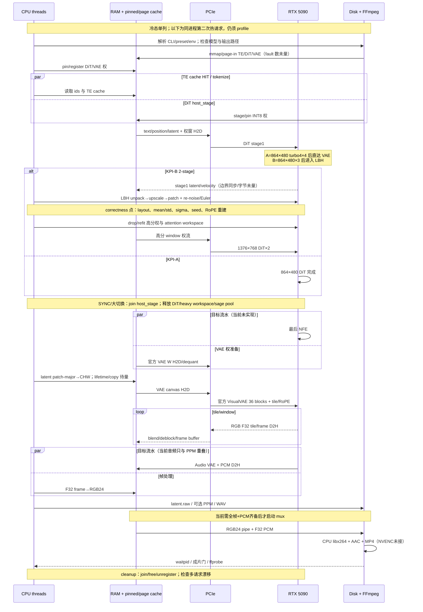
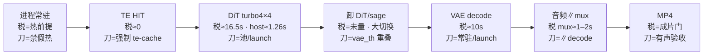

# H3.c · RTX 5090 × MiniMax-H3 单卡细粒度优化施工册（2026-09-30）

## 审查记录 2026-09-30

> 审稿口径：1×RTX 5090 32GB 热跑、冷启动单列；KPI-A/B 分列；官方 H3-VisualVAE 256/64 不改几何；kitchen = 社区核库；INT8 ConvRot 主线；无来源数字写「未量」。只改文档，不改 C/CUDA，不 commit。以下每条对应本次修正。

1. **KPI-A 算术下限无来源**：原「算术 ~23–30s」，16.47+1.26+9.97+1–2 只能得 ~29–30s，23 追不到路径 → 全文（怎么读 #2、§0.1、§3.1）改为 **~29–30s**，并注明 turbo-explainer「其它」段未量、不计。
2. **KPI-A VAE 秒数三处不一致**（§0.1 `~10（9.97–10.6）` vs 账本/流程图/§2.6/A2 `~8–11`）：统一为 **~10s（turbo4 9.97±0.01；gold 10.61±0.57，turbo-explainer）**；10.6 是 gold 臂，不是 turbo4。
3. **低分 3 NFE 目标「~4–6」**：09-16 §4.7 只写 ~4，6 无来源 → §3.2 回代表改 **~4（算术，无实测）**。
4. **附录 A「TE+DiT INT8 全常驻 ~18GiB（nvidia_quant_contract）」出处错**：quant_contract 写的是 INT8 pruned DiT 文件 ~19.5–21 GB 且不含 TE；18GiB 只出现在 `h3_w4a8_cache.c` 注释 → 改写并标 TE 常驻字节未量。
5. **`H3_VAE_CUDA_GRAPH` 默认值描述不全**（R10、§5.1、文件地图）：代码里未设该 env 时 **跟随 `H3_VAE_FLASH_SDPA`**（`h3_vae_int8_cuda.c` ~2219），cuDNN 路径 capture 会 abort → 补齐。
6. **`release_cached` 语义**（R2/S2/§1.4/§2.1）：代码已验证它 **不动 `hostreg` pin**，但把整个 cache 包（host pack + 设备 W + scratch）一起丢 → 把「不 unregister」从待办改为现状，待办改为「只卸设备 W/scratch、保留 pack」。
7. **`repeat_core: dit+vae+mux vs_kpi=27s` 日志行**（`tools/h3_cuda_generate.c` ~6442）不含 te/vae_load/audio，极易被当 e2e → 加进 §2.9 现状、§4 假阳性、R37。
8. **音频 VAE 时间**：账本原写「未量」，`out/verify_taomate/REPORT.md` 有 768P 热 ~0.2s → 补上（480P 仍未量）。
9. **Chaosyn Mixed 62s vs INT8 59s**（§2.5 INT4 表、§2.10）：09-22 记同站 8-step INT8 58s，两页口径未复核 → 加注。
10. **R 项合并**（不删编号）：R6→R8、R14→R61、R15→R57、R21→R49/R61、R22→R11、R25→R7、R29→R2、R30→R4、R34→R55、R36→R54、R38→R17、R39→R46、R40（时钟部分）→R53。
11. **§5.4 顺序与 §3.2 冲突**：原把 #6 显存置换排在 #4 VAE 对齐之前，且 #2/#3 融合排在 #4 之后（VAE 对齐本身就靠 36 层融合）→ 改为与 §3.2 B1→B2 一致，并注明 #2/#3 指 DiT graph/GEMM epilogue 与 VAE 对齐后的再压。
12. **口号式验收改具体**：R5、R9、R11、R12、R16、R27、R31、R40 的验收列补日志字段 / 工具 / 计数条件。
13. **Task 编号无出处**：全文 Task1/2/4 首次出现处补「09-16 Task N」链接。
14. **tile batch 三个名字**（`TILE_BATCH=4` / `tile_batch 默认 4` / `H3_VAE_MAX_TILE_BATCH`）：补 env `H3_VAE_TILE_BATCH`（`h3_vae_int8.c` ~466）与宏上限 4 的关系。
15. **「明确不做」两处重复**（表外 + §2.10）：不删，表外加注为速查、§2.10 为带路径正本。
16. **标题层级**：原 `# 1.–# 5.` 与 `## 0.` 混用、`## 2.0` 落在 `# 2.` 之前 → 统一为二级/三级/四级，加目录；章节顺序不动、内容不删。
17. **措辞**：标题与各节「极致」自评（17 处）改为「细粒度 / 剩余缺口 / 目标做法 / 必做」等可验证陈述；「彻底 / 完备」仅保留在否定句中。
18. **代码抽查结论**（rg 验证，均与文相符）：`release_cached` 在 `--repeat` 下一 clip 前无条件调用（~6451）；`vae_th`/`vae_th_ok` 只有 join 无 `pthread_create`；sage3 fallback 清 error 续跑（`h3_gpu_cuda.cu` ~6891）；`WEIGHT_CACHE` 默认开（`H3_VAE_WEIGHT_CACHE=0` 才关）；`gemm_f16_via` 为设备内 cast；`H3_VAE_MAX_TILE_BATCH 4`；sol 计时臂 `cudaDeviceSynchronize`（~6688）；`audio_decode_th` 仅盖 PPM（~6256）；ffmpeg argv 无 `-threads`、`libx264 fast crf18`；`latent.raw` 无条件 fopen；`phase_ms` 无 `vae_blocks=`；CMake nvcc≥12.8 才加 120；TE `[tokens,5120]→[tokens,5376]`；latent 54×30 / patch 96 通道。
19. **遗漏项**：除第 7 条 `repeat_core` 口径外，本轮审查未发现新漏项；R41–R61 保留。

### 目录

- [审计结论](#审计结论这是静态覆盖清单不是实测完备声明) → 账本 → Mermaid 泳道
- [整体图 / 剩余优化清单](#整体图--剩余优化清单)：流程图 · 怎么读 · R1–R61 · 硬件矩阵 · 明确不做（速查）
- [0. 目标锁死](#0-目标锁死打开就知道打哪)：KPI-A/B · 热/冷 · 禁混报
- [1. 5090 约束](#1-5090-这张卡的约束只写会改墙钟的)：32GB · sm_120 · VAE 碎核 · 加载税
- [2.0 CPU 流水](#20-cpu-流水利用与-s1-同阶段对照代码)（与 S1 同阶段）
- [2. 按模块拆](#2-按模块拆优化面gpu-算子面cpu-见-20)：2.1 加载 · 2.2 TE · 2.3 步数 · 2.4 attn · 2.5 量化（INT4 / W6A8）· 2.6 VAE · 2.7 2-stage · 2.8 mux · 2.9 日志 · 2.10 不做（正本）
- [3. 施工顺序](#3-两条主线的细致施工顺序)：S1–S3 → KPI-A → KPI-B
- [4. 风险与假阳性](#4-风险与假阳性)
- [5. 剩余缺口](#5-剩余缺口静态覆盖清单--必做--省不了)：5.1 付税路径 · 5.2 缺口表 · 5.3 重叠现状 · 5.4 与 §3 关系
- 文件地图 · 一手链接 · 附录（host↔device 点 / 32GB 切换）

| 项 | 写死 |
| --- | --- |
| **目标卡** | **1× RTX 5090 32GB**（sm_120）+ **宿主机 CPU**（核数以热验收机为准；不编型号） |
| **模型** | **MiniMax-H3**：DiT + **官方 H3-VisualVAE** 成片 + **音频 VAE** + **mux**。**不是** LTX / Wan / Hunyuan / TAE 成片 |
| **KPI-A** | 5s · 24fps · **864×480** · 有声 MP4 · **turbo4** 蒸馏 · 官方 VAE · 热 e2e **≤30s**；`phase_ms` 分段须加总对上 |
| **KPI-B** | 5s · 24fps · **1376×768** · 有声 MP4 · TaoMate/Comfy **2-stage**（864×480×3 → LBH → 1376×768×2）· 官方 VAE · 无 16px 格子 · 热 e2e **≤27s**（用户 Comfy 地板；本仓现状 **~52–53s**） |
| **CPU 角色** | GPU 等待期间做预取/pin/tokenize/音频/mux/H2D 流水；**不是**打满占用率，**不是**把 GEMM 搬回 CPU。与 **§3 S1 热验收同一阶段**开工 |

> **范围：** 只改本文档，**不改** C/CUDA 生产代码，**不 commit**。  
> **热跑：** 进程已活；DiT/TE/VAE 权已在该放处（GPU 或 pinned host）；**第二次请求起算**。冷启动单列，**禁止折进热 KPI**。  
> **质量：** 同 latent 对 Comfy 官方 VAE，无格子、不切块换馆。**金线 MAE 不是门。**  
> **对齐（数字只准带路径，禁止新编）：** [09-16](./2026-09-16-h3c-community-speed-direction.md) · [09-22](./2026-09-22-h3c-accel-web-survey.md)（废 kitchen~4s）· [09-15](./2026-09-15-h3c-module-opt-plan.md) · [turbo-explainer](./2026-09-13-h3c-turbo-explainer.md) · [TaoMate](./2026-09-13-h3c-taomate-h3-analysis.md) · [5090 extreme](./2026-09-13-h3c-5090-extreme-full-plan.md)。**kitchen** = 社区核库，非 MiniMax 官方。

**定位：** §3「共享先行 → KPI-A/B」是先看见 **≤30s / ≤27s** 的依赖序（假账上核优化无意义），**不是**墙钟上限。§2.0 CPU 流水与 S1 **同阶段**。§5 剩余缺口仍是必做或明确不做。「好」= 官方 H3-VisualVAE、无格子、不切块换馆；「省」= 墙钟与无效显存/launch。

## 审计结论：这是静态覆盖清单，不是实测完备声明

**现在还不能说「每一个细节都已全部考虑」。** 本轮沿 `CLI/preset/env → 文件与 page cache → prompt/tokenize/TE → 条件预处理 → latent/noise/scheduler/CFG → DiT 50 blocks/量化/attention → 2-stage LBH → latent layout/lifetime → 官方 VisualVAE 36 blocks/tile/RoPE/blend → D2H/RGB → 音频 → FFmpeg/mux/磁盘 → cleanup/下一请求` 做了**静态路径覆盖**，并把漏项补为 R41 起的独立验收项。

静态审计能证明「路径已列入清单」，不能证明「资源已彻底利用」或「没有遗漏的动态瓶颈」。在同一台 1×RTX 5090 32GB 热验收机上拿到 **Nsight Systems、Nsight Compute、perf/进程 page-fault、峰值 VRAM/RSS/pinned、PCIe 吞吐、磁盘与编码器实测**前，禁止写“完整优化”“全部利用”“端到端已完备”。仍未知且必须实测：

- KPI-A/B 每阶段真实 wall/GPU-active、stream 空洞、同步因果与可重叠短边；
- SM/Tensor Core/HBM 利用率，attention/GEMM/融合核的 roofline 归属；
- 每次 H2D/D2H 的字节、PCIe 有效带宽、pageable 回退与 copy/compute overlap；
- CUDA allocator 峰值、碎片、隐式同步、长进程多请求后的 VRAM/RSS/pinned 漂移；
- mmap major/minor fault、page-cache 命中、冷/温/热文件态，以及 `latent.raw`/PPM/MP4 的磁盘阻塞；
- CPU 核、NUMA、线程迁移、FFmpeg/libx264 占用；当前代码**没有 NVENC 路径**，NVENC 是否值得启用未量；
- 官方 VAE 全量帧 D2H、F32 帧缓冲与 RGB24 副本的峰值字节，颜色转换与 pipe backpressure；
- GPU clock/power/thermal throttle、后台进程干扰、P50/P95 与 30+ 请求稳定性；
- 同 seed/latent 的 LBH、scheduler、CFG、音画同步与发布质量回归。

### 端到端时间-空间账本（热请求；未 profile 一律写未量）

> `F=实际 VAE 输出帧数`，mux 最多取 120 帧；表中公式只表达应计字节，不冒充实测。KPI-A latent=`24×T×30×54` CHW / patch-major `T×15×27×96`；KPI-B 先 `24×T×30×54`，LBH 后 `24×T×48×86` / `T×24×43×96`。`T` 由 5s 对齐帧数运行时计算，须以日志为准。

| 阶段 | shape / dtype / location | 当前时间 | VRAM | RAM / pinned | PCIe | CPU | GPU | 可重叠 | 缺测 |
| --- | --- | --- | --- | --- | --- | --- | --- | --- | --- |
| CLI / preset / env / 建目录 | A `turbo4`；B `taomate-lift 3+2`；host | 未量 | 0 | 参数/路径小量 | 0 | 解析、校验、`mkdir` | 空 | 文件预取 | env 快照、耗时 |
| 模型文件 mmap / page-in / pin | TE/DiT/VAE safetensors；file-backed + pinned host | DiT host_stage 热约 1.26s；其余未量 | 0 或 staging 未量 | DiT/VAE pin 峰值未量；page cache 未量 | 后续 H2D 未量 | mmap、fault、注册 | 注册/H2D 时可能等待 | TE∥DiT host_stage | major/minor fault、磁盘读、pin 字节 |
| prompt / tokenize / TE | ids；TE embedding `[tokens,5120]→[tokens,5376]` F32 host | cache HIT≈0；MISS~13s 冷列 | TE 权/激活未量 | embedding 与 cache 未量 | TE 权 H2D、后续 text H2D 未量 | tokenize/cache IO | MISS 时 TE encode | DiT host stage | 真 tokenizer 时间、cache IO/page fault |
| 输入条件预处理（有条件生成时） | RGB24→F32 CHW host；VAE/vision/audio condition | KPI-A/B T2VA 主线未触发；其他模式未量 | vision/VAE encode 未量 | 全帧/音频输入峰值未量 | 输入 H2D 未量 | FFmpeg resize/crop/convert | vision/VAE encode | 文件预取 | 该 KPI 是否严格 T2VA、预处理账 |
| latent / audio noise 初始化 | A/B stage1 patch-major F32 host；Box-Muller/hash | 未量 | 0（forward 内再上卡） | latent、velocity、历史速度、audio 多副本未量 | 初始 latent/text/pos H2D 未量 | `fill_normal_f32`、alloc/memcpy | 空 | 权预取 | 初始化时间、RSS 峰值、可复现性 |
| sigma / CFG / RoPE / position | `steps+1` F32 host；CFG 可双 forward | 未量 | CFG/位置缓冲未量 | 小数组 + uncond embedding 未量 | text/pos 重传未量 | schedule、位置生成 | CFG 增加 DiT 工作 | 预建 attention plan | sigma/CFG 分段与额外字节 |
| DiT stage1 / A 全段 | A `864×480×4 NFE`；B `864×480×3 NFE`；INT8 W + F32 activation | A~16.5s；B low~10s | 权窗/attention/activation 峰值未量 | pinned W；host latent/velocity | 每层权流与 step D2H 未量 | cache/prefetch/launch | GEMM/attn/epilogue | H2D∥compute | SM/TC/HBM、每 block 时间/字节 |
| LBH + 重排（仅 B） | CHW F32 `24×T×30×54 → 24×T×48×86`，再 patch-major | ~2.5s（既有量级） | LBH workspace 未量 | `z_low/z_high/z0_pack/noise_hi` 峰值未量 | LBH H2D/D2H 未量 | pack/unpack、alloc/copy | latent upscaler | 高分权准备 | oracle/correctness、峰值与 copy |
| DiT stage2（仅 B） | `1376×768×2 NFE`，patch-major F32；INT8 W | ~19s，window=1 | free≈1.1–1.7GiB 旧日志；峰值未量 | pinned W/cache 未量 | host_hits/H2D 字节未量 | 权流/调度 | 高分 DiT | 下一 VAE 权预取（尚未实现） | 真 hit、window、PCIe、block profile |
| DiT→VAE 大切换 | drop DiT W/heavy scratch/sage pool；载入 VAE | 未量 | 释放/再占曲线未量 | mmap pin/cache 未量 | VAE W H2D 未量 | free/load/dequant | 可能隐式同步 | 末 NFE∥VAE H2D（尚未实现） | allocator 碎片、同步、切换峰值 |
| latent unpack / VAE denorm | patch-major→CHW F32 host；官方路径 denorm 合同 | 未量 | canvas buffer 未量 | `latent`+`latent_chw` 双份未量 | canvas H2D 未量 | unpack/layout | H2D | VAE 权准备 | layout/cast/copy 字节与 lifetime |
| 官方 VisualVAE 36 blocks | A 480P；B 768P；tile-local RoPE 256/64；F32/F16/INT8 混合 | A~10s（turbo4 9.97）；B~17–18s | resident W/tile/scratch 峰值未量 | tile heads/rope/patch host 缓冲未量 | 中途 fallback copy 未量 | tile 编排 | 36 blocks/SDPA/GEMM | tile 双缓冲（未实现/未证） | 每 block/核、fallback、HBM |
| unpatch / blend / D2H | `F×H×W×3` F32 host frames | `unpatch_d2h_ms`已有字段，数值未量 | `d_rgb`/tile 未量 | **`F×H×W×3×4` bytes** + blend 缓冲 | 同量级 D2H，实测未量 | blend/deblock | unpatch/拷贝 | tile D2H∥后续转换 | 实际 F、D2H bytes/bandwidth |
| F32 frame→RGB24 | 全量 frames F32 → 新 `F×H×W×3` U8 host | 未量（计入 `ppm`） | 0 | 在 F32 帧外再加 **`F×H×W×3` bytes** | 0 | clamp/quantize/布局转换 | 空 | 可按帧流水但当前整包 | CPU 带宽、峰值 RSS |
| 音频 VAE / waveform D2H | audio latent→F32 PCM 32kHz stereo host | 768P 热 ~0.2s（`out/verify_taomate/REPORT.md`）；480P 未量；独立 `audio=` | 音频 W/activation 未量 | PCM+W 未量 | waveform D2H 未量 | thread/join/WAV | audio kernels | 当前仅∥PPM | D2H、同步、时长/漂移 |
| PPM / latent.raw / WAV | `latent.raw` 无条件尝试写；PPM 可跳；WAV 有声时写 | 未量 | 0 | page cache/pipe buffers 未量 | 0 | fwrite/write | 空 | 理论可异步 | 写入字节、fsync、磁盘队列 |
| FFmpeg + mux | RGB24 pipe + F32 PCM；当前 `libx264 fast crf18`，CPU | mux A~1–2s、B~1.8–2s 量级 | 0；**未用 NVENC** | RGB整包+pipe+ffmpeg RSS未量 | 0；NVENC 路径不存在 | RGB pipe、x264、AAC/mux | 空 | 当前等帧/音频齐后串行 | pipe backpressure、线程、NVENC A/B |
| cleanup / 下一请求 | free/cache release/host unregister | 未量 | 释放曲线未量 | RSS/pinned 回落未量 | 0 | join/free/unmap | `cudaFree` 可同步 | 与下一请求预取 | 长进程漂移、碎片、泄漏 |

### Mermaid 资源泳道：KPI-A/B 关键事件、同步点与大切换



---

## 整体图 / 剩余优化清单

> **读法总则：** 图上「税」= 文档已有秒数或明确「未量」；节点旁短名 = **还没做完**的下一刀（已验收项不当待办）。表 R* 是待办总账；§2–§5 是展开。数字无路径禁止新编。

### 流程图 · KPI-B（1376×768 · 2-stage · 热）

主干一次热生成（有声 MP4）。每个节点：`标签 · 税=… · 刀=…`。


### 流程图 · KPI-A（864×480 · turbo4 · 单段 DiT · 热）

**不是** 2-stage：无 LBH、无低/高分两段。



### 怎么读（≤10 行）

1. **KPI-B** 墙钟主税在 **高分 DiT≈19s**（window=1）与 **VAE≈17–18s**；合计热 **~52–53s**，目标 **≤27s**。
2. **KPI-A** 是单段 turbo4：DiT≈16.5 + host_stage 1.26 + VAE≈10 + mux 1–2，算术 **~29–30s**（turbo-explainer「其它」段未量，不计）；目标 **≤30s**——**不要**画成 3+2。
3. **TE 热≈0** 是纪律（`--te-cache` HIT），不是算力刀；MISS~13s 进热 = 假账。
4. **卸 DiT/sage** 是 32GB 上 **唯一计划大切换**；今日串行（`vae_th` 未 create），税写 **未量**。
5. 节点旁「刀」对应下表 R*；假 hit / 假热未清零时，后面核秒数全废。
6. LBH≈2.5s **不是** KPI-B 第一刀；先 VAE→~10s 与高分常驻。
7. 图上秒数均有路径（§0.1 / §3.1–3.2 / 09-16）；无则标 **未量**。

### 剩余优化表（R1… · 宁细勿并 · 已验收不当待办）

**R1–R40 复核结论：** 原项继续有效，已覆盖热缓存/权流/attention/VAE 融合/graph/基础流水/质量门，但它们把若干端到端税合并得过粗，不能作为“全部考虑”的证据。缺失面按真实生命周期拆成 **R41–R61**，不改写或复用旧编号。**2026-09-30 审查：** 同一件事两个编号的，在 ID 列标「合并到 Rx」，编号保留、行不删；施工与验收以被合并到的行为准。

| ID | 阶段 | 现状（函数名） | 还没做的优化 | 预期作用 | 依赖 | 验收 | KPI |
| --- | --- | --- | --- | --- | --- | --- | --- |
| R1 | 热验收 | `weights_load` / `WEIGHT_CACHE`（默认开，`H3_VAE_WEIGHT_CACHE=0` 才关）/ Task1（09-16 Task 1）已落 | **5090** 打出第二次 `vae_load≈0`（S1 证据仍缺） | 去掉假热 load 税 | `h3_vae_int8_cuda.c`、probe | `[2/2] load_ms≈0`；热 `vae_load≈0` | 两者 |
| R2 | 热验收 | `h3_cuda_generate` ~6451：下一 clip 前无条件 `release_cached()`；它 **已不动** `hostreg` pin，但连 host pack + 设备 W + scratch 整包丢掉 | 修 `--repeat`：只卸设备 W / scratch，**保留** host pack 与 mmap pin | clip2 不再整包 dequant | `tools/h3_cuda_generate.c`、`release_cached` | `--repeat 2` 无整包 dequant 尖峰 | 两者 |
| R3 | DiT attn | `g_sage3_want/hits/fallback`；768P hits=0 fallback=200 | 加速档 `want>0 && hits==0` **硬退**（勿清 error 续跑） | 禁假 hit；逼真核或改 backend | `h3_gpu_cuda.cu`、preset | 加速档 abort 或 `hits==want` | 两者 |
| R4 | DiT 显存 | `window_size` / `int8_host_hits`；高分 free≈1.1–1.7GiB | 消 **768P window=1**：小 WS + decode 前 `sage3_drop_pool` + INT8 常驻 | 高分 ~19s→~8–10s **方向** | `h3_w4a8_cache.c`、sage drop | 日志 `window≫1`、`host_hits` 降 | B |
| R5 | VAE GEMM | `gemm_f16_via` / `f32_to_f16`→GEMM→`f16_to_f32` | 消每层 F32↔F16 **HBM 中转**（寄存器/融合） | 降每层 roundtrip | `h3_vae_int8_cuda.c`、`h3_gpu_cuda.cu` | Nsight Compute：每层 `f32_to_f16`/`f16_to_f32` kernel 计数归 0（或 dram bytes 下降）；同 latent 抽帧无 waffle | 两者 |
| R6（合并到 R8） | VAE launch | `run_block_cuda_w_dev` / `vae_run_layers_dev` | 压 **20+ launch/层**（层内合并） | 降 launch+同步税 | 同上 | 层 launch 数可见下降 | 两者·B 主 |
| R7 | VAE attn | `vae_kitchen_sdpa` → `…_layout_nb` | 正名：今只是 **batched cuDNN**；失败硬退；真 kitchen 核另 ID | 禁「有 kitchen 名=已加速」 | `h3_gpu_cuda.cu` | 日志 `one_cudnn batch≥2` 或硬退 | 两者·B 主 |
| R8 | VAE 融合 | 36 层 RMS/QKV/RoPE/SDPA/FFN 拆核 | **epilogue / 层内融合**（对照 kitchen 迁 C） | 对齐 5s768P **~10s** 量级 | VAE CUDA + kitchen 合同 | `vae_blocks+load`~10s；禁写已测 4s | B 主·A 次 |
| R9 | VAE attn | F16 SDPA 路径 | **INT8 window attn** 替 F16 SDPA（几何 256/64 不改） | 对齐后再压；秒 **未测上限** | VAE attn 路径 | 无格子（`test_h3_vae_rope` PASS）；日志 attn backend 字段为新核名而非 `cudnn`/`fallback_loop` | B |
| R10 | Graph | `H3_DIT_W4A8_CUDA_GRAPH`（=1 才开）；`H3_VAE_CUDA_GRAPH` 未设时**跟随 `H3_VAE_FLASH_SDPA`**、=0 强关、cuDNN 路径 capture 会 abort（`h3_vae_int8_cuda.c` ~2219）→ 产品路径实际关 | 形状稳定后热路径可开 DiT graph；VAE 仅可 capture 产品核 | 降 36×N launch | `h3_dit_w4a8.c`、VAE graph | graph hit；无静默 fallback | 两者 |
| R11 | CPU 流水 | `vae_th` / `vae_th_ok` **从未 `pthread_create`** | 真正 create：DiT 末步 ∥ VAE 权就绪 | 藏大切换串行税（未量） | `tools/h3_cuda_generate.c` | 日志出现 `vae_th: created` 类字段且 `phase_ms total` < `dit+vae_load+vae+audio+mux` 算术和；差值即重叠量 | 两者 |
| R12 | TE | te-cache → host `float*`；步内再 H2D text | 热路径减 **每步 embedding H2D**（常驻设备 text） | 降小 PCIe；方向：降 | TE/DiT forward | Nsight Systems H2D 事件：text 缓冲每 clip 1 次；或 DiT stats 新增 `h2d_text_bytes=` 每步为 0 | 两者 |
| R13 | 2-stage | `lift_prepare_hires_vram` → `drop_device_weights` + refit | 缩短低→高 **卸再装** DiT 设备权 | 降第二次计划切换 | generate / w4a8 cache | 分段可见；切换短 | B |
| R14（合并到 R61） | 成片 I/O | VAE tile D2H；`h3_ffmpeg_write_av_rgb24_f32` | 帧 D2H ∥ ffmpeg/mux 流水 | 藏 mux≈1.8–2s 短边 | ffmpeg / generate | `mux=` 分列；wall 不双计 | 两者 |
| R15（合并到 R57） | 同步 | sol 计时臂 `cudaDeviceSynchronize`；其余未逐确认 | 热路径改 event；禁过密 DeviceSync | 降假等 GPU | `h3_gpu_cuda.cu` 等 | 热 profile 无多余 sync | 两者 |
| R16 | 量化策略 | 默认 INT8 ConvRot；NVFP4/W4 实验臂 | **INT8 保持主线**；低比特 **只当显存腾挪**（换 window/VAE 常驻） | 禁主刀跑偏 | 配方/REPORT 纪律 | REPORT 列 `quant=int8_convrot`；nvfp4/w4a8/w6a8 行必带 `arm=experiment` 且不进 KPI 表 | 两者 |
| R17 | 日志 | `phase_ms: te dit vae vae_load audio…` | 补一级 **`vae_blocks=`**（或明文 `vae−load`） | 分段加总对上 total | generate phase_ms | 缺列=废数据 | 两者 |
| R18 | 可见性 | `vae_hostreg: fail` 后 staging | pin 失败 **进热否决**（不可静默当热） | 禁假热 pageable | `hostreg` / phase_ms | fail ≠ 过 KPI | 两者 |
| R19 | TE 纪律 | `--te-cache` 可选 | 热 KPI **强制** HIT；MISS 单列冷 | 防 ~13s 吃穿预算 | generate / 评测脚本 | 热日志 HIT且 te≈0 | 两者 |
| R20 | CPU 重叠 | `audio_decode_th` 只盖 PPM | audio **∥ video VAE decode**（或尾段） | 藏 audio 墙钟 | generate audio overlap | `audio=` 分列；不双计 | 两者 |
| R21（threads 合并到 R49；重叠合并到 R61） | mux | libx264 无显式 `-threads`；串末尾 | 合理 `-threads`；能 ∥ decode 尾/下一 clip 则 ∥ | 降/藏 mux 短边 | `h3_ffmpeg.c` | 有声 ffprobe 门 | 两者 |
| R22（合并到 R11） | DiT↔VAE | 末 clip：`dit_free` + `release_heavy` + `sage3_drop_pool` **串行** | 末 1–2 NFE 与 VAE H2D **双缓冲** | 同 R11；大切换重叠 | generate | overlap 标真 | 两者 |
| R23 | 768P attn | sage3 形状拒；sol_cute 同类 fallback | 真进核：kitchen `sol_attn` / Sol-Attn sm_120 或改形状 | 高分真 hit（假 hit 先 R3） | attn 插件/CUDA | backend 真名=实际核 | B |
| R24 | 480P attn | 曾真 hit；仍可能多余 permute/launch | 真 hit 后减池/cast/launch | 小刀；方向：降 | sage3 路径 | hits==want；无假名 | A |
| R25（合并到 R7） | VAE 批 | `one_cudnn batch≥2` 可失败走 `fallback_loop` | batched 失败 **硬退**（加速档） | 禁串行 per-tile 冒充 kitchen | `vae_kitchen_sdpa` | 失败 abort 或真 batch | B 主 |
| R26 | VAE 常驻 | `H3_VAE_CUDA_W_RESIDENT`；与 DiT 互斥 | decode 前卸 DiT 后 **W 真常驻**；热不重材料化 | 支撑 R1/R8 | VAE resident | 热无整包 dequant | 两者 |
| R27 | tile 流水 | tile batch 默认 4（env `H3_VAE_TILE_BATCH`，宏上限 `H3_VAE_MAX_TILE_BATCH=4`）仅 −0.5s（18.7→18.2，REPORT） | tile **双缓冲** / 权预取（在融合之后） | 碎核未解前收益有限；融合后加深 | VAE run | `vae: blocks=` 与 `phase_ms vae=` 同时下降；`test_h3_vae_rope` PASS；抽帧无格子 | B |
| R28 | host_stage | `dit_host_stage_th` / `kick_dit_host_stage` 热≈1.26s | 保持 pin；∥TE 全开；失败可见 | 防回冷 13.2s | `h3_w4a8_cache.c` | 热 host_stage~1.26；overlap 可见 | 两者 |
| R29（合并到 R2） | 假热 unload | clip 间卸设备 W **可以** | 写清语义：禁卸 pin；禁 host 整包再解 | 与 R2 配套 | release/hostreg API | 文档+日志一致 | 两者 |
| R30（合并到 R4，作纪律条） | 显存置换 | sage 池 2–4GiB vs INT8 层权 | 省下的 GiB **必须**写成 window>1 / VAE resident / tile batch | 禁「省了却空着」 | drop_pool + cache | REPORT 写常驻目标 | B 主 |
| R31 | DiT GEMM | cuBLAS + 外挂 bias/RMS/residual | 融合 epilogue（对照 kitchen linear） | 降 HBM roundtrip；未测上限 | `h3_gpu_cuda.cu` | Nsight：每 block kernel 数下降（bias/RMS/residual 不再独立 launch）；同 seed 末 latent checksum 差在容差内 | 两者 |
| R32 | 配方 A | `turbo4` / taomate 3@864 | 热 e2e 重测（S1–S3 后）；禁 stage1 冒充 A | 见 ≤30s | preset + generate | total≤30；864×480；有声 | A |
| R33 | 配方 B | taomate-lift 3+2；热 52–53s | VAE~10 + 高分常驻后重测 e2e | 见 ≤27s 轨迹 | 同上 | 1376；分段加总；轨迹合格 | B |
| R34（合并到 R55，作格子子门） | 质量门 | 官方 VisualVAE 几何 256/64 | 同 latent 抽帧无 16px 格子；禁减窗/整幅 RoPE | 守「好」 | `test_h3_vae_rope` | f0/24/48/90/119 过人眼 | 两者 |
| R35 | 构建 | `CMAKE_CUDA_ARCHITECTURES` 含 120 | 确认本机 fatbin 含 sm_120；热无 debug sync | 核真上 5090 | CMake 日志 | 日志含 120 | 两者 |
| R36（合并到 R54） | 多请求 | 同进程多 clip | pin/mmap/WEIGHT_CACHE **跨请求**；mmap 预热 | 热 load 稳态 0 | VAE/DiT cache | 多 clip `vae_load≈0` | 两者 |
| R37 | 报表 | backend 可假名 `sdpa=sage3`；`repeat_core: dit+vae+mux vs_kpi=27s` 行（`tools/h3_cuda_generate.c` ~6442）**不含** te/vae_load/audio，不是 e2e | 对外强制：冷热、画布、NFE、**真 backend**、分列 phase | 废假阳性行 | REPORT 模板 | 缺列/假名=废 | 两者 |
| R38（合并到 R17；`audio=` 字段已存在） | 音频模型 | `h3_audio_vae_cuda_decode` | 独立预算；勿折进 `vae=` | 防 VAE「假快」 | phase_ms | `audio=` 独立 | 两者 |
| R39（合并到 R46） | scratch | `d_*_scratch` grow-only / pregrow | 控制闲置占位；与 R4/R30 同屏 | 间接换 window | `h3_gpu_cuda.cu` | free GiB 与 window 同屏 | B |
| R40（时钟部分合并到 R53） | 持久/时钟 | 仓库无产品默认持久核开关 | 查清有无；有则热开；**查不到不编秒** | 可能方向：降 | 运行时/驱动 | 热验收前后各记 1 次 `nvidia-smi -q -d CLOCK,PERFORMANCE`；REPORT 写「持久核：有/无/未确认」 | 两者 |
| R41 | CLI/preset/env | 多个 CLI 与 `H3_*` env 可改 backend、tile、cache、graph、CFG | 每次 REPORT 落盘 argv、关键 env、git/build/driver/hash；拒绝口头配方 | 可复现；防暗开关 | generate/preset/eval 脚本 | A/B 配方可逐字段复现 | 两者 |
| R42 | 文件 I/O/page fault | 模型 mmap/pin，但无 fault/page-cache 账；TE cache 与 mmap 热度混杂 | 冷/温/热三态分开；记录 major/minor fault、read bytes、mmap/pin 字节；预触页只作为显式实验 | 清掉假热与缺页抖动 | mmap/store/`perf stat` | 热态 major fault=0 或解释；基线后不回退 | 两者 |
| R43 | latent/scheduler/CFG | `fill_normal_f32`、shifted sigma、velocity Euler、CFG 双路散落 | 固化 seed→noise checksum、sigma 列表、video/audio 双 schedule、CFG forward 数与 Euler 合同 | 防速度改坏轨迹 | generate/scheduler tests | 同 seed checksum/sigmas/末 latent 对照 | 两者 |
| R44 | 输入条件/预处理 | image/video/audio 走 FFmpeg resize/crop、F32 CHW、vision/VAE encode；T2VA 主 KPI 不触发 | 明确 KPI-A/B 输入模式；若覆盖 F/L/Ref2VA，单列 decode/resize/crop/encode RAM 与时间 | 防漏算条件输入 | `h3_ffmpeg.c`、vision/VAE encode | 模式矩阵和预处理 phase 完整 | 两者 |
| R45 | LBH correctness | LBH 有 mean/std、pack/unpack、re-noise、RoPE 重建，且存在 debug dump | 建 oracle：同输入对 Python/Comfy，逐点验 `z_low/z_high/z0_pack`、sigma、seed、shape；禁 debug `/tmp` 进 KPI | 防快但错/格子 | latent upscaler/oracle/tests | maxabs/统计阈值先建基线后不回退；无 debug IO | B |
| R46 | allocator/碎片 | CUDA scratch grow/free、多处 host malloc/realloc；无峰值和碎片曲线 | 记录每阶段 free/total、reserved/live、最大连续分配；热预分配/池化；检查 `cudaFree` 隐式同步 | 防 OOM与长尾 | CUDA allocator/generate | 30+ 请求无阶梯式 VRAM/RSS 增长；基线后不回退 | 两者 |
| R47 | D2H 字节 | VAE 有 `unpatch_d2h_ms`，DiT stats 有 d2h，但无总字节/带宽 | 计数每类 D2H：DiT velocity、VAE F32 frames、audio PCM、fallback；报告 bytes+GB/s+overlap | 找 PCIe/同步税 | CUDA copy sites | 实测字节等于 shape 账且无意外整包往返 | 两者 |
| R48 | 颜色转换/帧缓冲 | `frames_to_rgb24` 在全量 F32 frames 外再分配 RGB24；计入 `ppm`，口径混 | 独立 `color_ms`；按帧/批转换并接 pipe；记录 F32+RGB 双峰值，验证 clamp/range/色彩 | 降 CPU/RAM峰值 | generate/frame conversion | 像素回归过；峰值与 wall 基线后不回退 | 两者 |
| R49 | FFmpeg/NVENC | 当前 `libx264 fast crf18`、无显式 threads、无 NVENC | CPU x264 与 `h264_nvenc` 做同质量/码率/启动税 A/B；未证明更快前不默认 NVENC | 利用 CPU或NVENC而非想当然 | `h3_ffmpeg.c`/ffmpeg build | 成片质量/兼容门过；采用者 e2e 不回退 | 两者 |
| R50 | 磁盘/调试输出 | 热路径无条件尝试 `latent.raw`；PPM/WAV 可产生额外写与 page-cache 污染 | KPI 模式默认禁 latent.raw/PPM/WAV 或独立计时；记录 write bytes/await；MP4 落盘完成门 | 去掉隐形 IO | generate/output policy | 只写合同 MP4；调试 IO 不进 KPI | 两者 |
| R51 | 音频同步 | 只验 peak/样本数；视频帧时长与 PCM 时长可能不等，mux 未见 A/V drift 门 | ffprobe 验 stream start/duration、采样率/声道、尾差；禁止 pad 假音轨；定义容差 | 保证有声 MP4 正确 | audio VAE/ffmpeg/ffprobe | 5.000s±0.05、A/V 尾差阈值建基线后不回退 | 两者 |
| R52 | CPU NUMA/affinity | 仓库未见 affinity/NUMA 绑定 | 测 GPU 所在 NUMA；绑定 host-stage/ffmpeg/音频线程与内存策略；对照不绑定，禁盲目全核打满 | 降迁移/远端内存抖动 | 运行脚本/`numactl`/perf | CPU migrations、remote access、P95 基线后不回退 | 两者 |
| R53 | clock/power/thermal | 未记录锁频、功耗、温度、throttle | 验收记录 clocks/power/temp/throttle；预热到稳态；默认功耗策略与变更分开 | 防偶然快/热降频 | NVML/`nvidia-smi dmon` | 无 throttle；P50/P95 与功耗基线后不回退 | 两者 |
| R54 | 长进程稳定 | `--repeat` 仅短循环，cache/free 语义仍变动 | 同进程 30+ 请求，混合 A/B 与 seed；看 VRAM/RSS/pinned/fd/thread/cache 漂移及输出一致性 | 服务稳态真实热路径 | generate/cache/cleanup | 无泄漏、OOM、性能阶梯下降；P95不回退 | 两者 |
| R55 | 质量回归 | 现有门偏人眼/格子，未覆盖 scheduler/LBH/色彩/音频全链 | 固定 prompt+seed+latent 集；抽帧、运动、色彩、格子、音频、时长；与官方/Comfy同合同 | 防性能换质量 | eval corpus/tests | 建立基线与容差后不回退；失败阻断 KPI | 两者 |
| R56 | profile 协议 | wall、`clock()`、CUDA event 混用；无统一 Nsight/perf 采样法 | 固化 warmup、重复数、P50/P95、空机、timeline、kernel replay、perf、NVML、输出命名 | 让结论可证伪 | eval/profile scripts | 同协议可复现；phase 加总/重叠口径明确 | 两者 |
| R57 | stream/event/sync | 多 stream/event，但边界仍有 join、event sync、DeviceSync/`cudaFree` 风险 | Nsight 标注 stream、event、wait 原因；逐个同步分为正确性/计时/可删；graph capture 边界审计 | 填 GPU 空洞 | CUDA/generate/audio | 时间线无未解释 device-wide sync | 两者 |
| R58 | RAM/pinned 峰值 | latent/velocity/history/LBH/F32 frames/RGB24/PCM 多副本，无总峰值 | 按对象记录 alloc/free 生命周期、RSS/HWM/pinned；尽早释放，复用或按帧流水 | 防 RAM峰值和回收抖动 | generate/VAE/ffmpeg | 账本与 RSS/HWM 对上；基线后不回退 | 两者 |
| R59 | VAE layout/denorm/lifetime | patch-major→CHW→canvas→tile→F32 RGB，多次 cast/copy；TAE 与官方分支语义不同 | 只审官方分支：逐转换 shape/stride/dtype/所有权；验证 latent stats、tile blend、RoPE 256/64 | 防错位与多余 copy | VAE unpack/decode | layout 单测+copy bytes；无 use-after-free/重复 denorm | 两者 |
| R60 | DiT 每 block 账 | 只有聚合 layers 与 step0 prefetch/h2d/compute/d2h | 对 50 blocks 按类型聚合 GEMM/attn/AdaLN/RoPE/MLP、权 H2D、fallback、workspace | 找真实长板 | DiT stats/Nsight | block 总和对上 step；top kernels 有归属 | 两者 |
| R61 | 成片背压/落盘 | 父进程一次 `write_all` 全 RGB，FFmpeg pipe 阻塞与 waitpid 混入 mux | 记录 pipe write stall、编码、mux、落盘分段；评估环形帧队列，限制 RAM | 让 decode/convert/encode 真流水 | `h3_ffmpeg.c` | `pipe_wait_ms` 可见；无死锁/短写；e2e不回退 | 两者 |

### 硬件利用率验收矩阵（动态 profile 后才能勾）

| 资源 | 指标 | 工具/证据 | 通过条件 |
| --- | --- | --- | --- |
| GPU SM | `SM Active`、eligible warps、GPU active、时间线空洞 | Nsight Systems + Nsight Compute | 主计算段无未解释长空洞；建立同配方基线后不回退 |
| Tensor Core | tensor pipe utilization、HMMA/IMMA/FP4/INT8 指令归属 | Nsight Compute kernel sets | GEMM/量化主核实际进预期 TC 路径；建立基线后不回退 |
| HBM | DRAM throughput、L2 hit、bytes/kernel、roofline | Nsight Compute | 识别 compute/带宽受限；融合后有效 bytes 与 wall 建立基线后不回退 |
| PCIe | H2D/D2H bytes、GB/s、copy-engine active、overlap | Nsight Systems/CUPTI/NVML + 代码计数 | shape 字节账相符；无 pageable 意外回退；建立基线后不回退 |
| VRAM | 每阶段 used/free、峰值、最大分配、碎片、长期漂移 | NVML + `cudaMemGetInfo` + allocator 日志 | 不 OOM；window/resident 目标兑现；30+ 请求基线后不回退 |
| CPU | 每线程 CPU%、run queue、context switch、migration、cycles/IPC | perf/sched、pidstat、Nsight Systems | GPU 等待段有有效工作且不抢占/忙等；P95 建立基线后不回退 |
| RAM / page cache | RSS/HWM、pinned bytes、major/minor fault、read bytes、cache 命中 | `/proc`/`getrusage`/perf/vmstat | 热态无未解释 major fault；RSS/pinned 无阶梯增长；基线后不回退 |
| Disk | 模型读与输出写 MB/s、IOPS、await、写回、实际字节 | iostat/perf/eBPF/应用计数 | 热 KPI 不被调试 IO 污染；MP4 完整落盘；建立基线后不回退 |
| NVENC（若适用） | encoder utilization、session、encode latency、码率/质量 | NVML `encoder.stats`、FFmpeg benchmark/ffprobe | **当前不适用（代码走 libx264）**；接入后须质量门过且 e2e 优于 CPU 基线 |

### 明确不做（表外 · 勿当 R* 待办）

> 速查版；带路径的正本在 §2.10，两表同源、以 §2.10 为准。

| 不做 | 一句话 |
| --- | --- |
| **8 卡** Ulysses 冲 KPI | 本仓更慢；单卡 1×5090 冻结 |
| **真 INT4 / W6A8 / NVFP4 主刀** | 质量崩或墙钟≤/差于 INT8；只可显存实验（见 R16） |
| **TAE 成片** | 彩色闪；禁止冒充官方 VAE |
| **LTX** 成片当质量尺 | 30.6s 是别家 decode 尺 |
| **减窗** | 伤「好」/格子假象 |
| **整幅 RoPE** | 换馆；256/64 几何红线 |
| **TeaCache** 叠少步（3–8 NFE） | 几乎跳不了；改轨迹 |
| **假 hit 继续跑** | hits=0 仍报 sage3/sol = 硬失败要做（R3），不是「先跑着」 |

---

## 0. 目标锁死（打开就知道打哪）

### 0.1 两条成片 KPI（禁止再泛化成「视频生成加速」）

| KPI | 成片合同 | 热目标 | 本仓现状（有路径才写） |
| --- | --- | ---: | --- |
| **A** | 5s · 24fps · **864×480** · 有声 MP4 · **turbo4** · 官方 VisualVAE | **≤30s** | cafe turbo4 热账（**早于 Task1**；Task1 = [09-16 Task 1](./2026-09-16-h3c-community-speed-direction.md) VAE 加载常驻默认开）：DiT **~16.5s**（**16.47±0.31**，[turbo-explainer](./2026-09-13-h3c-turbo-explainer.md)）、TE HIT **≈0**、host_stage **1.26s**（旧 **13.2s**）、VAE 当时 **~10s**（turbo4 **9.97±0.01**；gold 臂 10.61±0.57）。算术 **~29–30s**（explainer「其它」段未量，不计）。**无 Task1 后 e2e** |
| **B** | 5s · 24fps · **1376×768** · 有声 MP4 · **3+2 2-stage** · 官方 VisualVAE · 无 16px 格子 | **≤27s** | 同配方热 **52–53s**；VAE **17–18s**；高分 2 NFE **~19s** 且 INT8 **window=1**（[09-16](./2026-09-16-h3c-community-speed-direction.md) · `out/verify_taomate/REPORT.md`） |

**机器：** 1× RTX 5090 32GB + 宿主机 CPU（核数以热验收机为准）。**模型栈：** MiniMax-H3 DiT + 官方 H3-VisualVAE + 音频 VAE + mux。

**金线 `--preset gold`：** 只对照（常 1344 / 8-step）。优化 **不必**先过金线 MAE。

### 0.2 什么算热跑 / 冷启动

- **热：** 进程已活；第二次请求起算（换 seed 或 `--repeat` 下一 clip，且 **GPU/pin 权真留住**）。
- TE：**HIT**（`--te-cache`）才进热 KPI；MISS **~13s**（已有文档）= **冷**。
- DiT：`dit_host_stage` 热应已 pin（**1.26s** 量级，不是冷 **13.2s**）。
- VAE：第二次 `vae_load≈0`（mmap pin + WEIGHT_CACHE + 设备 W 策略正确）。Task1 代码已落、**5090 上尚无「第二次≈0」日志** → 热 VAE 验收仍缺证据。
- **冷启动单列，不进 KPI-A/B。**

### 0.3 禁止混报（写进任何 REPORT 即废）

| 禁 | 为什么 |
| --- | --- |
| **1344** 冒充 **1376** / **864** | 画布不同；金线对照臂另列 |
| **640×360** / 尺 C 折算 | 不是本文 KPI；禁止用 A/B 像素比除出 ≤10s |
| **15s 片** 墙钟当 5s KPI | 帧数/窗数不同（含 kitchen PR167 362 帧） |
| **排除 decode** / 只报 DiT | 成片含官方 VAE + mux |
| **多卡** 秒数 ÷ 卡数 | 单卡 1×5090；Ulysses 冻结 |
| **LTX 30.6s** 当本仓质量尺 | decode 是 LTX VAE，不是 H3-VisualVAE |
| 冷 TE ~13s / 冷 VAE load 折进热 | 直接吃穿 ≤27/≤30 |
| 「kitchen ~4s」当已测 5s 768P | 09-22：**禁止**（一手 12.9 / 10.0；4.4 外推） |

---

## 1. 5090 这张卡的约束（只写会改墙钟的）

### 1.1 32GB：三家抢同一池

| 住客 | 量级（本仓事实） | 互斥点 |
| --- | --- | --- |
| DiT INT8 ConvRot | 常驻则窗口大；挤则 `window=1` + 上千 `host_hits` | 高分 1376 上 sage3 池占 **2–4GiB** 后 `free≈1.1–1.7GiB` → **window=1**（09-16 §4.4） |
| sage3 / 快 attn workspace | 池子留着才「像在用 sage3」 | 池 vs INT8 层权：**快核换来权流**，高分 2 NFE 墙钟 ~19s 里大量是 H2D |
| VAE resident F32 W | 36 层材料化；`H3_VAE_CUDA_W_RESIDENT` | 与 DiT 同时占满会 OOM；社区做法是 **decode 前卸 DiT/attn 池、VAE 留下**（Comfy PR 15456 思路；本仓已有 release_heavy 方向） |

**window=1 怎么来的：** 不是「32GB 装不下 INT8」，是 **attn 池 + reserve + 高分激活** 把剩余压到装不下多块层权。Comfy 同卡能 **kitchen 小 WS + 50 层 INT8 常驻**；我们日志写 sage3 却付 dense，还占着池。

### 1.2 sm_120：哪些核有、哪些假 hit

| 后端 | 5090 上 | 本仓行为 | 墙钟含义 |
| --- | --- | --- | --- |
| cuDNN SDPA | 有（需 cuDNN 对 sm_120 JIT） | gold / fallback 真路径 | 768P dense S² 贵 |
| sage3（`libh3_sage3.so`） | 插件可有；**形状常拒** | `g_sage3_want++`，失败 `g_sage3_fallback++`，**清 error 继续 dense**（`h3_gpu_cuda.cu` ~6891；仅 `head_dim==H3_CUDA_SDPA_F16_D && seq>=128` 才尝试），仍可能报 `sdpa=sage3` | **假 hit**。768P `seq≈37788`：**hits=0 fallback=200**（09-16） |
| sol_cute / Sol-Attn CuTe | 社区有 sm_120；kitchen 有 `sol_attn` | 本仓有插件路径；失败亦 fallback | 缺核硬退才算加速档成功 |
| kitchen `int8_attention` / 融合 RMS+RoPE | Comfy 0.36 + kitchen 0.2.34+ 有 | 本仓 **`vae_kitchen_sdpa` = batched cuDNN 入口**；**36 层融合核未做** | 名字带 kitchen ≠ 已吃到 PR 167 核 |
| FA3 / FA4 | Hopper / 别卡 | 5090 **没有**产品默认路径 | 不要抄 TaoMate FA3 命令 |

**480P seq~15k：** sage3 曾真 hit（turbo4 cafe）；**768P seq~37k：hits=0 仍报 sage3 = 硬失败要做**（[09-16 Task 4](./2026-09-16-h3c-community-speed-direction.md) 方向，本文档 §2.4 / §3）。

### 1.3 带宽、launch、HBM roundtrip ↔ VAE 36 层碎核

5s 768P 热 VAE **17–18s**（196 窗 × 36 block）：

- 每层：RMS / QKV GEMM（常 F32↔F16 cast）/ RoPE / SDPA / out / FFN —— **多次 launch + 多次读写 HBM**。
- `TILE_BATCH=4` 只把 18.7→18.2（−0.5s，09-16）→ 证明瓶颈不是「窗不够少」，是 **核碎**。
- `vae_kitchen_sdpa`：`h3_cuda_qkv_rope_sdpa_f16_dev_layout_nb` 可打 `one_cudnn batch>=2`；失败走 `fallback_loop` 串行 per-tile，**仍算「有 kitchen 函数名」**。加速档应对 batched 失败 **硬退**（[09-16 Task 2](./2026-09-16-h3c-community-speed-direction.md)）。
- naive `H3_VAE_FLASH_SDPA`：D=64 generic → clip **~305s**（09-15）。**禁止产品路径。**

对照社区一手（**不是 4s**，[09-22 §2.1](./2026-09-22-h3c-accel-web-survey.md)）：

| 来源 | 形状 | 秒 |
| --- | --- | ---: |
| kitchen PR 167 | 5090 · 1344×768 · **362 帧** int8 decode | **18.7→12.9** |
| Kijai HF#21 | 5090 · **5s@1344×768** int8 decode（load 另列） | **~10.0** |
| 帧线性外推 12.9×124/362 | — | **~4.4（外推，禁止当已测）** |
| 本仓 5s 1376 热 | 196 窗 C+cuDNN | **17.6–18.2** |

5090 的 HBM 够喂融合核；喂不动的是 **每层碎 kernel 的 launch + 中间张量往返**。

### 1.4 加载税（热 KPI 的隐形杀手）

| 项 | 社区 | 本仓 Task1 后（代码，未 commit） | 仍缺的 5090 证据 |
| --- | --- | --- | --- |
| WEIGHT_CACHE | 第二次 Queue 几乎 0 | **默认开**（`H3_VAE_WEIGHT_CACHE=0` 才关）；`h3_vae_int8_weight_cache_wanted` | 热 e2e 未重跑 |
| mmap pin | 跨 decode | `weights_load` **成功路径不再 unregister**；`hostreg_release` 在 store_free 前 | 有 |
| GPU W | resident | cache 可留 pack；**`--repeat` 下一 clip 前无条件 `release_cached()`**（`tools/h3_cuda_generate.c` ~6451）：不动 `hostreg` pin，但 host pack + 设备 W + scratch 整包丢 | clip2 再 dequant/H2D |
| `phase_ms` | 单列 load | 已有 **`vae_load=`**；`vae=` 仍是 decode 墙钟聚合；**尚无 `vae_blocks=` 一级字段**（blocks 在 `vae: ... blocks=` 行） | 第二次 load≈0 **未量** |

---

### 2.0 CPU 流水利用（与 S1 同阶段，对照代码）

> **原则：**「利用 CPU」= 让 CPU 在 **GPU 等待期间** 做预取下一 tile、pin、tokenize、音频编码、mux、H2D 流水。  
> **不是**空转打满占用率；**不是**把 DiT/VAE **GEMM 搬回 CPU**。  
> GPU 在算时，主线程 **不能**停在过密的 `cudaDeviceSynchronize` / 逐层 sync 上。  
> **施工：** CPU 流水与 **§3 S1 热验收同一阶段**开工——不是做完 GPU 核再考虑 CPU。

#### 2.0.1 谁在占 CPU、谁在空等（代码对照）

| 路径 | 文件 / 符号 | CPU 在干什么 | GPU 等待 / 空等？ |
| --- | --- | --- | --- |
| DiT `host_stage` mmap/pin | `h3_w4a8_cache.c`（`host_stage_*` / `host_mmap_registered`）；`tools/h3_cuda_generate.c` `dit_host_stage_th` / `kick_dit_host_stage` | 盘→pinned host；热路径 mmap+pin | 冷曾 **13.2s**；热 **1.26s**（已有文档）。可与 TE 重叠（`H3_DIT_HOST_STAGE_TE`，packed H2D 后 kick） |
| TE tokenize / encode | `tools/h3_cuda_generate.c` TE 段；真 ids 走 tokenizer；热 `--te-cache` | 冷 encode 吃墙钟；HIT 后 ≈0 | 冷 MISS **~13s** = 冷列。未逐层确认 TE 内 DeviceSync 密度 → **未逐调用确认** |
| VAE mmap / `cudaHostRegister` | `h3_vae_int8_cuda.c` `weights_load` / `g_vae_hostreg_*` / `hostreg_release` | pin 文件 mmap 供 DMA H2D | pin 失败打 `vae_hostreg: fail` 后走 staging；成功则跨 decode 保留 |
| VAE host dequant 循环 | `h3_vae_int8_cuda.c`：`H3_VAE_HOST_DEQUANT=1` 或非 gpu_dequant 路径调 `h3_vae_int8_dequant_f32`；`--repeat` 后 `release_cached` 可迫使再材料化 | **仍可能**整包 host 解包（假热时） | 热目标：第二次无整包 dequant；`H3_VAE_HOST_DEQUANT` 产品热路径应关 |
| 音频 VAE | `audio_decode_th` + `H3_AUDIO_VAE_OVERLAP`（`tools/h3_cuda_generate.c` ~6237） | 独立线程 decode PCM | **仅与 PPM dump 重叠**；**不与 video VAE decode 重叠** |
| mux / ffmpeg | `h3_ffmpeg_write_av_rgb24_f32`（`h3_ffmpeg.c`）：libx264 `fast` crf18；**argv 无 `-threads`** | 子进程编码；父进程喂 pipe | **串在** audio join + RGB 齐后；768P mux 量级 ~1.8–2s（已有文档量级） |
| `vae_th` | `tools/h3_cuda_generate.c`：`vae_th` / `vae_th_ok` | **死符号**：有 join，**从未 `pthread_create(&vae_th)`** | DiT 末步 → VAE 权上传 → decode → mux **全串行** |
| `--repeat` | `tools/h3_cuda_generate.c` ~6450 `h3_vae_int8_cuda_release_cached()` | clip 间卸 GPU 包 → clip2 再付 load/dequant | **假热**：热 KPI 若用 `--repeat` 未修则废 |
| 已知 DeviceSync | `h3_gpu_cuda.cu` sol 计时臂：`sdpa_ms` 且无 event 时 `cudaDeviceSynchronize()`（~6688）；`h3_audio_vae_cuda.c` 有 DeviceSync | 计时/收尾同步 | 产品热路径应避 debug sync；**其余逐层 sync 未逐调用确认** |

#### 2.0.2 应重叠的三段流水（专用线程或双缓冲）

| # | 重叠 | 现状 | 目标 |
| --- | --- | --- | --- |
| ① | **TE / tokenize ∥ 权上传（host_stage / 小窗 prefetch）** | 已有部分：`kick_dit_host_stage` after packed；`dit_prefetch`（`latent_t≥32` 会 skip GPU prefetch） | 热路径默认开；失败可见；HIT 后勿把冷 host 记进热 |
| ② | **DiT 末步 ∥ VAE 权就绪（H2D / resident）** | **串行**（DiT 完 → drop_pool / make_room → VAE）；`vae_th` 未 create | 最后 1–2 NFE 与 VAE 权双缓冲预上传（不破质量） |
| ③ | **VAE decode ∥ 音频 + mux 准备** | audio 只盖 PPM；mux 全串行 | decode 尾段∥audio；帧齐后∥mux 或下一 clip DiT |

验收：**`phase_ms` 墙钟 < 各段算术和**（重叠真发生）；日志标 overlap 真假。分段字段须能加总对上 `total`。

#### 2.0.3 CPU 活 · 现状 · 目标做法 · 验收 · 服务哪条 KPI

| CPU 活 | 现状 | 目标做法 | 验收 | KPI |
| --- | --- | --- | --- | --- |
| host_stage mmap/pin | 热 **1.26s**（旧 **13.2s**）已落地；可∥TE | 保持 pin；热不回 pageable；HIT 后勿重付冷 stage | 热日志 host_stage ~1.26 量级；与 TE overlap 可见 | A/B |
| TE tokenize + cache | 冷 MISS **~13s**；HIT ≈0 | 热 KPI **强制** `--te-cache`；冷单列 | `te≈0` 且 HIT；MISS 不进 ≤30/≤27 | A/B（纪律） |
| VAE pin / 禁假热 unload | Task1 pin 跨 decode；`--repeat` 仍 `release_cached` | S1+S2：第二次 `vae_load≈0`；clip 间可卸设备 W，**不** `cudaHostUnregister` mmap | probe `[2/2] load_ms≈0`；`--repeat 2` 无整包 dequant | A/B · **S1 同阶段** |
| 禁重复 host dequant | `H3_VAE_HOST_DEQUANT` / 假热重 load 可走 host 循环 | 热路径 gpu_dequant；关 host 整包；常驻格式 | 热无 host-dequant 墙钟尖峰 | A/B |
| 音频∥video decode | 只∥PPM | 与 video decode **重叠**（或 decode 尾段） | `audio=` 分列；wall 不双计 | A/B |
| mux / ffmpeg 线程 | libx264 无显式 `-threads`；串在末尾 | 开合理线程数；能与 decode 尾/下一 clip 重叠则重叠 | `mux=` 分列；有声 ffprobe 门 | A/B |
| 主线程少 sync | sol 计时臂有 DeviceSync；其余未逐调用确认 | 热路径用 event；禁过密 DeviceSynchronize | 热 profile 无多余 DeviceSync；查不到标「未逐调用确认」 | A/B |
| pageable / 重复分配税 | pin 失败降级 staging | pin 失败进日志并否决「假热」；禁静默 pageable 当热 | `vae_hostreg: fail` ≠ 静默过 KPI | A/B |

**不要编 CPU 秒数。** 已引用的仅有：host_stage **13.2→1.26s**、TE 冷 **~13s**、mux ~1.8–2s（768P 量级）。其余写「方向：降」或「未量」。

---

## 2. 按模块拆优化面（GPU 算子面；CPU 见 §2.0）

统一栏：现状 / 痛点 / 做什么 / 不做什么 / 验收 / **对 KPI-A(864×480) 与 KPI-B(1376×768) 的优先级**。  
**本次会话不改下列 C 文件**；验收写成 checkbox，标依赖路径。  
**提醒：** §2.0 CPU 流水与下面加载/常驻、mux 条目同一施工波次，不是「算子做完再挖 CPU」。

---

### 2.1 加载与常驻

| 栏 | 内容 |
| --- | --- |
| **现状** | Task1（09-16 Task 1）已落未 commit：`WEIGHT_CACHE` 默认开（`H3_VAE_WEIGHT_CACHE=0` 才关）、tile batch 默认 4（env `H3_VAE_TILE_BATCH`，宏上限 `H3_VAE_MAX_TILE_BATCH=4`）、mmap pin 跨 decode、`phase_ms` 含 `vae_load`。DiT `host_stage` mmap+pin 热 **~1.26s**（09-15）。TE cache 热 HIT≈0。`--repeat`：**仍** `h3_vae_int8_cuda_release_cached()` 丢掉整个 cache 包（host pack + 设备 W + scratch；`hostreg` pin 不动）（`tools/h3_cuda_generate.c` ~6451）。 |
| **痛点** | 热评测若用 `--repeat`，clip2 假装热、实际重付 VAE GPU 材料化。clip 间为给 INT8 让路卸设备 W **可以**；卸 pin/mmap **不行**。无 5090「第二次 vae_load≈0」日志。 |
| **做什么** | ① 修 `--repeat`：只卸设备 W / scratch，**保留** host pack（mmap pin 今已保留，不是待办）；或 clip 末再 H2D 但不 unregister。② `--probe-vae-load --vae-repeats 2` 在 5090 打出第二次 `load_ms≈0`。③ 热 generate：DiT 释放后再 `W_RESIDENT`；中间 clip 可卸 GPU W，**不卸 pin**。④ `phase_ms` 补一级 `vae_blocks=`（或明确文档：`vae=`−`vae_load`≈blocks+stitch）。 |
| **不做什么** | 不把 7GB host F32 当热路径；不静默 pageable（pin 失败打日志计入 load）。 |
| **验收** | - [ ] `tests/test_h3_vae_resident.c` PASS（已有）<br>- [ ] 5090：`--probe-vae-load --vae-repeats 2` → `[2/2] load_ms≈0`<br>- [ ] `--repeat 2` 热 clip：`vae_load≈0` 且无整包 dequant 墙钟<br>依赖：`h3_vae_int8*.c/h`、`h3_vae_int8_cuda.c`、`tools/h3_cuda_generate.c` |
| **优先级** | **A·P0**（≤30s 预算里 load 吃穿）；**B·P0**（同） |

---

### 2.2 文本编码 TE

| 栏 | 内容 |
| --- | --- |
| **现状** | Qwen3-VL NVFP4；MISS **~13s**；`--te-cache` HIT **~0**。cache 不是 daemon。 |
| **痛点** | 冷 TE 折进 ≤27/≤30 是撒谎。热评测忘开 cache → 假失败。HIT 后 `dit_host_stage` 曾记进 DiT（审计文），分段会漂。 |
| **做什么** | A/B 热 KPI **强制** `--te-cache` + 进程常驻；日志写 HIT/MISS。冷 TE 另表。 |
| **不做什么** | 不为冲 KPI 改 TE 数学；不把冷 MISS 写进热 e2e。 |
| **验收** | - [ ] 热日志 `te≈0` 且 cache HIT<br>- [ ] 同 ids HIT vs MISS embedding MAE=0（既有 te-cache 合同） |
| **优先级** | **A·P0（评测纪律）**；**B·同**。算力主墙不是 TE |

---

### 2.3 DiT 步数与配方

| 栏 | 内容 |
| --- | --- |
| **现状** | `h3_generate_preset.c`：`gold`（8-step 对照）、`turbo4`（4-step+LoRA）、`taomate` / `taomate-lift`（3 或 3+2）、`nvfp4`、`lift`。未蒸馏 `--steps 4` = 红线（turbo4 必须 LoRA）。 |
| **痛点** | A：公开单段 20-step 76–131s；≤30s 只能来自少步+热常驻（09-22 §4.1）。B：≤27s 来自 **2-stage 日程**，不是单段 8-step（ChrisJohnson 10-step 1344 热 **85.23s**）。 |
| **做什么** | A：turbo4 或 TaoMate 3 NFE @864×480 + 官方 VAE + 常驻；人眼+听音过地板。B：保持 **864×480×3 → LBH → 1376×768×2**，LoRA 0.75。FastH3 V2 / PAI PDD Acc：**只对照、不叠默认**；R2V 不要 FastH3 V2（未蒸 Ref2VA）。 |
| **不做什么** | 未蒸馏 4-step；蒸馏叠蒸馏；TeaCache 叠 3–8 NFE（几乎跳不了）；把 gold 8-step 当发布默认。 |
| **验收** | - [ ] A：热 e2e **≤30s**、画布写死 864×480、含 VAE+mux、`phase_ms` 加总对上<br>- [ ] B：热 e2e **≤27s**；日志写清低/高 NFE 与 1376；停在 stage1 **不得**标成「KPI-A」 |
| **优先级** | **A·P0（少步）**；**B·P0（日程已对，勿再发明）** |

---

### 2.4 DiT 注意力

| 栏 | 内容 |
| --- | --- |
| **现状** | `h3_gpu_cuda.cu`：sage3 失败 → fallback dense，**仍可报 sage3**。480P seq~15k 可真 hit；768P **hits=0 fallback=200**。sol_cute 同类 fallback。 |
| **痛点** | 假 hit：日志骗人 + 池占 VRAM → window=1。社区 15s 14-step 栈 Sage e2e 仅 **1.02×**（09-22）→ 768P 长序列不能当银弹；但 **假成功必须死**。 |
| **做什么** | 加速档：`want>0 && hits==0` **硬失败**（gold 可走 cudnn）。修形状或换 **kitchen `sol_attn` / Sol-Attn sm_120** 真进核。decode 前 `sage3_drop_pool` 让 INT8 常驻。 |
| **不做什么** | 禁止 hits=0 继续；禁止 KingGore 式静默 SDPA 当成功；禁止把 On-Device 50-step **231.2s** 除进 27s。 |
| **验收** | - [ ] 加速档日志 `hits==want` 或 abort<br>- [ ] backend 真名 = 实际核<br>- [ ] 768P 高分：window 明显 >1 或显式 resident_all |
| **优先级** | **共享先行 S3（假 hit 硬退）必做**；**B·真 hit 必做**（高分 ~19s 的必要条件）。A 短序列真 hit 后仍要挖 launch/池（§5），不是「P1 以后再说」。 |

---

### 2.5 量化与显存预算

| 栏 | 内容 |
| --- | --- |
| **现状** | 默认 DiT INT8 ConvRot。NVFP4：smeltcore 5090 **175 vs INT8 185s（+5.4%）**；Chaosyn offload 后更慢（09-22）。NVFP4 **几乎不买墙钟**。 |
| **痛点** | 把 NVFP4 写成 27s 主刀会错方向。window=1 是池 vs 权，不是「再压 4bit」。 |
| **做什么** | INT8 常驻优先；attn 小 workspace；decode 前 `sage3_drop_pool`；省下的 GiB **写成** window>1 / VAE resident / tile batch——禁止「省了显存却空着」。NVFP4 仅盘/显存实验臂。 |
| **不做什么** | NVFP4 当主加速柱；Kijai W4A8 进主题；减窗换显存。 |
| **验收** | - [ ] 高分日志 `window=` 与 `host_hits`；常驻目标写进 REPORT；池卸与 window 同屏可见 |
| **优先级** | **A/B · 必做（显存置换）**；与 §5 #6 绑定，不是「有空再做」 |

#### INT4 / 量化方向（联网 2026-09-30）

> 对照本仓：`h3_dit_w4a8` = **DiT 线性** W4 权 + A8 激活（INT8 GEMM；产品默认仍是同文件 `open_int8`）；`h3_dit_nvfp4` = **DiT** NVFP4（**不是 INT4**，可 dequant→INT8 sidecar）；`h3_vae_int8` = **视频 VAE** INT8+scale ConvRot。注意力/AdaLN/RoPE 一般不进 4bit。

| 项目 | 对象 / 算法 | 精度 | 1×5090 墙钟 | KPI 含义 |
| --- | --- | --- | --- | --- |
| [Merserk INT4-ConvRot](https://huggingface.co/Merserk/MiniMax-H3-INT4-ConvRot)（社区 HF；VAE 仍指官方） | DiT FL2VA/Ref2VA + TE；**对称/ConvRot INT4**；VAE/音频 **不**量化 | 卡片自承与 BF16 有差；[Reddit](https://www.reddit.com/r/StableDiffusion/comments/1ve67ny/minimax_h3_smaller_other_quants/)：**形变/不连贯，不可用**；无 MAE | **没有** KPI 形秒数；Blackwell 社区称无 INT4 TC，常先升 INT8 | 只省盘/显存；**不能主刀**；质量风险大 |
| [Kijai experimental](https://huggingface.co/Kijai/MiniMax-H3-experimental) · [Wiki 2026-08-05](https://comfyui-wiki.com/en/news/2026-08-05-kijai-minimax-h3-w4a8) · kitchen [#90](https://github.com/Comfy-Org/comfy-kitchen/pull/90) | DiT attn/mlp **W4A8**（假「纯 INT4」：INT4 存 + INT8 GEMM）；另发 **VAE int8_convrot**（~2× decode 自称） | 权 relL2~0.073；人眼样张有；**int8 VAE ≠ 官方 FP16 VisualVAE 合同** | 微基准称 ~1.09× vs INT8；**无** KPI-A/B e2e；5090 仅有样帧 | **假 INT4**；速度≈INT8；进主题仍禁（§2.5）；VAE 加速须另验官方几何 |
| [Winnougan「INT4」](https://huggingface.co/Winnougan/MiniMax-H3-INT4_Convrot_ComfyUI) / [starsfriday w4a8](https://huggingface.co/starsfriday/MiniMax-H3-w4a8)（2026-08 主线 `asym_w4a8`） | 同上 **W4A8 ConvRot** DiT±TE；VAE 外挂 | 「轻微降质」口头；无 MAE | **没有** 5090 KPI 秒 | 镜像 Kijai；**不主刀** |
| [rockerBOO INT4 W4A4](https://huggingface.co/rockerBOO/minimax-h3-nvfp4-convrot)（实验臂） | DiT 线性 **W4A4** ConvRot（块 2–46）；边缘/refiner BF16 | 作者标 quality unevaluated；论文称满 INT4 损低频；[ModelsLab](https://huggingface.co/ModelsLab/MiniMax-H3-ref2va-NVFP4) 测 W4A4 **文字伪影、未发货** | **没有** 5090；作者：Blackwell 掉 INT8 激活路径 **无速度论据** | 禁主线 |
| [Chaosyn](https://blog.chaosyn.com/en/posts/minimax-h3-rtx-5090-speed-cost/) Mixed INT4/INT8（测 2026-08-21） | DiT **混合** INT4/INT8 + Turbo；含 VAE+存盘 | 质量批次作废 | **5090** 0.7MP 5s 8-step：**62s** vs INT8 **59s（更慢）**（09-30 联网所见；09-22 记同站 8-step INT8 **58s**，两页口径未复核）；非 864/1376 KPI 画布 | 再压 4bit **不买墙钟** |
| [joeygambino GGUF Q4_0](https://huggingface.co/joeygambino/MiniMax-H3-GGUF) | DiT GGUF **Q4_0**（**无真 Q4_K**：hidden 2688%256≠0）；TE/VAE 另装官方 | 无 MAE 门 | 5090 仅 **Q5_1** ~10.3min（243f·544×960·20step）；**无** Q4 热 KPI-A/B | 低 VRAM 流式；**不能**当 ≤30/≤27 主刀 |
| NVFP4（非 INT4）：[smeltcore](https://smeltcore.com/recipes/minimax-h3-on-rtx-5090-32-gb-video-audio-and-what-nvfp4-does-not-buy-you/) · lilcheaty / ModelsLab | DiT **NVFP4**；TE 常 NVFP4-AWQ；VAE 官方 | 人眼可；非 MAE 门 | 5090：**175 vs INT8 185s（+5.4%）**（09-22）；Chaosyn NVFP4 offload 更慢 | **几乎不买墙钟**；仅盘/显存实验 |

**显存资源（单独写，不是 DiT 秒刀）：** 纯 INT4/W4 包可到 ~11–12GiB DiT，理论上给 **sage 池 + VAE 常驻** 腾 GiB、消 `window=1`。但 5090 证据显示（1）真 INT4 质量崩；（2）W4A8/Mixed 墙钟≤INT8；（3）本仓瓶颈是 **池 vs INT8 常驻置换**（§1.1 / §5 #6），不是再压比特。省下的 GiB 必须换成 `window>1` / VAE resident——禁止「省了却空着」。

**判决：** INT4 / 假 INT4（W4A8）/ Q4 GGUF / NVFP4 **都不做 KPI-A/B 主线**。主线仍 **INT8 ConvRot DiT + 官方 H3-VisualVAE**；量化侧只做显存置换与假格式识别（禁静默回退 FP16、禁把 W4A8 报成「INT4 加速」）。

#### W6A8（联网 2026-09-30，同口径）

> 本仓 **无** `w6a8`/`INT6` 路径（仅 `h3_dit_w4a8` / `h3_dit_nvfp4` / `h3_vae_int8`）。公开 **有** MiniMax-H3 **W6A8**，但是 WIP / 假「真 W6A8 GEMM」。

| 项目 | 对象 / 算法 | 精度 | 1×5090 墙钟 | KPI 含义 |
| --- | --- | --- | --- | --- |
| [Kijai experimental](https://huggingface.co/Kijai/MiniMax-H3-experimental) · `wip/minimax_h3_ref2va_pruned_w6a8_g32.safetensors`（~16.8GiB；卡片标 WIP）· kitchen [#191](https://github.com/Comfy-Org/comfy-kitchen/pull/191)（已合）· Comfy [#16483](https://github.com/Comfy-Org/ComfyUI/pull/16483)（已合） | **DiT** Ref2VA pruned 线性；**均匀 INT6 存**（无 codebook）+ fp8 组 scale → **dequant→INT8 GEMM**（与 W4A8 **同核**）；A=INT8 ConvRot。VAE/TE **不**在此包 | 权 relL2 ~0.024（W4A8~0.073 / INT8~0.011）；**无** e2e 人眼/MAE 门 | 仅有 **一层** `out_proj` 微基准（5090，M=4096）：INT8 **0.477ms** / W6A8 g32 **0.627ms** / W4A8 **0.664ms**；作者称 H3 token 下「≈W4A8≈INT8 奇偶」。**没有** KPI-A/B 冷热秒（含/不含 VAE） | **假 W6A8**（存 6bit、算 INT8）；**不降 DiT 秒**；显存介于 W4(~0.56B) 与 INT8(1.0) 之间(~0.78B/w) → **不能当主刀** |
| [pipenetwork MLX-6bit](https://huggingface.co/pipenetwork/MiniMax-H3-MLX-6bit) | Apple Silicon MLX 6bit DiT；**不是** CUDA W6A8 | 6bit 夹在 8/4 之间；作者：量化 **不**砍注意力墙钟 | **无** 5090 | 无关 KPI |

**硬件：** sm_120 TC 公开常见 **FP4/FP6(MX)/FP8 + INT8 IMMA**；Kijai W6A8 = **整数 6bit 存储 + INT8 计算**，≠ MXFP6「真 W6A8」浮点 MMA。公开材料 **未确认** 整数 **INT6 MMA** 指令（勿把 MXFP6 当成 INT6）。

**谱上位置（相对刚写的 INT4 节）：** 真 INT4 伤画质 → W4A8 墙钟≈INT8 且误差大 → **W6A8 误差更好、墙钟仍≈W4A8/不优于 INT8** → NVFP4 +5% 几乎不买 → **主线仍 INT8 ConvRot DiT + 官方 VisualVAE**。W6A8 只可能当「比 W4 更稳的显存中间态」实验臂，**禁止**当 ≤30s/≤27s 主加速柱。

---

### 2.6 VAE 解码

| 栏 | 内容 |
| --- | --- |
| **现状** | 官方 H3-VisualVAE；**256/64 tile-local RoPE**（几何红线）。196 窗 C GEMM+cuDNN @768P **~18s**。`vae_kitchen_sdpa` = batched cuDNN；**36 层融合未做**。 |
| **痛点** | 旧文「合同下限 18s」「厨房必须 4s」两头都错。对齐目标 = Comfy **0.36 int8** 公开路径：**5s 约 10s 量级**，不是口头 4s（09-22）。 |
| **做什么** | ① 对齐 Comfy 0.36 int8 公开线：**5s 768P 热 ~10s**（Kijai/PR167；**不是 4s**）。② 对齐后再压（未测上限）：tile 双缓冲 / 权常驻格式 / **INT8 window attn**（替 F16 SDPA）/ 36 层融合 —— 再快写 **未测上限**，禁止编秒。几何 **不改**。③ `one_cudnn batch>=2` 失败硬退。 |
| **不做什么** | 减窗；整幅 RoPE；TAE 冒充成片；naive flash（`H3_VAE_FLASH_SDPA`）；嵌 Python kitchen；Flash-VAED / KJ Triton（对不上 H3 ViT）；VDN（不改 VAE）。 |
| **验收** | - [ ] 同 latent vs Comfy：无 16px 格子（抽 f0/24/48/90/119）<br>- [ ] `tests/test_h3_vae_rope.c` 断言方向不改<br>- [ ] 热 `vae_blocks+load` 对齐 **~10s 量级**（5s 768P），对照 PR167/Kijai，**禁止写「已测 4s」**<br>- [ ] 日志出现 `vae_kitchen_sdpa: one_cudnn batch>=2` 或融合核真名；batched 失败硬退<br>- [ ] 对齐 10s **之后**的再砍：无新一手秒数则标「方向：降 / 未测上限」 |
| **优先级** | **B·必做（对齐 10s）**；对齐后再压进 §5 剩余缺口表。**A**：480P VAE 量级 ~10s（9.97–10.6），Amdahl 小于 B，但仍列进剩余缺口（launch/常驻），不是「可跳过」。 |

---

### 2.7 2-stage 日程（只服务 768P）

| 栏 | 内容 |
| --- | --- |
| **现状** | TaoMate-lift：864×480×3 → LBH → 1376×768×2。本仓热 **52–53s**。 |
| **痛点** | 停在 stage1 = 低分草稿，**不是** KPI-A 的 864×480 成片（KPI-A 要官方 VAE 直接出 864×480）。 |
| **做什么** | B 默认极速配方锁此日程；LBH ~2.5s 不是第一刀。 |
| **不做什么** | 为 A 强行 lift；把 stage1 墙钟报成 480P 成片。 |
| **验收** | - [ ] 日志分段：dit_low / lbh / dit_high / vae_* / mux；加总对上<br>- [ ] 成片分辨率 **1376×768** |
| **优先级** | **A·不做**；**B·P0（配方已锁）** |

---

### 2.8 mux / 音频

| 栏 | 内容 |
| --- | --- |
| **现状** | x264 fast crf18；768P mux ~1.8–2s（量级）。`audio_decode_th` **仅与 PPM dump 重叠**（`H3_AUDIO_VAE_OVERLAP`，默认开）；**不与 video VAE decode 重叠**。`vae_th` 符号在 `tools/h3_cuda_generate.c` 存在，但 **从未 `pthread_create(&vae_th)`** → DiT 末步 / VAE 权上传 / decode **全串行**。mux 在 audio join + RGB 之后单线程。U=8 假片 ~6kb/s 已有审计。 |
| **痛点** | mux 失败装成「VAE 很快」；音频墙钟进 `phase_ms audio=`，热 KPI 若跳过有声则假省。 |
| **做什么** | ① 单独预算 `audio` / `mux`，禁止折进 VAE。② **与 §2.0 同阶段**：能与 **video decode 尾段** 或 **下一 clip DiT** 重叠就重叠。③ ffprobe 门；ffmpeg 补合理 `-threads`。 |
| **不做什么** | 不冒充 VAE 加速；不静音 pad 假有声。 |
| **验收** | - [ ] 5.000s±0.05 / 帧数对齐 / 有声<br>- [ ] 热日志可见 `audio=` / `mux=` 分列；重叠开启时 wall 不双计 |
| **优先级** | **A/B · 必做（省墙钟）**；量级小于 VAE/高分 DiT，但串行累加吃穿 ≤27/≤30 余量；**与 S1 同波次开重叠骨架** |

---

### 2.9 失败可见与日志

| 栏 | 内容 |
| --- | --- |
| **现状** | `phase_ms: te dit vae vae_load audio ppm mux total dit_evals dit_skips hot= clip=`（`tools/h3_cuda_generate.c` ~6437）。VAE 细分为 `vae: load canvas_h2d blocks unpatch_d2h total` 另行列。紧随其后的 **`repeat_core: dit+vae+mux vs_kpi=27s`** 行不含 te/vae_load/audio，**不是 e2e**。sage3/sol fallback 打 stderr 但 **不硬退**。 |
| **痛点** | 缺一级 `vae_blocks`；backend 假名；冷热/画布/步数/是否含 load 口头混用。 |
| **做什么** | 对外报表强制列：冷热、画布、步数/NFE、backend **真名**、`te/dit/vae_load/vae_blocks/mux/total`。加速档：kitchen/sage/sol 失败硬退。禁止静默 TAE。 |
| **不做什么** | 只报 DiT；hits=0 当成功；把 `repeat_core` 行当 e2e。 |
| **验收** | - [ ] 任意 KPI 行缺列 = 废数据<br>- [ ] `sdpa=` / `vae=` 与 stats hits 一致<br>- [ ] KPI 秒数只取 `phase_ms total=`，不取 `repeat_core` |
| **优先级** | **A/B · P0（纪律）** |

---

### 2.10 明确不做（省了会伤「好」或已测更慢 / 几乎不买墙钟）

| 不做 | 理由（路径） |
| --- | --- |
| 8 卡 Ulysses 冲 KPI | 本仓 `peer=0` U=8 **更慢**；09-16/09-22 冻结 |
| NVFP4 当主刀 | smeltcore 5090 **175 vs INT8 185s（+5.4%）**；几乎不买墙钟（09-22） |
| 真 INT4 / W4A4 DiT 当主刀 | Merserk 人眼崩；rockerBOO/ModelsLab 伪影或 unevaluated；5090 无 KPI 加速秒（§2.5 INT4） |
| 「INT4」包装的 W4A8 当加速银弹 | Kijai/Winnougan = INT4 存 + INT8 GEMM；Chaosyn Mixed **62s > INT8 59s**（09-22 同站记 58s，未复核）；≈不买墙钟 |
| TeaCache on 少步（3–8 NFE） | 几乎跳不了；改轨迹（09-22 §2.10） |
| 减窗 / 整幅 RoPE | 伤「好」：格子或换馆；256/64 tile-local 几何红线 |
| TAE 成片冒充官方 VAE | 彩色闪；禁止 |
| 换 LTX / Sol-H3 成片当质量尺 | 30.6s 是速度参照，decode 是 LTX VAE |
| naive flash（`H3_VAE_FLASH_SDPA` 产品路径） | D=64 generic → clip **~305s**（09-15） |
| 假 hit fallback 当加速成功 | `g_sage3_want++` / `g_sage3_fallback++` 仍报 `sdpa=sage3` |
| 金线 MAE 当发布门 | 金线无社区验证；最多 `--preset gold` 对照 |
| 嵌 Python kitchen | 税；迁 C |
| 未蒸馏 `--steps 4` | `h3_generate_preset.c` turbo4 红线；必须 LoRA |
| Flash-VAED / KJ Triton VAE | 对不上 H3 ViT |
| VDN 当 VAE 方案 | 不改 VAE；头牌不含 decode |
| 把 360P≤10s 当主 KPI / 用 A/B 折算 | 公开无合格方案 |
| 5s×2 冒充 10s | 口径 |
| 口头 kitchen 4s 当验收 | 外推/口头；一手是 **12.9 / 10.0**（09-22） |

---

## 3. 两条主线的细致施工顺序

> **这是「先看见 KPI-A ≤30s / KPI-B ≤27s」的依赖序，不是耗时上限。**  
> **S1 与 §2.0 CPU 流水同一阶段**（假热清零 + 三段重叠骨架），不是做完 GPU 再挖 CPU。  
> 对齐/假账清零之后，§5 剩余缺口里每一行仍是必做（或明确不做）。原 **S1–S3** 与算子融合顺序 **保留**。

```text
共享先行（S1–S3 + §2.0 CPU 同阶段）
  S1  Task1 热验收（5090 第二次 vae_load≈0）
      + CPU：pin/mmap 保留、禁假热 unload、phase_ms 可加总
  S2  修 --repeat 卸 GPU W（保留 pin）
  S3  sage3 hits==0 硬退（加速档）
  同波次开工 §2.0 三段重叠骨架：
      TE/tokenize ∥ 权上传；DiT 末步 ∥ VAE 权就绪；VAE decode ∥ 音频+mux
        │
        ├─► KPI-A · 864×480 turbo4 热 e2e ≤30s：先热 e2e，不先写融合核
        │
        └─► KPI-B · 1376×768 2-stage 热 e2e ≤27s：
              VAE 对齐 Comfy int8（~10s）→ 高分 attn 真 hit + 权常驻 → 才看得见 ≤27s
        │
        └─► 见 ≤27/≤30 之后：继续 §5（融合/graph/重叠加深/显存置换）——仍在剩余缺口清单内
```

**本次不改 C 文件。** 下列 checkbox 供后续会话勾。

---

### 3.0 共享先行（S1–S3 + CPU 骨架勾完再分叉）

- [ ] **S1 · Task1 热验收（与 §2.0 CPU 同阶段）**  
  命令级：`--probe-vae-load --vae-repeats 2`（及真实 generate 第二 clip）。  
  预期：`probe_vae_load[2/2]: load_ms≈0`；generate 热 `phase_ms` 里 **`vae_load≈0`**；**各字段加总对上 `total`**。  
  同阶段 CPU：确认 pin/mmap 未 unregister；TE∥host_stage 真开；规划 `vae_th` / audio∥decode（实现可后续会话）。  
  依赖：`h3_vae_int8_cuda.c`、`tools/h3_cuda_generate.c`、`h3_w4a8_cache.c`。  
  现状缺口：代码默认 cache/pin 已开，**无 5090 第二次≈0 日志**；`vae_th` 从未 create。

- [ ] **S2 · 修 `--repeat` 卸 GPU W**  
  今日行为：`h3_vae_int8_cuda_release_cached()` 在下一 clip 前无条件丢掉整个 cache 包（host pack + 设备 W + scratch；`hostreg` pin 由独立的 `hostreg_release` 管，今已不动）。  
  目标：clip 间可卸设备 W 给 DiT，**保留 host pack**，继续**不得** `cudaHostUnregister` mmap；热 clip2 不再整包 dequant。  
  依赖：`tools/h3_cuda_generate.c`、`h3_vae_int8_cuda.c`（`release_cached` / `hostreg_release` 语义拆清）。

- [ ] **S3 · sage3 假 hit 硬退**  
  加速档：`want>0 && hits==0` → abort（不要清 error 继续还报 sage3）。gold 可纯 cudnn。  
  依赖：`h3_gpu_cuda.cu`、`h3_generate_preset.c`（non_gold 路径）。

---

### 3.1 KPI-A · 864×480 · turbo4 · 热 ≤30s（先跑热 e2e，不先写融合核）

**配方写死：** `--preset turbo4` + `--te-cache` + **官方 H3-VisualVAE** + 常驻 + 有声 mux。画布写死 **864×480** · 5s · 24fps。  
（对照臂可用 taomate 3 NFE 停在 864×480，**不得**用 TAE/LTX 报 KPI-A。）

**早于 Task1 的回代账（禁止当成 Task1 后实测）：**

| 段 | 秒 | 来源 |
| --- | ---: | --- |
| DiT | ~16.5（16.47） | turbo-explainer / fast_sku |
| TE HIT | ≈0 | 同 |
| host_stage | **1.26**（旧 13.2） | 09-15 / extreme-full |
| VAE | ~10 | explainer turbo4 9.97±0.01（gold 10.61） |
| mux | ~1–2 | 量级 |
| **算术合计** | **~29–30**（不含 explainer「其它」段，未量） | **没有 Task1 后 e2e** |

#### 命令级验收（预期 phase_ms，必须能加总）

- [ ] **A1 · 冷启动一刀（单列，不进 KPI）**  
  预期量级：`te~13000`（MISS）、`dit` 含首次 host、`vae_load` 非 0。只建基线。

- [ ] **A2 · 热 KPI-A（主）**  
  同进程第二发或 `--repeat 2`（S2 修完后）：  
  2026-09-30 一手（opt-dev §8.2）：热 `total=22.704s`（`out/m6_kpia`）/ `22.725s`（`out/kpi_a_m4_actf16`），**≤30 已达**。口径未改。  
  预期（量级，写清「热」）：

  | 字段 | 预期 |
  | --- | ---: |
  | `te` | ≈0（HIT） |
  | `dit` | ~16–18s 量级（turbo4；含合理 host，勿和 16.47 横比若口径不同） |
  | `vae_load` | ≈0 |
  | `vae` / blocks | ~10s 量级（480P 官方 VAE，explainer 9.97–10.6；Task1 后应无重复 load） |
  | `audio` / `mux` | 分列；mux <2s 量级 |
  | `total` | **≤30s**；若 >35 先查假热/假 sage/load/CPU 串行 |
  | 加总 | `te+dit+vae_load+vae_blocks+audio+mux(+…)` **对上** `total`（重叠段不双计） |

- [ ] **A3 · 质量**  
  同 latent 对 Comfy 官方 VAE：无格子、不切块换馆；听音过；**禁止** TAE/LTX 报 ≤30s。

- [ ] **A4 · 不先做**  
  不为 480P 单独开 36 层融合核；融合核排在 KPI-B。CPU 三段重叠 **要**与 S1 同波次开骨架。

依赖文件（后续改）：`tools/h3_cuda_generate.c`、`h3_generate_preset.c`、VAE/TE 常驻相关；**本会话不改**。

---

### 3.2 KPI-B · 1376×768 · 2-stage · 热 ≤27s

**配方写死：** TaoMate/Comfy 日程 **864×480×3 → LBH → 1376×768×2** + `--te-cache` + 官方 H3-VisualVAE + 有声 mux。用户 Comfy 地板 **≤27s**；本仓现状 **~52–53s**。

#### 回代算术（方向档已有数，09-16 §4.7 / 09-22 §4.1）

| 段 | 现状 (s) | 目标方向 (s) | 刀 |
| --- | ---: | ---: | --- |
| 低分 3 NFE | ~10 | ~4（09-16 §4.7 算术，无实测） | 已在配方；attn/权流再挤 |
| LBH | ~2.5 | ~2.5 | 非第一刀 |
| 高分 2 NFE | ~19 | ~8–10 | 真 attn + INT8 常驻（消 window=1） |
| VAE | ~18 | **~10**（Comfy 0.36 int8 公开量级；**不是 4s**） | 融合核 + 常驻 |
| mux | ~2 | ~2（可与 decode 重叠藏掉） | CPU 流水 §2.0 |
| TE 热 | ~0 | ~0 | te-cache |
| **合计** | **~52–53** | VAE→10 先见 **~44**；高分再砍 + CPU 重叠才 **见 ≤27** | |

#### 施工顺序

- [ ] **B1 · VAE 对齐 Comfy int8（P0）**  
  目标：热 `vae_blocks+load` → **~10s 量级**（对照 Kijai 5s 10.0s / PR167 精神），同 latent 无 waffle。  
  步骤：batched `one_cudnn` 硬退 → 36 层融合（kitchen 核迁 C）。  
  依赖：`h3_vae_int8_cuda.c`、`h3_gpu_cuda.cu`。  
  **禁止**验收文写「已测 kitchen 4s」。

- [ ] **B2 · 高分 attn 真 hit + 权流（P1，可与 B1 后期并行设计）**  
  seq~37k 能进核或硬失败；`sage3_drop_pool` / 小 WS；window≫1。  
  依赖：`h3_gpu_cuda.cu`、`h3_w4a8_cache.c`。

- [ ] **B3 · 热 e2e 重测**  
  配方锁 **1376×768** 2-stage；S1–S3 + §2.0 骨架已过。  
  2026-09-30 一手（opt-dev §8.3）：热 `total=57.743s`（`out/m6_kpib`，`--steps 5`）/ `56.507s`（`out/m5_768p/run2.log`）。相对旧 ~52–53s **没有**按回代表走到 ≤27。**禁止**声称看见 ≤27。未传 `--steps 5` 的 3 NFE 热 39.4s **不是** KPI-B。  
  预期分段入 REPORT；`phase_ms` 加总对上；总墙钟相对 52–53s 下降轨迹与上表一致才声称「看见 ≤27」。

- [ ] **B4 · gold 对照臂（可选）**  
  `--preset gold` **1344** 8-step；**另列**，不挡 B1–B3，**禁止**与 KPI-B 混报。

---

## 4. 风险与假阳性

| 假阳性 | 怎么识破 |
| --- | --- |
| **假 hit** | `hits=0 fallback=N` 仍 `sdpa=sage3` / `sol`；加速档必须 abort |
| **换质量尺** | TAE 闪、LTX 成片、金线 MAE「过了所以更快」、减窗无格子假象 |
| **冷热混报** | 无 `hot=1` / 无第二次 load≈0 / TE MISS 进 27 |
| **画布混报** | 1344 vs **1376** vs 864 vs 640；PR167 是 **1344×362帧** |
| **DiT-only 秒数** | TaoMate 14.8s、VDN 6.9s：**排除** load/VAE/mux |
| **多卡折单卡** | 28.7s / 9.0s / 14.8s DiT **禁止**画进单卡列 |
| **kitchen 4s** | 外推或口头；一手是 **12.9 / 10.0** |
| **`--repeat` 假热** | release_cached 丢整包 cache → clip2 重 dequant/H2D |
| **`repeat_core` 当 e2e** | 该行 = `dit+vae+mux`，不含 te / vae_load / audio；KPI 只认 `phase_ms total=` |
| **stage1 当 480P 成片** | 低分草稿 ≠ KPI-A |
| **360P 折算** | 禁止用 A/B 像素比除出 ≤10s |

---

## 5. 剩余缺口（静态覆盖清单 · 必做 / 省不了）

> **读法：** §3 的 S1–S3（热验收、`--repeat` 不卸 pin、sage3 硬退）+ **§2.0 CPU 流水** **仍然是第一步同波次**——后面核优化在假账或全串行上无意义。本节把原「P1 / 以后 / 次要」纳入**静态覆盖清单**：写清能省什么、为什么要列、依赖什么；无一手秒数写「方向：降」或「未测上限」，**禁止编秒，也禁止在动态 profile 前称全部覆盖完成**。

### 5.1 代码里还在付税的路径（只读对照）

| 区 | 符号 / 行为 | 付税点 |
| --- | --- | --- |
| `tools/h3_cuda_generate.c` | `phase_ms` / `clip_repeat` / `h3_vae_int8_cuda_release_cached()`（~6450）/`h3_generate_preset` 配方 | `--repeat` 假热；TE↔DiT 有部分 overlap（`kick_dit_host_stage` / `dit_prefetch`），但 **DiT 末步→VAE 权上传→decode→mux 串行**；`vae_th` **从未 create** |
| 同上 | `audio_decode_th` + `H3_AUDIO_VAE_OVERLAP` | 仅与 **PPM** 重叠，**不与 video VAE decode** 重叠；mux 在 join 后 |
| `h3_vae_int8_cuda.c` | `run_block_cuda_w_dev` / `vae_run_layers_dev` / `H3_VAE_MAX_TILE_BATCH=4` / `hostreg` / `release_cached` / `weights_load` | 36 层碎核（RMS→GEMM F32→RoPE→F16 SDPA→…）；graph 产品路径关（`H3_VAE_CUDA_GRAPH` 未设时跟随 `H3_VAE_FLASH_SDPA`；=1 强开 / =0 强关；cuDNN 路径 capture 会 abort，~2219）；pin 失败打 `vae_hostreg: fail` 后 sync H2D |
| `h3_gpu_cuda.cu` | `g_sage3_want/hits/fallback`、`h3_cuda_sage3_drop_pool`、cuBLASLt GEMM、`d_*_scratch` grow-only、`graph_capture` | 假 hit；池占 VRAM；GEMM 与 epilogue 拆 launch；F32/F16 中转；timing 路径可 `cudaDeviceSynchronize`（sol 计时臂） |
| `h3_w4a8_cache.c` | `host_stage_*` / `window_size` / `int8_host_hits` / `host_mmap_registered` | 热 ~1.26s host_stage；window=1 → 上千 host_hits |
| `h3_dit_w4a8.c` | `H3_DIT_W4A8_CUDA_GRAPH`（默认关）、`graph_exec` | 36 层 × NFE 多次 launch；graph 非默认 |
| `h3_generate_preset.c` | `turbo4`=4+LoRA；`taomate*`=3（禁 4-step sage）；未蒸馏 steps4 红线 | 步数地板已锁；再砍只能人眼过的蒸馏日程内 |
| `CMakeLists.txt` | `CMAKE_CUDA_ARCHITECTURES` 含 **89+120**（nvcc≥12.8） | sm_120 已进构建；是否本机 fatbin 以实际 cmake 日志为准 |
| 音频 | `h3_audio_vae_cuda_decode` / `h3_ffmpeg_write_av_rgb24_f32` | 独立 `audio=` / `mux=`；与视频 decode 未流水 |

### 5.2 剩余缺口表

| # | 现状浪费 | 动作（必做，除非末列「不做」） | 预期墙钟 | 480P / 768P | 验收 |
| --- | --- | --- | --- | --- | --- |
| 0 | 假热 / 假 hit | **先做 §3 S1–S3**：第二次 `vae_load≈0`；`--repeat` 保留 mmap pin；`want>0 && hits==0` 硬退 | 去掉假账（否则后续秒数全废） | 共用 | probe + 加速档 abort + backend 真名 |
| 1 | TE / DiT / VAE / mux **大半串行** | 保留并强化已有 TE↔`dit_host_stage`/`dit_prefetch`；**新增** DiT 最后 1–2 NFE 与 VAE 权 H2D 双缓冲；video decode 与 audio/mux（或下一 clip）流水。现状：`vae_th` 死符号、audio 只盖 PPM | **方向：降**（重叠掉的是短边；未测上限） | 共用；B 余量更紧 | `phase_ms` wall ＜ 各段算术和；日志标 overlap 真假 |
| 2 | 36 层 × N 次 kernel launch（VAE+DiT） | DiT：`H3_DIT_W4A8_CUDA_GRAPH` 热路径默认可开（形状稳定后）；VAE：融合层内 epilogue **或** 可 capture 的产品核（**禁止**靠 `H3_VAE_FLASH_SDPA` 开 graph） | **方向：降** launch/同步税；无本仓 fused 一手秒 → **未测上限** | A 次；**B VAE 主刀** | 日志 graph hit；无静默 fallback |
| 3 | cuBLAS GEMM + 外挂 bias/RMS/residual；F32 中转再 cast | 融合 epilogue（对照 kitchen `linear_input_act` / rms）；能在寄存器消的 F32↔F16 **不落 HBM**（`h3_gpu_cuda.cu` GEMM 路径 / `h3_vae_int8_cuda.c` `h3_cuda_gemm_f32_*`） | **方向：降**（每层多次 HBM roundtrip）；秒数 **未测上限** | 共用；B VAE 层数×窗放大 | 同 latent 无 waffle；profile 显示 launch 数下降 |
| 4 | VAE 碎核 + F16 SDPA；对齐 Comfy 后仍留税 | ① 对齐公开 **~10s**（5s 768P，Kijai/PR167）。② 对齐后再压：tile pipeline/双缓冲、权常驻格式、**INT8 window attn** 替 F16 SDPA。几何 256/64 **不改** | 对齐线 **~10s**（有来源）；再快 = **未测上限** | **B 主**；A Amdahl 较小仍做常驻/launch | 无格子；禁止写已测 4s |
| 5 | 注意力 launch / 假池 | 480P：真 hit 后减多余 launch/permute（`g_sage3_*` 池与 cast）。768P：真 hit（sol/kitchen/`sol_attn`）后，Sol-Attn/kitchen **剩余墙钟**：社区长序列 e2e Sage **~1.02×**（09-22）→ 期望有限；无本仓真 hit 后数 → **未知** | 480P：**方向：降**（小）；768P 真 hit 后 **未知** / 池卸掉换 window≫1 才是大头 | A 次；**B 池→常驻必做** | hits==want；window>1；不得假 hit |
| 6 | 32GB 上闲置占位 | sage 池（`h3_cuda_sage3_drop_pool` 已有、须在 decode 前默认走通）；grow-only scratch（`h3_cuda_ensure_*` / `pregrow`）；重复 dequant；音频模型与 TE 冷权。**省下的显存必须换成：** INT8 `window>1` / VAE W 常驻 / 更大 tile batch（≤硬件与正确性） | 间接：**768P 高分 ~19s→~8–10s 方向**（消 window=1，09-16 算术）；VRAM 本身无秒 | **B 主** | 日志 `window=` / `host_hits` / free GiB；常驻目标入 REPORT |
| 7 | 加载：二次 load=0 不够 | 同进程多请求：pin/mmap/WEIGHT_CACHE 跨请求；mmap 预热；**pin 失败降级必须可见**（已有 `vae_hostreg: fail`，须进 `phase_ms`/热否决）。`host_stage` 热 ~1.26s 再压（已 pin 后） | 冷单列；热 load→0；host_stage **方向：降** | 共用 | 多 clip `vae_load≈0`；pin fail ≠ 静默假热 |
| 8 | 步数 | **已有结论**：A 用 turbo4(4+LoRA) 或 TaoMate **3**；B 用 **3+2** 2-stage。TeaCache 少步几乎 0。未蒸馏 4-step **红线**。再砍 NFE = 质量实验，须人眼过地板，**不是**默认可省 | 公开少步已从 76–131s 量级砍到可见 30s 区（09-22）；再砍无保证 | A/B 配方已锁 | 人眼+听音；禁未蒸馏 4-step |
| 9 | 音频 + mux 串在 decode 后 | 独立预算；与 video decode **尾段**或 PPM/下一 clip 重叠；mux ~1.8–2s（768P 量级）能盖则盖 | **方向：降**（短边，~1–2s 级可藏） | 共用 | `audio=`/`mux=` 分列；有声门 |
| 10 | 编译/运行时 | `CMakeLists.txt`：**sm_120** 在 nvcc≥12.8 已列入。DiT graph `=1` 才开；VAE graph 未设 env 时跟随 `H3_VAE_FLASH_SDPA`，产品 cuDNN 路径实际关。`quiet`/`graph_capture` 可跳过 event sync；sol 计时臂仍可能 `cudaDeviceSynchronize`（`h3_gpu_cuda.cu`）。**持久 kernel / 时钟策略**：仓库无产品默认持久核开关 → **未确认**。禁止产品路径靠 debug sync | 有则 **方向：降**；查不到不编 | 共用 | cmake 日志含 120；热路径无多余 DeviceSynchronize |

### 5.3 重叠现状结论（问「是不是全串行」）

| 段 | 现状 | 还要挖 |
| --- | --- | --- |
| TE ↔ DiT host_stage / 小窗 prefetch | **已有部分 overlap**（`kick_dit_host_stage`、`dit_prefetch`；大 `latent_t` 会 skip GPU prefetch） | 热路径全开；失败可见 |
| DiT 末步 ↔ VAE 权上传 | **串行**（DiT 完 → `sage3_drop_pool` / `make_room` → VAE） | 双缓冲预上传（不破质量） |
| Video VAE decode ↔ audio | **串行**（audio 只盖 PPM） | decode∥audio 或 decode∥mux 准备 |
| mux | **串行**在帧+PCM 齐后 | 与下一 clip DiT 重叠（多请求） |

### 5.4 与 §3 施工顺序的关系

```text
S1–S3 + §2.0 CPU 三段重叠骨架（假账清零 + 流水）  ← 不动摇，同波次第一步
    → §5 #7 加载可见 / 多请求常驻（与 S1 叠）
    → §5 #1/#9 CPU/GPU 与 audio/mux 流水加深（与 §2.0 叠，不是事后）
    → KPI-A：热 e2e 重测（§3.1 A2），不先写融合核
    → §5 #4 VAE 对齐 ~10s（= §3.2 B1；对齐本身就靠 batched 硬退 + 36 层融合）
    → §5 #6 显存换成 window/常驻 + §5 #5 注意力真 hit（= §3.2 B2）
    → §5 #2/#3 DiT graph + DiT GEMM epilogue；VAE 对齐后的再压（未测上限）
    → §5 #8 仅在质量地板内谈更少 NFE
    → §5 #10 确认 sm_120 / 无多余 sync
不做：§2.10 / 表外已测更慢或伤「好」的项
（2026-09-30 审查：原序把 #6 排在 #4 前、#2/#3 排在 #4 后，与 §3.2 B1→B2 冲突，已按 §3.2 改。）
```

---

## 文件地图（施工时改谁——本次只读）

| 文件 | 与本文关系 |
| --- | --- |
| `h3_vae_int8.c` / `.h` | cache/batch 默认；RoPE 合同 |
| `h3_vae_int8_cuda.c` / `.h` | load、pin、resident、`release_cached`（丢整包，不动 pin）、`hostreg_release`（唯一 unregister 点）、碎核循环、`g_vae_layer_graph`（`H3_VAE_CUDA_GRAPH` 未设时跟随 `H3_VAE_FLASH_SDPA`） |
| `h3_gpu_cuda.cu` | sage3 / sol / `vae_kitchen_sdpa`；GEMM；scratch grow；未来融合核 |
| `h3_w4a8_cache.c` | window / resident / host_hits / `host_stage_*` |
| `h3_dit_w4a8.c` | DiT CUDA graph（`H3_DIT_W4A8_CUDA_GRAPH`=1 才开） |
| `tools/h3_cuda_generate.c` | `--repeat`、`phase_ms`、te-cache、probe-vae-load、audio/mux overlap、`release_cached`、`vae_th` 死符号、`kick_dit_host_stage` |
| `h3_generate_preset.c` | gold / turbo4 / taomate-lift |
| `h3_audio_vae_cuda.*` / `h3_ffmpeg.c` | 音频独立预算；mux 无显式 `-threads`；§2.0 CPU 流水 |
| `CMakeLists.txt` | sm_89 + sm_120 |
| `tests/test_h3_vae_resident.c` | Task1 默认开关 |
| `tests/test_h3_vae_rope.c` | 几何红线（不改断言方向） |

---

## 一手链接（与数字同源）

- comfy-kitchen / PR 167 / Comfy 16187：见 [09-22 §5](./2026-09-22-h3c-accel-web-survey.md)  
- Kijai 5s int8 decode 10.0s：HF discussion 21（09-22）  
- 用户 2-stage **≤27s** 地板 / 本仓 **52–53s**：`out/verify_taomate/REPORT.md` + [09-16](./2026-09-16-h3c-community-speed-direction.md)  
- cafe turbo4 16.47 / VAE~10 / host_stage **13.2→1.26**：[turbo-explainer](./2026-09-13-h3c-turbo-explainer.md) · [extreme-full](./2026-09-13-h3c-5090-extreme-full-plan.md)  
- muninn 5090 热 30.6s（**LTX 尺，禁止当 KPI**）：09-16/09-22  
- Chaosyn 0.7MP 4-step 46s：09-22  
- INT4 / W4A8 / GGUF Q4：§2.5「INT4 / 量化方向」表内链接（Merserk · Kijai · Winnougan · rockerBOO · joeygambino · Chaosyn Mixed 62s）
- W6A8：§2.5「W6A8」· Kijai `wip/…w6a8_g32` · kitchen [#191](https://github.com/Comfy-Org/comfy-kitchen/pull/191) · Comfy [#16483](https://github.com/Comfy-Org/ComfyUI/pull/16483)（一层 5090 微秒；无 KPI e2e）

**数字没有来源就写「未量」。** 本文不引入无路径新秒数。  
**上限 ≠ 口号：** KPI 锁 **1×5090 × MiniMax-H3 × A≤30s / B≤27s**；CPU 进 §2.0 与 S1 同波次；静态可见的墙钟项进 §5 与 R1–R61；伤「好」或已测更慢进 §2.10。**只有完成前述 profile 协议与硬件矩阵，才允许把“静态覆盖”升级为“实测闭环”。**

---

## 附录：显存常驻 / 零切换（1×5090 32GB）

### 一次 generate 的真实 host↔device 点（函数）

| 段 | 函数 / 符号 | 行为 |
| --- | --- | --- |
| DiT host_stage | `h3_w4a8_cache_stage_host_int8` ← `h3_dit_w4a8_stage_host` ← `dit_host_stage_th` / `kick_dit_host_stage` | 盘 mmap + `cudaHostRegister` 别名（注释：无额外 18GiB 拷）；热 ~1.26s；可∥TE |
| DiT 权上卡 | `h3_w4a8_cache_get_linear` / prefetch；`host_hits` | **不是每步重传**：window 大则常驻；`window=1` 则层间 H2D 抖动 |
| DiT 步激活 | `h3_dit_w4a8` resident forward：text H2D + patch；末 velocity D2H | 权常驻时仍有小激活 PCIe；注释称可消 ~1GB×3/step 的旧路径 |
| TE | 冷 `h3_nvfp4_encode_*`；热 `h3_te_cache_load` → **host** `float*`；每步再 H2D text | te-cache **不在 GPU**；HIT 只省 encode |
| VAE load | `h3_vae_int8_cuda_weights_load`：`cudaHostRegister` / gpu_dequant / `WEIGHT_CACHE`；`release_cached`；末 `hostreg_release` | 假热：`--repeat` 仍 `release_cached()` 卸 GPU W |
| VAE `gemm_f16_via` | `h3_cuda_f32_to_f16_dev` → GEMM → `f16_to_f32_dev` | **设备内** cast，不是 host↔device |
| 2-stage | `lift_prepare_hires_vram`：`drop_device_weights` → WS/sage prebuild → INT8 refit | 低→高：**卸再装 DiT 设备权**（进程不卸 DiT 句柄） |
| DiT→VAE | 末 clip：`h3_dit_w4a8_free` + `h3_cuda_release_heavy_workspace` + `h3_cuda_sage3_drop_pool` → 再 VAE | 有计划的大切换；今日 **串行**（`vae_th` 未 create） |
| 帧/音频 | VAE tile D2H；`h3_audio_vae_cuda` waveform D2H；`h3_ffmpeg_write_av_rgb24_f32` | 成片写出免不了；应与 mux 重叠 |

### A. 全程只留显存？

**单卡 32GB 做不到**「DiT INT8 常驻（pruned INT8 文件 ~19.5–21 GB，`docs/nvidia_quant_contract.md`；`h3_w4a8_cache.c` 注释按 18GiB 计；TE 常驻字节未量）+ sage 池 2–4GiB（09-16 §4.3）+ VAE resident F32（历史材料化 ~7GB 量级，09-15）+ 高分激活」同时占满。文档已写 DiT 与 VAE resident **同时会 OOM**；高分还出现 `free≈1.1–1.7GiB`→`window=1`。必须卸的通常是 **DiT 设备权（和/或 sage 池）**，再保 VAE W 在卡上——**一次有计划的切换**，不是来回抖。

### B. 32GB 现实：切换降到最低

1. 进程一次 pin：DiT `host_stage` + VAE `hostreg`；热 `vae_load=0`、`dit_host_stage` 不再读盘、TE HIT。  
2. 禁：每层 host dequant、pageable H2D、`--repeat` 卸 GPU W 再整包装、sage 池挤成 `window=1` 后上千 `host_hits`。  
3. 唯一大切换：DiT 末（或卸 sage）腾出 → VAE 已在显存；**须与末 NFE 重叠**，勿串在关键路径（今 `vae_th` 死）。2-stage 低→高的 `drop_device_weights`+refit 算第二次计划切换，同样要短。  
4. 激活留设备：`gemm_f16_via` 已是设备 cast；帧 D2H 仅 decode 出图按 tile，∥mux。  
5. 验收：`phase_ms` 热第二次 `vae_load≈0`、`te≈0`（HIT）、无冷 `dit_host_stage` 尖峰；日志 `host_hits`/`window`/`load_ms`；`nvidia-smi` 中途无数 GiB 来回涨跌。
